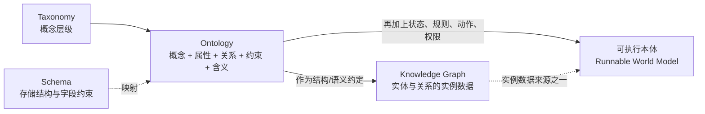
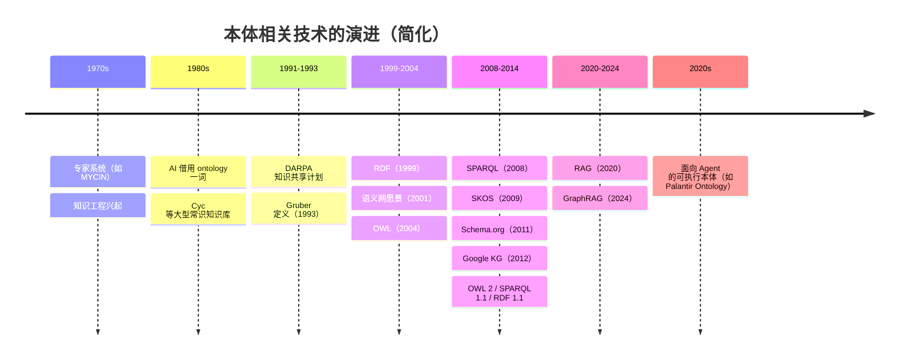
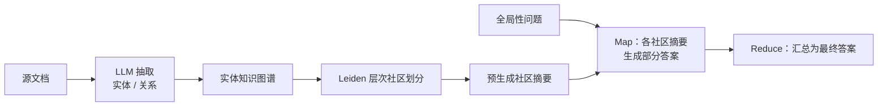
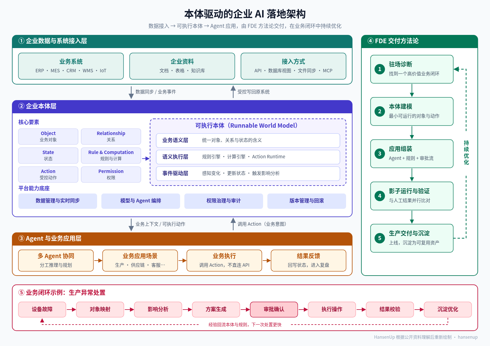
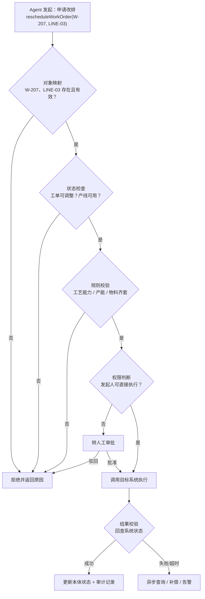
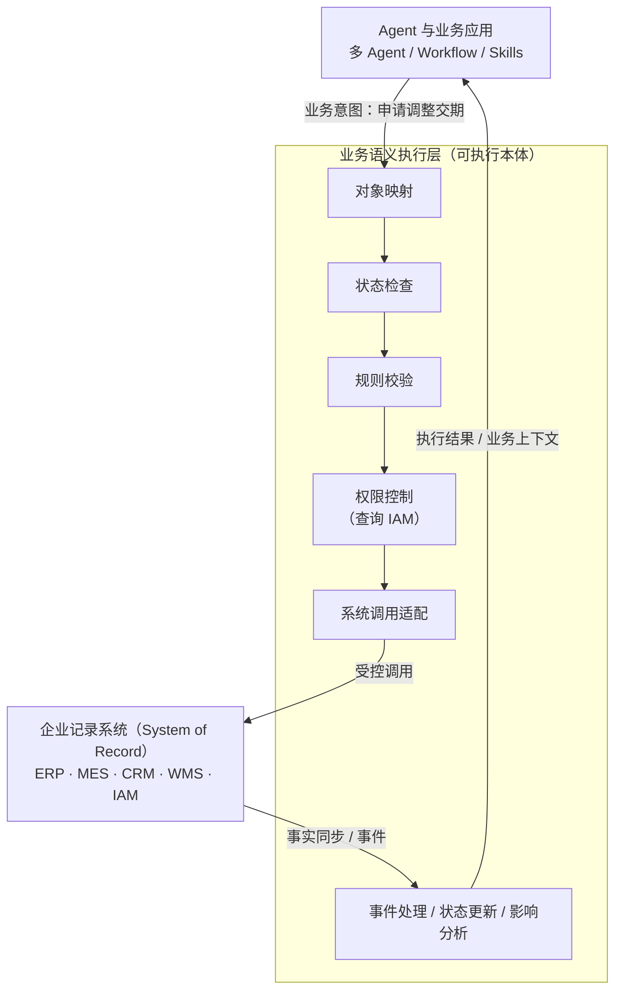
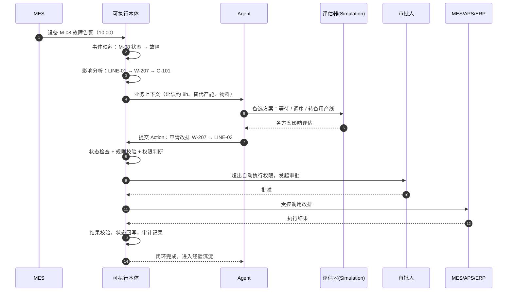
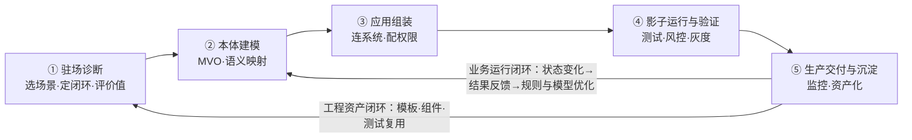
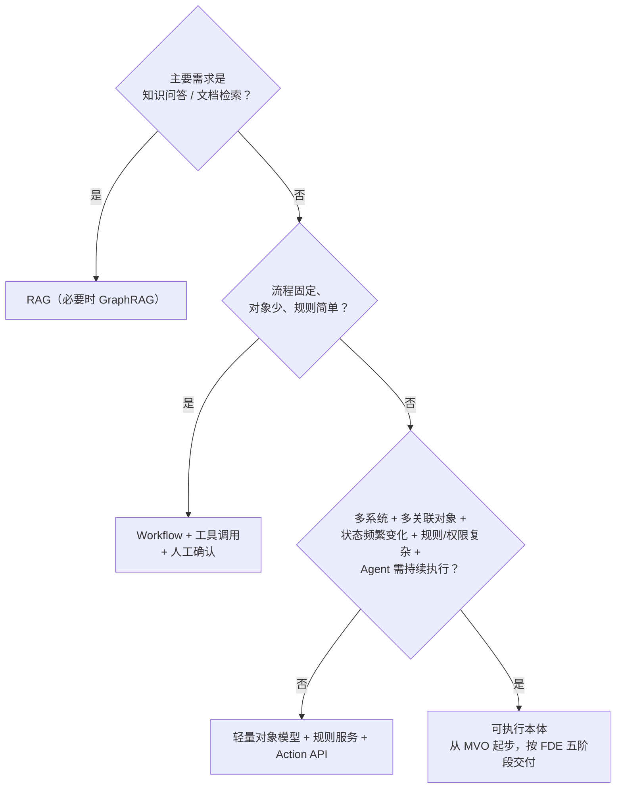

# 从「存在之学」到「可执行本体」：Ontology 的概念、演进与企业 AI 落地

> 作者：HansenUp ｜ 2026 年 10 月
>
> **摘要**：Ontology（本体论）原是哲学里研究「存在」的学问。上世纪 80～90 年代，知识工程借用了这个词，用来指「对概念化的显式规约」。后来它经过语义网、知识图谱、RAG/GraphRAG，到今天又被企业 AI 重新拿出来讨论。这一轮讨论的重点已经从「让机器读懂概念」转到「让 Agent 在受控的业务世界里行动」。本文按「概念 → 演进 → 企业应用」三部分梳理这条脉络。企业应用部分主要参考公众号「智能体AI」的文章《为什么企业 AI 落地，正在从 RAG、知识图谱、Agent 工作流，进一步走向本体论（Ontology）驱动的 FDE 交付模式？》[^wx]，并对照 Palantir Foundry 官方文档、W3C 规范和相关论文做交叉核对。
>
> **来源说明**：文中凡是转述上述公众号文章的观点、案例或框架，都标注「据『智能体AI』」或引用 [^wx]。文中出现的设备 M-08、工单 W-207 等编号都是原文为说明问题设计的示例场景，不是真实企业案例。标注「笔者观点」的内容是本文作者的个人理解，不构成事实陈述。其余事实性内容都附有来源链接，见文末「参考资料」。

---

## 目录

- [0. 引子：为什么企业又开始谈 Ontology](#0-引子为什么企业又开始谈-ontology)
- [1. 概念](#1-概念)
  - [1.1 哲学起源：关于「存在」的学问](#11-哲学起源关于存在的学问)
  - [1.2 信息科学中的本体：Gruber 的定义](#12-信息科学中的本体gruber-的定义)
  - [1.3 Ontology、Taxonomy、Schema 与知识图谱](#13-ontologytaxonomyschema-与知识图谱)
- [2. 演进](#2-演进)
  - [2.1 知识工程与专家系统](#21-知识工程与专家系统)
  - [2.2 语义网：RDF、RDFS、OWL、SPARQL](#22-语义网rdfrdfsowlsparql)
  - [2.3 知识图谱：Things, not strings](#23-知识图谱things-not-strings)
  - [2.4 RAG 与 GraphRAG](#24-rag-与-graphrag)
  - [2.5 面向 Agent 的可执行本体：Runnable World Model](#25-面向-agent-的可执行本体runnable-world-model)
  - [2.6 演进对照表](#26-演进对照表)
- [3. 企业应用](#3-企业应用)
  - [3.1 从「知道」到「能做」：RAG + Agent 为什么不够](#31-从知道到能做rag--agent-为什么不够)
  - [3.2 可执行本体的五类能力](#32-可执行本体的五类能力)
  - [3.3 业务语义执行层](#33-业务语义执行层)
  - [3.4 权限与治理](#34-权限与治理)
  - [3.5 闭环示例：一次设备故障的处置](#35-闭环示例一次设备故障的处置)
  - [3.6 FDE 五阶段交付](#36-fde-五阶段交付)
  - [3.7 最小可用本体（MVO）](#37-最小可用本体mvo)
  - [3.8 落地难点](#38-落地难点)
  - [3.9 什么时候不该上 Ontology](#39-什么时候不该上-ontology)
- [4. 结语](#4-结语)
- [附录 A：术语速查](#附录-a术语速查)
- [参考资料](#参考资料)

---

## 0. 引子：为什么企业又开始谈 Ontology

先看「智能体AI」文章开头的一个设想场景[^wx]：一家制造企业的 MES 上报某台设备故障，预计停机 8 小时。管理者要回答的远不止「这是什么故障」，还有一连串问题：

- 哪条产线、哪些工单受影响？
- 牵连哪些客户订单？
- 有没有替代产能？
- 库存是否允许改排产？
- 谁有权批准调整？
- 调整后如何执行、如何确认结果？

原文的判断是：这几年企业 AI 的常用技术各管一段，中间缺一层：

- RAG 让模型「知道文档里写了什么」；
- 知识图谱让模型「知道对象之间有什么关系」；
- Agent 工作流让模型「会调用工具」。

缺的那一层把**业务对象、实时状态、可执行动作和权限规则**放在同一个语义模型里管理[^wx]。原文认为，企业 AI 的建设重心正在从「知识理解」转向「业务执行」。

「本体论」这个词因此重新流行起来。要理解它为什么能扛起这件事，得先回到它的源头。

---

## 1. 概念

### 1.1 哲学起源：关于「存在」的学问

在哲学中，Ontology 是研究「存在」（being）本身的分支，追问世界上**有什么**、存在者**有哪些种类**。Gruber 为《数据库系统百科全书》撰写的「Ontology」词条把这一传统上溯到亚里士多德：亚里士多德把存在者划分为实体、性质等「范畴」（categories）[^gruber08]。

作为单词，拉丁语 *ontologia* 出现得晚得多。一般认为它最早（很可能是首次）出现在书中，是德国学者 Jacob Lorhard 1606 年的《Ogdoas Scholastica》，当时它被当作「形而上学」（metaphysica）的同义词[^lorhard][^ohrstrom]。1613 年，Rudolph Goclenius（Göckel）在《Lexicon philosophicum》中也收录了该词，释义为「ontologia, philosophia de ente」，即「关于存在的哲学」[^lorhard]。Barry Smith 指出，据《牛津英语词典》记录，该词在英语中最早见于 1721 年 Bailey 的词典，释义为「an Account of being in the Abstract」[^smith-onto]。

> 笔者观点：哲学本体论关心的是「世界本来是什么样」。信息科学借走这个词以后，关心的变成「为了让一群人和程序协作，我们**约定**世界是什么样」。从「发现」到「约定」的变化，是理解后面所有工程问题的钥匙。

### 1.2 信息科学中的本体：Gruber 的定义

人工智能领域在 20 世纪 80 年代开始借用 ontology 一词[^gruber08]。90 年代初，美国 DARPA 推动「知识共享」研究（Neches 等，1991，*AI Magazine*），参与者主张知识系统之间要靠标准化的本体来达成内容层面的约定，才能共享和复用知识[^gruber08][^nas]。

在这个背景下，Tom Gruber 于 1993 年在 *Knowledge Acquisition* 期刊发表《A Translation Approach to Portable Ontology Specifications》，给出了后来引用最广的定义[^gruber93][^gruber08]：

> **An ontology is an explicit specification of a conceptualization.**
> （本体是对概念化的显式规约。）

这句话里有两个关键词：

- **概念化（conceptualization）**：对某个领域的抽象看法，包括其中有哪些概念、概念之间有哪些关系[^nas]。
- **显式规约（explicit specification）**：把这些概念和对它们的使用约束明确写出来[^nas]。

Gruber 在后来的百科词条中把定义细化为：本体定义一组**表示原语**（representational primitives），通常是类（classes）、属性（attributes）和关系（relationships），用来为某个知识领域建模；这些原语的定义同时包含含义说明和使用约束[^gruber08]。

1998 年，Studer、Benjamins 和 Fensel 在 *Data & Knowledge Engineering* 上把定义扩展为「**对共享概念化的形式化、显式规约**」（a formal, explicit specification of a shared conceptualization）[^studer98][^keet]：

- 「形式化」强调机器可读、语义明确；
- 「共享」强调这是一个群体的共识，不是某个人的私人视角[^nas]。

也有人批评这些定义过于宽泛，Gruber 的词条里专门提到了这类讨论[^gruber08]。

**对企业实践最有启发的是「共享」二字。** 企业里最难的往往不是把概念写下来，而是让销售、生产、财务对同一个「订单」达成共识。后文 3.8 节会再回到这一点。

### 1.3 Ontology、Taxonomy、Schema 与知识图谱

这四个概念经常被混用。下表按「表达什么」「语义强度」「典型技术」做一个对照：

| 维度 | Taxonomy（分类法） | Schema（数据库模式） | Ontology（本体） | Knowledge Graph（知识图谱） |
|---|---|---|---|---|
| 核心表达 | 概念的层级（上下位、广义/狭义） | 数据的存储结构：表、字段、类型、约束 | 概念、属性、关系及其约束与含义 | 实体与关系组成的图数据，常以某个本体或 schema 为结构 |
| 关注层次 | 词汇与分类 | 逻辑/物理层：数据怎么存 | 语义层：概念是什么、意味着什么[^gruber08] | 实例层的事实，再加上结构层 |
| 典型标准/技术 | SKOS[^skos] | 关系模型、SQL DDL | RDFS[^rdfs]、OWL 2[^owl2] | RDF 三元组库、属性图；Google Knowledge Graph[^googlekg] |
| 对「缺失信息」的默认态度 | 不涉及 | 通常是**封闭世界**：库里没有就视为假[^owl2primer] | OWL 采用**开放世界**：没写不等于假，只是未知[^owl2primer] | 取决于实现 |
| 推理能力 | 弱（层级继承） | 约束校验 | 可做逻辑推理（类层级、属性特征等） | 图遍历、路径查询，可叠加本体推理 |
| 典型问题 | 「这个商品属于哪个类目？」 | 「订单表有哪些字段？」 | 「什么算『已完成订单』？它和发货单是什么关系？」 | 「客户 A 的订单关联了哪些工单和设备？」 |

几点补充：

1. **Taxonomy 是本体的「骨架子集」。** W3C 的 SKOS 规范专门用来表示叙词表、分类法这类「知识组织系统」，它的语义有意比 OWL 弱[^skos]。
2. **Schema 与 Ontology 的区别不在于「有没有结构」，而在于层次和语义。**
   - Gruber 指出，本体处在「语义」层，数据库模式处在「逻辑/物理」层；本体语言在表达力上更接近一阶逻辑[^gruber08]。
   - W3C 的 OWL 2 Primer 也专门对比过：数据库里缺失的事实通常被视为假（封闭世界假设），OWL 文档中缺失的事实只是「未说明」，可能为真（开放世界假设）。数据库 schema 往往带有规定性约束[^owl2primer]。
   - OWL 2 Primer 同时承认，数据库在技术上仍是很多本体系统可行的底座[^owl2primer]。
3. **知识图谱是「数据」，本体是「对数据含义的约定」。**
   - Hogan 等人的知识图谱综述把 schema、identity、context 列为知识图谱的核心议题，说明图谱通常要叠加一层模式或本体来约束含义[^hogan]。
   - Google 2012 年推出的 Knowledge Graph 则是一个面向搜索的大规模实体图谱[^googlekg]，详见 2.3 节。



最后一个箭头「可执行本体」是传统定义里没有的东西，也是本文后半部分的主角。

---

## 2. 演进



> 时间轴中的年份均对应下文引用的规范或论文；「2020s」一栏表示趋势，不对应某个单一事件。

### 2.1 知识工程与专家系统

本体思想在计算机里的第一站是**知识工程**。

20 世纪 70 年代，斯坦福大学的 MYCIN 是一个基于规则的会诊系统，用于感染性疾病的诊断和抗生素治疗建议。它把领域知识（规则）与推理程序分开，这是知识工程的典型做法[^mycin-paper][^mycin-book]。

Buchanan 与 Shortliffe 1984 年编撰的 MYCIN 实验文集专门辟出一部分讨论「构建知识库」（Building a Knowledge Base）与知识工程[^mycin-book]。这说明当年的研究者已经意识到，从专家头脑中获取、形式化并维护知识，是这类系统最费力的环节。

1984 年起，Douglas Lenat 主持的 Cyc 项目走向另一个极端：试图手工构建一个覆盖人类常识的大型知识库。Lenat 1995 年在 *Communications of the ACM* 上把它称为「对知识基础设施的大规模投资」[^cyc]。

> 笔者观点：这一阶段留给今天的教训有两条。第一，知识的价值来自「可推理、可复用」，单纯存储没有意义。第二，知识获取和维护的成本会吞掉大部分收益。今天企业做本体时遇到的「规则藏在人脑里」「模型越建越大没人用」（见 3.7、3.8 节），本质上是同一个问题的新版本。

### 2.2 语义网：RDF、RDFS、OWL、SPARQL

2001 年 5 月，Tim Berners-Lee、James Hendler 和 Ora Lassila 在《科学美国人》发表《The Semantic Web》，设想让 Web 内容对计算机「有意义」，让软件 Agent 能够理解并代人完成任务[^semweb]。

> 二十多年前的「Agent 读懂网页并替人办事」，和今天的「Agent 读懂企业对象并执行业务动作」，是同一个愿望在不同时代的投射。

围绕这一愿景，W3C 陆续发布了一组标准：

| 标准 | 作用 | 关键版本与日期 |
|---|---|---|
| **RDF** | 用「主语—谓语—宾语」三元组描述资源，是语义网的数据模型 | RDF Model and Syntax，W3C 推荐标准，1999-02-22[^rdf99]；RDF 1.1 Concepts，2014[^rdf11]；RDF 1.2 Concepts 已进入候选推荐阶段（2026-04-07 快照）[^rdf12] |
| **RDFS** | 在 RDF 之上提供类、子类、属性、定义域/值域等基础建模词汇 | RDF Schema 1.1，2014-02-25[^rdfs] |
| **OWL / OWL 2** | 表达力更强的本体语言，有形式化语义，支持推理 | OWL 概览，2004-02-10[^owl04]；OWL 2 概览（第二版），2012-12-11[^owl2] |
| **SPARQL** | RDF 数据的查询语言 | SPARQL Query Language，2008-01-15[^sparql08]；SPARQL 1.1，2013-03-21[^sparql11] |
| **SKOS** | 表示叙词表、分类法等知识组织系统 | SKOS Reference，2009-08-18[^skos] |

用一个最小例子感受一下这套栈（Turtle 语法，仅为示意）：

```turtle
@prefix ex:   <http://example.org/factory#> .
@prefix rdfs: <http://www.w3.org/2000/01/rdf-schema#> .
@prefix owl:  <http://www.w3.org/2002/07/owl#> .

ex:Equipment      a owl:Class .
ex:ProductionLine a owl:Class .
ex:WorkOrder      a owl:Class .

ex:belongsToLine  a owl:ObjectProperty ;
    rdfs:domain ex:Equipment ;
    rdfs:range  ex:ProductionLine .

ex:M-08  a ex:Equipment ;  ex:belongsToLine ex:LINE-01 .
```

```sparql
# 查询：LINE-01 上有哪些设备
PREFIX ex: <http://example.org/factory#>
SELECT ?eq WHERE { ?eq ex:belongsToLine ex:LINE-01 . }
```

这套技术把「概念是什么」「概念之间什么关系」表达得很严谨，但它的强项是**描述与推理**，不是**执行**：

- OWL 能推理出「M-08 属于 LINE-01」；
- 它不负责「把工单 W-207 改排到 LINE-03，并在 ERP 中落账」。

2011 年 6 月，Google、Bing 和 Yahoo 联合推出 Schema.org，为网页提供一套共享的结构化数据词汇[^schemaorg]。这是语义网思想在工业界最「务实」的一次落地：不追求完整的推理，只求大家用同一套词。

### 2.3 知识图谱：Things, not strings

2012 年 5 月 16 日，Google 发布 Knowledge Graph，口号是「things, not strings」，意思是让搜索理解「事物」，而不只是匹配字符串[^googlekg]。官方博客给出的信息有：

- 发布时图谱包含 **5 亿多个对象**和 **35 亿多条**关于这些对象及其关系的事实；
- 数据来源包括 Freebase、维基百科和《CIA 世界概况》等公开资料；
- 目标是三件事：帮用户找到正确的「那个东西」、给出最佳摘要、帮用户探索得更深更广；
- 最初面向美国英语用户推出[^googlekg]。

从本体的角度看，知识图谱是一次重心转移：从「精心设计的概念体系」转到「大规模的实例事实」。它让「实体 + 关系」进入主流工程，后来也成为企业知识图谱、风控图谱、供应链图谱的通用范式[^hogan]。

但知识图谱本质上还是**以查询和理解为中心**。它擅长回答「谁和谁有关系」，不负责「现在该做什么、谁有权做、做完怎么确认」。

### 2.4 RAG 与 GraphRAG

**RAG（检索增强生成）** 由 Lewis 等人在 2020 年提出：把参数化的生成模型与非参数化的检索记忆结合起来，先检索相关文档，再基于检索结果生成答案[^rag]。它在大模型时代成为企业知识问答的默认方案。

传统「向量 RAG」擅长回答局部问题，比如「某条制度怎么规定」。遇到需要通读全局的问题，比如「这批数据集的主要主题是什么」，就力不从心了。

微软研究院在 2024 年提出 **GraphRAG**[^graphrag][^graphrag-blog]。论文《From Local to Global: A GraphRAG Approach to Query-Focused Summarization》的方法分四步[^graphrag]：

1. 用 LLM 从源文档中抽取实体、关系，构建知识图谱；
2. 用 Leiden 算法对图做层次化社区划分；
3. 为每个社区预先生成摘要；
4. 回答问题时，先让各社区摘要分别生成部分答案，再汇总成最终答案（map-reduce）。



论文在两个约 100 万 token 量级的数据集（播客转录和新闻文章）上做了评测[^graphrag]：

- **全面性**：GraphRAG 相对向量 RAG 的胜率在 72%～83%（播客）和 72%～80%（新闻）之间；
- **多样性**：胜率分别为 75%～82% 和 62%～71%；
- **成本**：使用根层级社区摘要时，所需 token 比直接对源文本做摘要少 97% 以上。

项目已在 GitHub 开源[^graphrag-repo]。

GraphRAG 说明了一件事：**结构（图、社区、实体）能显著提升模型对复杂语料的理解。** 但它解决的仍然是「理解」问题，生成的图谱是从文本中自动抽取的，没有状态，没有动作，也没有权限。

### 2.5 面向 Agent 的可执行本体：Runnable World Model

**Palantir Foundry 的 Ontology** 是近年被讨论最多的工业界实践。官方文档的描述要点如下[^pltr-onto]：

- 它被定位为组织的「**operational layer**」（运营层），建立在数据集、虚拟表和模型等数字资产之上，把它们与现实世界中的对应物连接起来，常被当作组织的数字孪生。
- 它把元素分为两类：
  - **语义元素**（semantic）：对象（objects）、属性（properties）、链接（links）；
  - **动能元素**（kinetic）：动作（actions）、函数（functions）、动态安全（dynamic security）。
- 它还提供 **interfaces**，用于对象类型的多态。

几个关键构件：

| 构件 | 官方文档要点 | 来源 |
|---|---|---|
| Object / Property / Link | 对象类型、属性与链接类型构成语义层，映射到底层数据 | [^pltr-onto] |
| **Action** | 一个 action 是「一次修改一个或多个对象属性的单一事务」，可附带通知、校验等副作用；编辑结果会写入 writeback 数据集 | [^pltr-action] |
| **Submission criteria** | 旧称 validations。可以基于当前用户、参数或执行上下文等条件决定一个 Action 能否提交，不满足时给出失败提示。文档举的例子是：只有特定航班调度员用户组，且飞机处于特定运行状态时，才能执行某操作 | [^pltr-sub] |
| **Function** | 用 TypeScript / Python 编写、在服务端隔离环境运行的逻辑，可读取属性、遍历链接、执行本体编辑，也可作为 function-backed action 的实现 | [^pltr-func] |
| **AIP 工具** | LLM 可使用的工具包括执行 Action、调用 Function、查询对象、计算器等 | [^pltr-logic][^pltr-tools] |

和 Agent 安全最相关的是 AIP Logic 文档里的一条说明：**LLM 并不直接访问工具，只能「请求」使用工具；工具调用由 AIP Logic 在发起调用的用户权限范围内执行**[^pltr-logic]。文档同时提示，行级/列级等访问控制在读取时生效，不会自动延伸到模型的输出或它产生的编辑上[^pltr-logic]。这一点在 3.4 节还会提到。

「智能体AI」的文章把这类形态称为**可执行本体**，也叫 **Runnable World Model**（可运行的世界模型）[^wx]。原文专门澄清，这里的「世界模型」不是强化学习、机器人领域那种预测物理环境的模型，而是**与真实业务系统保持同步、可被 Agent 查询、推理和操作的业务环境**。原文给出了一个概括式公式[^wx]：

> 可执行本体 ≈ 本体 + 状态管理 + 规则引擎 + 计算能力 + Action Runtime + 事件机制 + 权限治理

原文还提醒，传统本体本身并不提供事务、权限、回滚这类执行语义[^wx]。正因为这样，才需要上面公式里加上的那些部分。

### 2.6 演进对照表

| 阶段 | 要解决的核心问题 | 知识怎么表示 | 推理 / 执行 | 主要局限 |
|---|---|---|---|---|
| 知识工程 / 专家系统 | 把专家经验装进程序 | 规则、框架 | 规则推理 | 知识获取与维护成本高[^mycin-book] |
| 语义网 | 让 Web 内容机器可理解、可互操作 | RDF / RDFS / OWL[^rdf11][^owl2] | 描述逻辑推理、SPARQL 查询 | 建模门槛高，偏描述，不涉及执行 |
| 知识图谱 | 大规模实体与关系 | 实体—关系图[^googlekg][^hogan] | 图查询、关联分析 | 偏查询，缺少状态与动作 |
| RAG / GraphRAG | 让 LLM 用上私有语料 | 文本块 + 向量；LLM 抽取的图 + 社区摘要[^rag][^graphrag] | 检索 + 生成 | 解决「理解」，不解决「受控执行」 |
| 可执行本体 | 让 Agent 在业务世界中安全地行动 | 对象 / 关系 / 状态 / 规则 / 动作 / 权限[^wx][^pltr-onto] | 规则 + 计算 + Action 事务 + 审批 | 建模与治理成本高，见 3.8 节 |

> 笔者观点：这条线并不是后一代取代前一代，而是逐层叠加。可执行本体内部照样会用到图结构（关系）、检索（文档类知识），也会借鉴形式化本体的概念设计方法。

---

## 3. 企业应用

本章主体内容来自「智能体AI」的文章[^wx]，笔者按主题重新组织和转述，并对照 Palantir 文档做补充。



*图 1：本体驱动的企业 AI 落地架构。笔者根据原文[^wx]的思路理解后重新绘制并简化。*

图 1 左侧自上而下是三层架构，右侧是 FDE 交付方法论，底部是一个业务闭环示例：

- **企业数据与系统接入层**：ERP、MES、CRM、WMS、IoT 等业务系统，加上文档、表格、知识库等企业资料，通过 API、数据库视图、文件同步、MCP 等方式接入；数据和事件向上同步，本体的动作再受控写回原系统。
- **企业本体层**：
  - 核心要素：对象、关系、状态、规则与计算、Action、权限；
  - 中枢：可执行本体（Runnable World Model），内含业务语义层、语义执行层（规则引擎 / 计算引擎 / Action Runtime）和事件驱动层；
  - 平台能力底座：数据管理与实时同步、模型与 Agent 编排、权限治理与审计、版本管理与回滚。
- **Agent 与业务应用层**：多 Agent 协同、面向具体业务应用场景、通过调用 Action 执行业务（不直连底层 API）、结果反馈。
- **FDE 交付方法论**：驻场诊断 → 本体建模 → 应用组装 → 影子运行与验证 → 生产交付与沉淀，并持续优化。
- **业务闭环示例**：以生产异常处置为例，设备故障 → 对象映射 → 影响分析 → 方案生成 → 审批确认 → 执行操作 → 结果校验 → 沉淀优化，经验再回流到本体与规则。

### 3.1 从「知道」到「能做」：RAG + Agent 为什么不够

原文用一个采购 Agent 的例子说明问题[^wx]。系统发现某物料库存偏低，「自动下采购单」看上去顺理成章，但实际可能是下面任一种情况：

- 对应订单已经取消；
- 其他仓库可以调拨；
- 已有在途采购；
- 供应商交期变了；
- 生产优先级调整了。

这些信息分散在 ERP、MES、WMS、SRM 里。更麻烦的是**语义差异**：

- 账面库存 100，等于可用库存 100 吗？
- 采购单状态是 Approved，是否意味着供应商已经确认？

原文的概括是：数据只告诉 AI「系统里记录了什么」，业务语义才告诉它「这意味着什么、什么时候允许行动」[^wx]。

原文还对比了三种技术面对「客户 A 的订单为什么延期」这个问题时的表现[^wx]：

| 技术 | 能回答到哪一步 | 回答不了什么 |
|---|---|---|
| RAG | 找到相关制度、邮件、报告里的文字描述 | 当前实时状态；对象之间的结构化关联 |
| 知识图谱 | 沿关系链找到 订单 O-101 → 工单 W-207 → 设备 M-08 | M-08 现在是否故障、延误多少、能否改排 |
| 可执行本体 | M-08 当前处于故障状态，W-207 预计晚 8 小时完成，O-101 有延期风险；改排需先校验产能，再走审批 | —— |

原文还有一个观点值得记下：模型和框架可以替换，**业务概念才是企业 AI 中相对稳定的核心资产**[^wx]。

### 3.2 可执行本体的五类能力

原文指出，只给「生产线」定义 `name / capacity / status / factory_id` 几个字段远远不够，可执行本体至少要覆盖五类能力[^wx]。下表左三列转述原文，最右列是笔者按 Palantir 文档做的概念对照，属于解读，不是官方对应关系。

| 能力 | 含义（据「智能体AI」） | 示例（原文示例场景） | Palantir 文档中可对照的概念 |
|---|---|---|---|
| **对象 Objects** | 有唯一标识和属性，并映射到真实系统中的记录 | 设备、生产线、工单、订单、物料 | Object type / Property[^pltr-onto] |
| **关系 Relationships** | 不只用于查询，还用于影响分析 | 设备 → 产线 → 工单 → 订单 | Link type[^pltr-onto] |
| **状态 States** | 对象处于什么状态、能否转换、转换条件是什么 | 设备：运行 / 空闲 / 维护 / 故障；工单：已创建 / 已排产 / 执行中 / 已完成 | 通常以属性加 Action 约束来表达（笔者解读） |
| **规则与计算 Rules & Computations** | 确定性业务规则与模型预测分开管理 | 产能校验、交期计算、风险预测 | Function[^pltr-func]、Submission criteria[^pltr-sub] |
| **动作 Actions** | 受控的业务操作，带有明确的契约 | `rescheduleWorkOrder()`、`assignProductionLine()`、`requestMaterialTransfer()`、`approveScheduleChange()` | Action type[^pltr-action] |

关于「规则与计算」，原文提醒了一个常见误区：**模型给出的解释不等于正式的业务规则**[^wx]。确定性逻辑（如「订单锁定后不得改交期」）应由规则引擎执行；预测类判断（如「延误概率」）可以交给模型，但两者要分开治理。

关于 Action，原文认为每个动作至少要说清楚七件事[^wx]：

| 契约项 | 以 `rescheduleWorkOrder(W-207, LINE-03)` 为例（原文示例） |
|---|---|
| 输入参数 | 工单号、目标产线 |
| 前置条件 | 目标产线具备对应工艺能力、有剩余产能、物料齐套、订单允许调整 |
| 权限要求 | 发起人是否有排产调整权限 |
| 调用的目标系统 | MES / APS 等 |
| 预期的状态变化 | 工单从 LINE-01 迁移到 LINE-03，状态变为「已排产」 |
| 成功确认方式 | 回查目标系统，确认变更已生效 |
| 失败处理 | 任一前置条件不满足时拒绝执行，或转人工审批 |



*图 2：一个受控 Action 的执行路径。笔者根据原文的 Action 契约要求[^wx]绘制。*

### 3.3 业务语义执行层

原文强调：**不要让 Agent 直接调用企业系统的底层 API**[^wx]。原因在于，一个看似简单的 `updateOrderDeliveryDate` 背后可能连着客户通知、财务影响、审批流程和对外承诺。

更合理的做法是在 Agent 和系统 API 之间放一层**业务语义执行层**，由它负责对象映射、状态检查、规则校验、权限控制和系统调用。这样 Agent 表达的是业务意图（「申请调整订单交期」），而不是一条 API 调用[^wx]。



*图 3：业务语义执行层在架构中的位置。笔者根据原文[^wx]的思路和图 1 的分层绘制并简化。*

原文还划了一条边界：**Ontology 不应取代 ERP、MES、CRM 成为新的主数据库**。记录系统（System of Record）仍然留在原业务系统里，本体负责语义统一和受控执行，否则只会造出一座新的数据孤岛[^wx]。这和 Palantir 文档把 Ontology 定位为建立在已有数据资产之上的「运营层」的说法是一致的[^pltr-onto]。

在 Agent 时代的工程组件分工上，原文给出了一个清晰的划分[^wx]：

| 组件 | 职责（据「智能体AI」） |
|---|---|
| Skills | 封装可复用的业务方法 |
| MCP | 负责连接外部系统与工具 |
| Workflow | 负责确定性的流程编排 |
| Agent | 负责推理与决策 |
| Ontology | 提供统一的业务模型 |

原文的告诫是：不要把所有东西都塞进 Prompt[^wx]。

### 3.4 权限与治理

可执行本体让 Agent 能「动手」，权限和治理就从附加功能变成了地基。原文列出的权限与责任问题有[^wx]：

- Agent 代表谁执行？
- 是否存在用服务账号绕过用户权限的情况？
- 审批的范围如何界定？
- 审计如何留痕？

把原文的关注点和 Palantir 的公开机制放在一起看：

| 治理关注点 | 原文观点[^wx] | 可参考的公开机制 |
|---|---|---|
| 以谁的身份执行 | 警惕服务账号绕过用户权限 | AIP Logic：LLM 只能请求工具，工具在**发起调用的用户**权限内执行[^pltr-logic] |
| 能否执行某个动作 | 权限要建模到「操作」级别 | Action 的 submission criteria 可以基于用户组、参数、执行上下文设定条件，并给出失败提示[^pltr-sub] |
| 输出与编辑的权限 | —— | 文档提示：读取时的行/列级控制不会自动延伸到模型输出或其产生的编辑，需要另行设计[^pltr-logic] |
| 高风险操作 | 涉及资金、合同、排产、对外承诺的操作要保留审批和回滚/补偿 | Agent 的 Action 工具可配置为自动执行或执行前需用户确认[^pltr-tools] |
| 变更管理 | 本体要像代码、API、schema 一样做版本、依赖与变更管理 | ——（原文观点） |
| 多 Agent 协同 | 采购、生产、销售、财务 Agent 各自维护状态会互相冲突，应共享同一套业务语义；但「共享语义 ≠ 共享数据」，数据隔离照样适用 | —— |

Palantir 文档还有一条与 submission criteria 相关的细节：不建议在用户组条件上使用「NOT」类判断，原因与受限范围令牌（scoped token）场景下的行为有关[^pltr-sub]。这类细节说明，**权限判断本身也需要测试**。

> 笔者观点：原文提出的「从 Agent-centric 走向 Business-centric」[^wx]，笔者理解为：治理的对象不再是一个个 Agent 的提示词和工具清单，而是一套所有 Agent 共同遵守的业务对象、状态和动作契约。Agent 可以有很多个，业务世界只有一个。

### 3.5 闭环示例：一次设备故障的处置

原文用「10:00 设备 M-08 故障」演示了一个完整闭环，分七步[^wx]：

1. **事件映射**：MES 告警映射为本体中的设备状态变更（M-08 → 故障）。
2. **影响分析**：沿关系链找出受影响的产线、工单（W-207）和订单（O-101）。
3. **上下文计算**：计算延误时长、可用的替代产能、物料是否齐套等。
4. **方案生成**：Agent 生成多个备选方案，例如等待维修、调整工单顺序、转移到备用产线。
5. **Simulation 评估**：评估各方案的影响。原文特别说明，这一步不必一开始就做复杂仿真，规则化的评估器也可以。
6. **审批与受控执行**：按权限决定直接执行还是转审批，再通过 Action 调用系统。
7. **结果校验与回写**：确认执行结果，更新本体状态。

原文的要点是：在设计阶段就要明确哪些环节由规则完成、哪些由优化算法完成、哪些由 Agent 推理、哪些必须人工审批。好的 Agent 要「知道什么时候不该执行」[^wx]。



*图 4：设备故障处置闭环时序图。笔者根据原文的七步闭环[^wx]绘制。*

Palantir 的 submission criteria 文档提到，条件判断可以使用执行上下文，包括 Ontology Scenario[^pltr-sub]。笔者认为，这与原文「先模拟评估、再受控执行」的思路相通：方案应先在一个不影响生产数据的「场景」里评估，再决定是否真正提交。

### 3.6 FDE 五阶段交付

**FDE**（Forward Deployed Engineer，前置部署工程师）因 Palantir 而广为人知。Palantir 官方博客对两类工程角色的区分是[^pltr-delta]：

- 产品研发（Dev）是「一种能力，服务很多客户」；
- 前置部署的 Delta 是「一个客户，用到很多能力」。

博客强调 Delta 不是顾问，而是直接写代码、在客户现场交付可用系统的工程师[^pltr-delta][^pltr-fdse]。

「智能体AI」的文章认为，FDE 不等于「派人驻场写代码」，核心是四件事[^wx]：

- 理解业务问题；
- 识别真实的事实来源；
- 设计可运行的方案；
- 用生产结果验证价值。

衡量 FDE 的应该是业务结果，比如异常发现时间、风险判断准确率、协同效率、交付表现，而不是交付了多少功能点[^wx]。

原文把交付过程分为五个阶段（与图 1 中的 FDE 交付方法论一致）[^wx]：

| 阶段 | 要做什么 | 关键产出 | 原文提示的陷阱/要点 |
|---|---|---|---|
| ① 驻场诊断 / 业务诊断 | 选场景、定义闭环、评估价值。要问清：要改善什么结果？瓶颈在哪？数据和接口是否可得？哪些环节可以自动化？谁对结果负责？ | 选定的首个业务闭环 | 如果一个场景只能证明「AI 写的文字更好看」，就不适合当首个案例 |
| ② 本体建模 | 定义对象标识、数据来源、关系、状态、规则、权限和 Action；做语义映射 | 最小可用本体（MVO） | 明确每个事实的权威来源，例如交期以 ERP 为准、设备状态以 MES 为准、审批权限以 IAM 为准；预先定义冲突策略，**不能让 LLM 临场决定信哪个系统** |
| ③ 应用组装 | 连接系统、配置权限，组合 Skills / MCP / Workflow / Agent | 可运行的应用 | 各组件各司其职，不要把一切塞进 Prompt |
| ④ 影子运行与验证 | 测试评估、风险控制、灰度发布 | 测试集与对比报告 | 测试集要覆盖正常流程、异常、权限边界和失败场景；影子模式下与人工结果对比；涉及资金、合同、排产、承诺的操作保留审批与回滚/补偿 |
| ⑤ 生产交付与资产沉淀 | 监控运维、经验沉淀 | 可复用资产 | 监控 Agent 成功率、系统状态、Action 完成率、重复执行、未处理异常；沉淀规则、模型、工具封装、测试与经验。复用的是方法、组件、行业模板和测试，**不是照搬 schema** |



*图 5：FDE 五阶段与两个闭环。阶段划分据原文[^wx]，图由笔者绘制。*

原文把 FDE 的价值归结为**两个闭环**[^wx]：

- **业务运行闭环**：让业务在本体上持续运行、反馈、优化；
- **工程资产闭环**：把每次交付中的方法、组件、测试沉淀下来，供下一次交付复用。

只有第一个，每个项目都是定制；只有第二个，资产会脱离真实业务。

### 3.7 最小可用本体（MVO）

原文对「一上来就建全企业本体」的做法提出了明确警告：建了几个月、定义了几百种关系，却没有一个 Agent 上线[^wx]。

原文的建议是从一个业务闭环出发，构建**最小可运行的世界**。以生产异常处置为例，第一期只建模下面这些内容[^wx]：

| 类别 | 第一期范围（原文示例） | 后续扩展方向 |
|---|---|---|
| 对象 | 设备、生产线、工单、订单、物料 | 供应商、仓库、质检批次…… |
| 关系 | 这一场景必需的关键关系（设备—产线—工单—订单、工单—物料） | 供应关系、调拨关系 |
| 状态 | 场景需要的设备状态、工单状态 | 更细的质量、物流状态 |
| Action | 故障登记、影响查询、排产调整申请、审批、执行结果确认 | 调拨申请、供应商催交、质量处置 |

原文认为这样做有两个好处[^wx]：

- 每一次扩展都有清晰的业务价值；
- 模型会在真实使用中不断被校准。

笔者据此整理了一个 MVO 自检清单（个人建议，非原文内容）：

- [ ] 能用一句话说清这一期要闭环的业务问题和衡量指标；
- [ ] 每个对象都能指出它在哪个记录系统中、以什么为唯一标识；
- [ ] 每个状态转换都写明了触发条件；
- [ ] 每个 Action 都具备 3.2 节的七项契约；
- [ ] 每个事实字段都有唯一的权威来源，并定义了冲突策略；
- [ ] 有覆盖权限边界和失败场景的测试集，并经过影子运行对比。

### 3.8 落地难点

原文先指出交付的「根本性困难」[^wx]：

- **同一个词在不同部门有不同含义。** 「订单」对销售意味着承诺与交付，对生产意味着工单、物料与产能，对财务意味着收入与开票。
- **规则藏在人脑里，或写在过时的 SOP 里，彼此还可能冲突。** 例如制度写明「交期调整需提前 7 天」，实际却经常走紧急审批。只按文档建模会脱离现实；只按当前习惯建模，又会把历史遗留问题固化进系统。

原文进一步列出五个工程难点，下表左两列转述原文[^wx]，右列的应对思路中凡原文提到的都已标注：

| 难点 | 典型表现（据原文） | 应对思路 |
|---|---|---|
| 1. 语义一致性 | 「订单完成」可能指已收款、已下线或已发货 | 每个关键概念给出唯一定义和判定规则，由业务方签字确认（笔者建议） |
| 2. 实时状态一致性 | 数据新鲜度、同步延迟、版本与冲突 | 为每个事实标注来源与时效，并定义冲突策略（原文在「本体建模」阶段提出） |
| 3. Action 可靠性 | ERP 调用超时，采购单其实已经创建，Agent 重试后生成重复单 | 幂等控制、明确事务边界、异步查询状态、失败补偿（原文列出） |
| 4. 权限与责任边界 | Agent 代表谁？服务账号是否绕过用户权限？审批范围？审计？ | 在用户身份内执行工具调用、操作级权限条件、高风险操作保留审批（见 3.4 节） |
| 5. 维护成本 | 本体会随业务变化，牵一发而动全身 | 像管理代码、API、schema 一样做版本、依赖和变更管理（原文提出） |

其中第 3 点最容易被低估。下面用一个最小伪代码示意幂等 Action 的写法（笔者示例，非原文内容）：

```python
def request_purchase_order(req, idempotency_key):
    # 1. 幂等：同一业务意图只执行一次
    existing = action_log.find(idempotency_key)
    if existing:
        return existing.result

    # 2. 先落「处理中」记录，再调用外部系统
    action_log.start(idempotency_key, req)
    try:
        erp.create_po(req, client_ref=idempotency_key)
    except TimeoutError:
        # 3. 超时不等于失败：先查询再决定是否补偿或重试
        po = erp.find_po_by_client_ref(idempotency_key)
        if po is None:
            raise RetryableError()

    # 4. 以记录系统的回查结果作为成功确认
    po = erp.find_po_by_client_ref(idempotency_key)
    action_log.complete(idempotency_key, po)
    ontology.update_state(req.material_id, "PO_IN_TRANSIT")
    return po
```

### 3.9 什么时候不该上 Ontology

原文的态度很克制：**要根据业务复杂度决定，而不是追热点**[^wx]。

原文认为以下情况不一定需要 Ontology[^wx]：

| 场景 | 更合适的方案（据原文） |
|---|---|
| 内部制度、政策问答 | RAG 即可 |
| 从邮件中提取信息录入 CRM，再由人工确认 | Workflow + 工具调用 |
| 对象少、流程稳定、规则简单 | 可能完全不需要 |

原文认为值得投入的信号是下面几条同时出现[^wx]：

- 涉及多个系统；
- 对象多且彼此关联；
- 状态频繁变化；
- 规则复杂；
- 权限严格；
- 需要 Agent 持续参与执行。

即便需要，也可以先从「轻量对象模型 + 规则服务 + Action API」起步，不必一开始就上完整的平台[^wx]。



*图 6：是否引入 Ontology 的决策树。判断条件据原文[^wx]，图由笔者整理。*

---

## 4. 结语

回看这条脉络：

- **哲学**追问世界上有什么；
- **知识工程**把专家知识写成规则；
- **语义网**把概念和关系形式化，让机器可以推理；
- **知识图谱**把实体关系做到了海量规模；
- **RAG / GraphRAG** 让大模型用上私有语料，并借助图结构理解全局；
- **可执行本体**进一步把状态、规则、动作和权限纳入同一个模型，让 Agent 在受控的业务世界里行动。

「智能体AI」的文章用一句话收尾，大意是：Ontology 定义 AI 能理解和操作的业务世界，Agent 在这个世界里推理和行动，FDE 负责把这套能力带进真实企业。企业 AI 架构的中心，正在向业务对象、状态和闭环转移[^wx]。

笔者的几点补充看法（个人观点）：

1. **先闭环，后体系。** 一个跑通的最小闭环，比一份完美的全企业本体更有说服力。
2. **本体的价值在于「约定」，不在「模型」本身。** Gruber 和 Studer 定义里的「显式」与「共享」[^gruber93][^studer98]，在企业里落成的是跨部门的语义共识和权威数据来源。这比任何技术选型都难，也更重要。
3. **执行语义是新增的硬骨头。** 事务、幂等、审批、补偿、审计，这些都是传统本体技术不提供的部分，需要用软件工程的纪律来补齐。
4. **克制本身就是一种能力。** 很多场景用 RAG 或 Workflow 就够了，承认这一点，反而能让 Ontology 用在真正值得的地方。

---

## 附录 A：术语速查

| 术语 | 简释 |
|---|---|
| Ontology（本体） | 对共享概念化的形式化、显式规约[^studer98] |
| Taxonomy（分类法） | 概念的层级分类，可用 SKOS 表示[^skos] |
| RDF / RDFS | W3C 的三元组数据模型 / 基础建模词汇[^rdf11][^rdfs] |
| OWL 2 | W3C 本体语言，具有形式化语义[^owl2] |
| SPARQL | RDF 查询语言[^sparql11] |
| Knowledge Graph | 以实体和关系组织的图数据[^hogan][^googlekg] |
| RAG | 检索增强生成[^rag] |
| GraphRAG | 基于 LLM 抽取图谱与社区摘要的 RAG 方法[^graphrag] |
| Action（Palantir） | 修改一个或多个对象的单一事务[^pltr-action] |
| Submission criteria | 决定 Action 能否提交的条件[^pltr-sub] |
| Runnable World Model | 与真实业务系统同步、可被 Agent 查询、推理和操作的业务环境[^wx] |
| FDE / Delta | 前置部署工程师；Palantir 内部称 Delta[^pltr-delta] |
| MVO | 最小可用本体，从单个业务闭环出发的最小建模范围[^wx] |

---

## 参考资料

[^wx]: 公众号「智能体AI」，《为什么企业 AI 落地，正在从 RAG、知识图谱、Agent 工作流，进一步走向本体论（Ontology）驱动的 FDE 交付模式？》，https://mp.weixin.qq.com/s/J9Ujnjm9_Hd_yYMR4wwyAg 。本文第 3 章的框架与示例场景参考该文，由笔者转述整理；图 1 是笔者理解原文思路后重新绘制的。

[^gruber93]: Thomas R. Gruber. "A Translation Approach to Portable Ontology Specifications." *Knowledge Acquisition*, 5(2):199–220, 1993. https://doi.org/10.1006/knac.1993.1008 ；另见 "What is an Ontology?" http://www-ksl.stanford.edu/kst/what-is-an-ontology.html

[^gruber08]: Tom Gruber. "Ontology." *Encyclopedia of Database Systems*, Ling Liu & M. Tamer Özsu (Eds.), Springer. 作者存档版本：https://tomgruber.org/writing/definition-of-ontology

[^studer98]: Rudi Studer, V. Richard Benjamins, Dieter Fensel. "Knowledge Engineering: Principles and Methods." *Data & Knowledge Engineering*, 25(1–2):161–197, 1998. https://doi.org/10.1016/S0169-023X(97)00056-6

[^keet]: C. Maria Keet. *An Introduction to Ontology Engineering*, §2.3 "What is an Ontology?". https://eng.libretexts.org/Bookshelves/Computer_Science/Programming_and_Computation_Fundamentals/An_Introduction_to_Ontology_Engineering_(Keet)/02%3A_Introduction_to_Ontology_Engineering/2.03%3A_What_is_an_Ontology

[^nas]: National Academies of Sciences, Engineering, and Medicine. *Ontologies in the Behavioral Sciences: Accelerating Research and the Spread of Knowledge*, Chapter "Understanding Ontologies". https://www.ncbi.nlm.nih.gov/books/NBK584339/

[^lorhard]: "Jacob Lorhard." Wikipedia. https://en.wikipedia.org/wiki/Jacob_Lorhard ；另见 https://www.ontology.co/jacob-lorhard.htm

[^ohrstrom]: Peter Øhrstrøm, Henrik Schärfe, Sara L. Uckelman. "Jacob Lorhard's Ontology: A 17th Century Hypertext on the Reality and Temporality of the World of Intelligibles." Springer, 2008. https://doi.org/10.1007/978-3-540-70596-3_5 ；预印本：https://eprints.illc.uva.nl/id/eprint/294/

[^smith-onto]: Barry Smith. "Ontology." In G. Hurtado & O. Nudler (Eds.), *The Furniture of the World*, 2012. https://philarchive.org/rec/SMIOJD

[^owl2primer]: W3C. *OWL 2 Web Ontology Language Primer (Second Edition)*. https://www.w3.org/TR/owl2-primer/ （「OWL 2 and databases」相关段落）

[^skos]: W3C. *SKOS Simple Knowledge Organization System Reference*, W3C Recommendation, 18 August 2009. https://www.w3.org/TR/skos-reference/

[^hogan]: Aidan Hogan et al. "Knowledge Graphs." *ACM Computing Surveys*, 2021. arXiv:2003.02320. https://arxiv.org/abs/2003.02320

[^googlekg]: Amit Singhal. "Introducing the Knowledge Graph: things, not strings." Google Blog, May 16, 2012. https://blog.google/products/search/introducing-knowledge-graph-things-not/

[^mycin-paper]: E. H. Shortliffe et al. "Computer-based consultations in clinical therapeutics: Explanation and rule acquisition capabilities of the MYCIN system." *Computers and Biomedical Research*, 8(4), 1975. https://doi.org/10.1016/0010-4809(75)90009-9

[^mycin-book]: Bruce G. Buchanan, Edward H. Shortliffe (Eds.). *Rule-Based Expert Systems: The MYCIN Experiments of the Stanford Heuristic Programming Project*. Addison-Wesley, 1984. 在线版本：https://people.dbmi.columbia.edu/~ehs7001/Buchanan-Shortliffe-1984/MYCIN%20Book.htm

[^cyc]: Douglas B. Lenat. "CYC: A Large-Scale Investment in Knowledge Infrastructure." *Communications of the ACM*, 38(11):33–38, 1995. https://doi.org/10.1145/219717.219745

[^semweb]: Tim Berners-Lee, James Hendler, Ora Lassila. "The Semantic Web." *Scientific American*, 284(5):34–43, May 2001. https://www.scientificamerican.com/article/the-semantic-web/ ；作者存档：https://www.lassila.org/publications/2001/SciAm.html

[^rdf99]: W3C. *Resource Description Framework (RDF) Model and Syntax Specification*, W3C Recommendation, 22 February 1999. https://www.w3.org/TR/1999/REC-rdf-syntax-19990222/

[^rdf11]: W3C. *RDF 1.1 Concepts and Abstract Syntax*, 2014. https://www.w3.org/TR/rdf11-concepts/

[^rdf12]: W3C. *RDF 1.2 Concepts and Abstract Syntax*, Candidate Recommendation Snapshot, 07 April 2026. https://www.w3.org/TR/rdf12-concepts/

[^rdfs]: W3C. *RDF Schema 1.1*, W3C Recommendation, 25 February 2014. https://www.w3.org/TR/rdf-schema/

[^owl04]: W3C. *OWL Web Ontology Language Overview*, W3C Recommendation, 10 February 2004. https://www.w3.org/TR/owl-features/

[^owl2]: W3C. *OWL 2 Web Ontology Language Document Overview (Second Edition)*, W3C Recommendation, 11 December 2012. https://www.w3.org/TR/owl2-overview/

[^sparql08]: W3C. *SPARQL Query Language for RDF*, W3C Recommendation, 15 January 2008. https://www.w3.org/TR/rdf-sparql-query/

[^sparql11]: W3C. *SPARQL 1.1 Overview*, W3C Recommendation, 21 March 2013. https://www.w3.org/TR/sparql11-overview/

[^schemaorg]: Google Search Central Blog. "Introducing schema.org: Search engines come together for a richer web." June 2011. https://search.googleblog.com/2011/06/introducing-schemaorg-search-engines.html

[^rag]: Patrick Lewis et al. "Retrieval-Augmented Generation for Knowledge-Intensive NLP Tasks." *NeurIPS* 33, 2020. https://arxiv.org/abs/2005.11401

[^graphrag]: Darren Edge et al. (Microsoft). "From Local to Global: A GraphRAG Approach to Query-Focused Summarization." arXiv:2404.16130, 2024. https://arxiv.org/abs/2404.16130

[^graphrag-blog]: Microsoft Research Blog. "GraphRAG: Unlocking LLM discovery on narrative private data." February 2024. https://www.microsoft.com/en-us/research/blog/graphrag-unlocking-llm-discovery-on-narrative-private-data/

[^graphrag-repo]: microsoft/graphrag, GitHub. https://github.com/microsoft/graphrag

[^pltr-onto]: Palantir Foundry Documentation. "Ontology: Overview." https://www.palantir.com/docs/foundry/ontology/overview/

[^pltr-action]: Palantir Foundry Documentation. "Action types: Overview." https://www.palantir.com/docs/foundry/action-types/overview/

[^pltr-sub]: Palantir Foundry Documentation. "Submission criteria." https://www.palantir.com/docs/foundry/action-types/submission-criteria/

[^pltr-func]: Palantir Foundry Documentation. "Functions: Overview." https://www.palantir.com/docs/foundry/functions/overview/

[^pltr-logic]: Palantir Foundry Documentation. "AIP Logic: Blocks." https://palantir.com/docs/foundry/logic/blocks/

[^pltr-tools]: Palantir Foundry Documentation. "AIP Chatbot Studio: Tools – Overview." https://palantir.com/docs/foundry/chatbot-studio/tools/

[^pltr-delta]: Palantir Blog. "Dev versus Delta: Demystifying engineering roles at Palantir." https://blog.palantir.com/dev-versus-delta-demystifying-engineering-roles-at-palantir-ad44c2a6e87

[^pltr-fdse]: Palantir Blog. "A Day in the Life of a Palantir Forward Deployed Software Engineer." https://blog.palantir.com/a-day-in-the-life-of-a-palantir-forward-deployed-software-engineer-45ef2de257b1

---

*本文由 HansenUp 撰写，文中图表均由笔者绘制，第 3 章思路参考公众号「智能体AI」原文[^wx]。转载请注明出处。*
