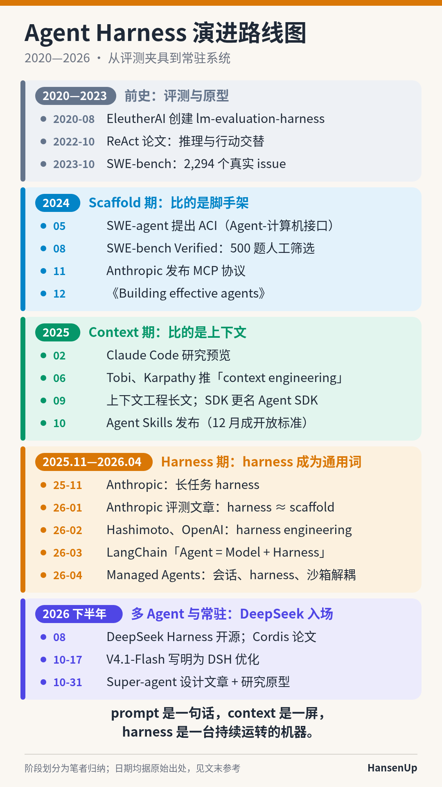
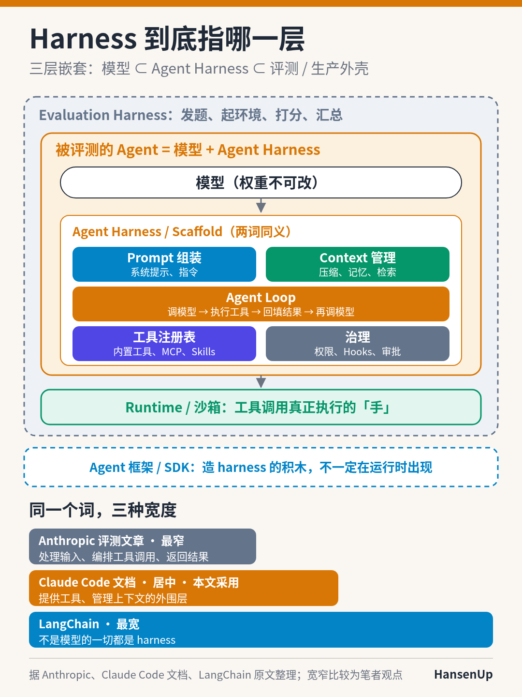
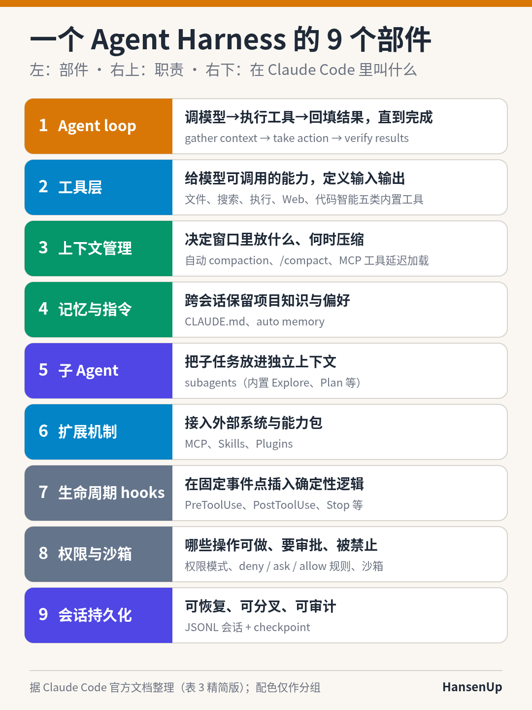
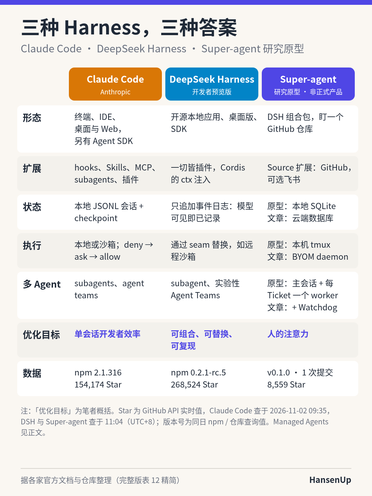
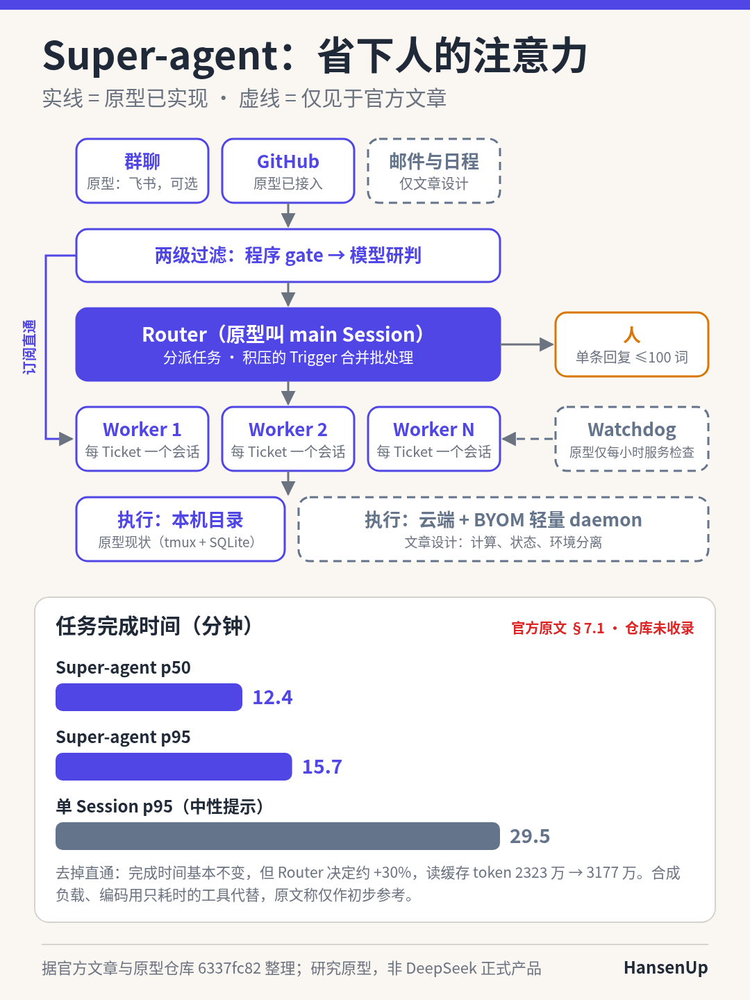

# 一张图看懂 Agent Harness：2020—2026 的演进（精炼版）

作者：HansenUp ｜ 事实与数据截至 2026-11-02（UTC+8）

> 这是长文《Agent Harness：模型之外的那一层》的精炼版。本文以图为主，五张图都是笔者绘制，事实和出处都来自完整版。完整版链接在文末。

同一个模型，换一套外围软件，成绩就可能差出十倍。OpenAI 在发布 SWE-bench Verified 时提到：同一个 GPT-4，在 SWE-bench Lite 上用基于 RAG 的 scaffold 只解决了 2.7% 的问题，换成名为 CodeR 的 scaffold 能解决 28.3%[^swev]。Anthropic 2026 年 3 月也做过一个对比：让 Claude 单独构建一个复古游戏制作器，花了 20 分钟、9 美元，结果「核心功能不能用」；换成「规划者—生成者—评审者」三角色的 harness，花了 6 小时、200 美元，应用质量明显更高[^hd]。

模型之外的这一层，现在有了一个通用的名字：**harness**。harness 原本指马的挽具，词源上有「to control for use as power」的义项，也就是驾驭某种力量来做功[^etym]。下面用五张图把它讲清楚：它从哪里来，指的是哪一层，由什么组成，各家怎么做，下一步往哪里走。

## 一、路线图：七年，五个阶段

*图 1：Agent Harness 演进路线图。阶段划分是笔者的归纳，日期都来自原始出处。*

这个词最早是在评测圈流行起来的。2020-08-28，EleutherAI 创建了 lm-evaluation-harness[^lmeval]，「harness」在这里指批量、可复现地给模型发题和打分的测试夹具。2022 年的 ReAct 让模型交替「推理」和「行动」[^react]。2023 年的 SWE-bench 收录了来自 12 个仓库的 2,294 个真实 issue[^swebench]。从这时起，评测对象从「答题」变成了「干活」。

2024 年进入 **Scaffold 期**，大家比的是脚手架。SWE-agent 提出 ACI（Agent-计算机接口），主张像为人设计 UI 一样，为模型专门设计文件查看、编辑、搜索等接口[^sweagent]。8 月，OpenAI 发布 SWE-bench Verified，它是 500 个经人工筛选的样本，由 93 名专业开发者参与标注[^swev]。11 月，Anthropic 发布 MCP（Model Context Protocol）[^mcp]。12 月的《Building effective agents》区分了「workflow」和「agent」两种做法[^bea]。

2025 年进入 **Context 期**，大家比的是上下文。2 月，Claude Code 以研究预览版发布[^cc-launch]。6 月，Tobi Lütke 和 Andrej Karpathy 先后推「context engineering」这个说法[^tobi][^karpathy]。9 月，Anthropic 的长文把 context engineering 称为 prompt engineering 的「natural progression」，并提出 context rot 和 attention budget 等概念[^ctx]；同一时期，Claude Code SDK 更名为 Claude Agent SDK[^sdk-rename]。10 月发布的 Agent Skills 在 12 月成为开放标准[^skills]。

从 2025 年 11 月到 2026 年 4 月，**harness 成为通用词**。Anthropic 接连发表长任务 harness[^eh]、Agent 评测[^evals]和三角色 harness 设计[^hd]三篇文章。2026 年 2 月，Mitchell Hashimoto 和 OpenAI 先后用了「harness engineering」这个说法[^mitchell][^oai-he]。3 月，LangChain 给出公式「Agent = Model + Harness」[^lc-anatomy]。4 月，Anthropic 的 Managed Agents 把会话、harness、沙箱拆成三个独立组件[^ma]。

2026 年下半年，DeepSeek 入场，重心开始从单个会话转向**多 Agent 和常驻系统**。8 月 13 日，V4-Pro 正式版的 Code Agent 类评测注明「使用 DeepSeek Harness 极简模式」[^ds-0813]，同一天 deepseek-harness 仓库创建[^ghapi]。8 月下旬又有 InfoQ 的报道[^infoq]和 Cordis 设计论文[^cordis-paper]。10 月 17 日，V4.1-Flash-1017 的说明写着「Optimized for DeepSeek Harness, Tencent CodeBuddy, WorkBuddy」[^ds-1017]。10 月 31 日，DeepSeek 公开了 Super-agent 设计文章和研究原型[^sa-wx][^sa-commit]。

> 笔者观点：用一句话概括这五个阶段，prompt 是一句话，context 是一屏，harness 是一台持续运转的机器。

## 二、Harness 到底指哪一层

*图 2：Agent Harness 与模型、评测 harness、Runtime 和框架的关系。笔者绘制。*

先看各家的说法。Anthropic 的评测文章写道，「An agent harness (or scaffold) is the system that enables a model to act as an agent」，并且明确说评测一个 Agent，就是评测 harness 和模型的组合。文中还举了一个例子：CORE-Bench 的分数在修正评分问题、放宽 scaffold 限制后，从 42% 升到了 95%[^evals]。Claude Code 文档的定义是「the layer around the model that provides the tools and manages the context the model sees」[^cc-how]。LangChain 的定义最宽：「If you're not the model, you're the harness.」[^lc-anatomy]

图 2 展示的是三层嵌套：最内层是模型，中间是 agent harness，最外层是评测 harness，或者生产环境里的监控与调度。Prompt 组装、Context 管理、Agent loop、工具注册和治理这五个部件都在中间那一层。Runtime（沙箱）在 harness 下方，是真正执行工具调用的「手」。Agent 框架画在外面，因为它是用来造 harness 的积木，不一定在运行时出现。本文采用居中的定义：**agent harness 是模型之外、运行时直接参与「模型—工具—上下文」循环的那一层软件**。仓库、文档、CI 这些「环境」，算作 harness engineering 的工作对象。

## 三、拆开看：九个部件

*图 3：现代 agent harness 的九个典型部件，以及它们在 Claude Code 里的对应。笔者据官方文档整理。*

Claude Code 的官方文档写得最细，所以图 3 用它做对照。它的主循环是「gather context → take action → verify results」三个阶段。内置工具分为文件、搜索、执行、Web 和代码智能五类。上下文快满时会自动压缩，也可以手动执行 `/compact`[^cc-how]。项目说明写在 CLAUDE.md 里，文档建议每个文件少于 200 行。Auto memory 在每个会话开始时加载 MEMORY.md 的前 200 行或前 25KB，以先到者为准[^cc-mem][^cc-how]。内置的子 Agent 有 Explore 和 Plan 等[^cc-sub]。截至 2026-11-02 查询，hooks 文档列出了 33 种生命周期事件，hook 脚本以退出码 2 退出时会阻断当前操作[^cc-hooks]。权限规则按 deny → ask → allow 的顺序生效[^cc-perm]。会话以 JSONL 格式存储，并支持 checkpoint[^cc-how]。

这九个部件各管一件事：循环负责推进，工具负责行动，上下文和记忆负责「看到什么」，子 Agent 负责隔离，扩展机制负责接入外部系统，hooks、权限和会话日志负责把行为约束住、记录下来。LangChain 的拆法与此类似，它的判断是「Harnesses today are largely delivery mechanisms for good context engineering.」[^lc-anatomy]

## 四、三种做法：Claude Code、DeepSeek Harness 与 Super-agent

*图 4：Claude Code、DeepSeek Harness、Super-agent 研究原型的对比。「优化目标」一行是笔者的概括。Star 数和版本号是 2026-11-02 的查询值，具体时间见图注。*

**Claude Code** 是成熟的产品形态，覆盖终端、IDE、桌面和 Web，另有 Agent SDK。截至 2026-11-02 09:35（UTC+8）查询，npm 包 `@anthropic-ai/claude-code` 的最新版本是 2.1.316，GitHub 仓库有 154,174 个 Star[^npm][^ghapi]。它的扩展手段最全，有 hooks、Skills、MCP、subagents 和插件。v2.1.283 起，交互式会话默认以 Auto 模式启动：由分类器在后台审查操作，而不是每次都问用户[^cc-perm]。同一家公司的 **Managed Agents** 走得更远。它把会话日志放在 harness 之外，harness 崩溃后用 `wake` 重启即可，沙箱只是一个 `execute(name, input) → string` 工具。文章称 p50 首 token 时间大约下降 60%，p95 下降超过 90%。Anthropic 把它称为「meta-harness」[^ma]。

**DeepSeek Harness（DSH）** 的仓库描述是「Everything is a Plugin.」，连 agent loop 本身也只是一个可以替换的「默认驱动器」[^dsh-arch]。它的底层是 Cordis 框架，插件通过共享上下文 `ctx` 注册服务和事件[^dsh-arch]。它的日志规则是「模型可见即已记录」：每个模型请求都必须能从日志重建[^dsh-arch]。截至 2026-11-02 查询，工具目录列出了 35 个已发布的工具包[^dsh-tools]。这个项目还是开发者预览版，README 用大写写着「THERE WILL BE COMPATIBILITY-BREAKING CHANGES.」[^dsh-repo]。同日 11:04（UTC+8）查询，仓库有 268,524 个 Star，npm 包 `@deepseek-ai/dsh` 的最新版本是 0.2.1-rc.5[^ghapi][^npm]。完整版指出过，这个 Star 数比 Claude Code 还高，属于异常值，笔者无法进一步核实。

**Super-agent** 是一个研究原型。README 的第一句就是「Research prototype for reference only, not an official DeepSeek product.」[^sa-repo]。它要解决的问题不在单个会话里面，而在于人同时只能盯住几个会话，这一点放到第五部分展开。

> 笔者观点：三者的分歧集中在「状态放在哪里」和「谁来调度」。Claude Code 把会话存在本机的 JSONL 文件里，DSH 用只追加的事件日志，Super-agent 的设计把状态挪到云端数据库，再在单个会话之上加一层 Router。

## 五、Super-agent：瓶颈从 token 变成了人的注意力

*图 5：Super-agent 的架构（实线表示原型已实现，虚线表示仅见于官方文章）和任务完成时间。实验数据来自官方原文第 7.1 节，原型仓库未收录。笔者绘制。*

2026-10-31 20:29（UTC+8），微信公众号「DeepSeek Harness 团队」发表《Super-agent 设计探索：迈向更自主的 Agent 系统》，文中说明这是一篇架构讨论，不是产品功能介绍[^sa-wx]。文章的出发点是：「据我们观察，一个人通常只能同时跟进 3 到 5 个活跃 Session。」[^sa-wx] 它提出的框架由五个模块组成：

1. Router + Worker 双层架构：Router 负责与人沟通和分派任务，Worker 之间上下文隔离、各自执行；
2. 事件驱动：两级过滤、订阅直通、Inline & Spill、链式召回、投机执行；
3. 面向人的交互：异步 ReAct，IM 里单次回复不超过 100 词；
4. 计算、状态与环境分离，支持 BYOM（把自己的电脑接入云端 Agent）；
5. 用 Watchdog 监督 Worker 的进展[^sa-wx]。

开源原型（版本 0.1.0，截至 2026-11-02 11:04 查询只有一次提交，Star 8,559）只落地了其中一部分[^sa-repo][^ghapi]。路由、订阅直通和沟通规则已经实现。但原型的 Router 仍然带着 `bash`，只是命令 5 秒就返回[^sa-exec][^sa-arch]。存算分离、BYOM daemon 和判断 Worker 进展的 Watchdog 只存在于文章里：原型实际是本机 tmux 里的一个 DSH profile，状态放在一个 SQLite 文件里，只有每小时一次的服务检查[^sa-deploy]。主动接活默认是 `observe` 模式，只记录、不动手[^sa-auth]。

图 5 下半部分的数字**全部来自官方原文第 7.1 节，原型仓库未收录**。在合成负载下，Super-agent 的任务完成时间 p50 为 12.4 分钟、p95 为 15.7 分钟；「单 Session + Subagent」方案在中性提示下的 p95 是 29.5 分钟。去掉订阅直通后，完成时间基本不变，但 Router 要做的决定增加约 30%，读缓存 token 从 2323 万增加到 3177 万。原文自己限定，这些结果「仅作为初步参考」[^sa-wx]。

## 六、往哪里走（笔者观点）

> 以下是笔者个人的判断，不是任何一方的公开表态。

- **会出现「harness 的 harness」。** Managed Agents 的 meta-harness、Super-agent 的 Router 和 Watchdog、Claude Code 的 subagents，都在单个 agent loop 之上加了一层调度。今后比的可能不再是谁的循环写得好，而是谁能同时稳定地管住很多个循环。
- **部件要能被删掉。** Anthropic 先后删掉了 context reset 和 sprint 两个部件[^hd]，DSH 把每个部件都做成了可以卸载的插件[^dsh-arch]。今天为了弥补模型缺陷而加的部件，明天可能就成了累赘。
- **日志就是事实依据。** 只追加日志、「模型可见即已记录」、JSONL 会话，三家在这一点上已经殊途同归。
- **安全会从弹窗审批走向架构隔离。** Managed Agents 把凭据放在沙箱之外[^ma]，Super-agent 的文章也把安全与隐私列为待解问题[^sa-wx]。

正如 Anthropic 所说，「the space of interesting harness combinations doesn't shrink as models improve. Instead, it moves」[^hd]。对工程师来说，值得长期投资的不是某一个具体的 harness，而是判断「哪一层交给模型、哪一层留在 harness」的能力。

---

**完整版**（含 8 张图、13 张表、术语速查、检索记录和全部出处）：https://github.com/HansenUp/agent-engineering-notes/blob/main/articles/2026-11-agent-harness.md

## 参考资料（精选）

[^swev]: OpenAI, "Introducing SWE-bench Verified", 2024-08-13. https://openai.com/index/introducing-swe-bench-verified/
[^hd]: Anthropic Engineering, "Harness design for long-running application development". https://www.anthropic.com/engineering/harness-design-long-running-apps
[^etym]: Online Etymology Dictionary, "harness". https://www.etymonline.com/word/harness
[^lmeval]: EleutherAI, lm-evaluation-harness（GitHub）. https://github.com/EleutherAI/lm-evaluation-harness
[^react]: Yao et al., "ReAct: Synergizing Reasoning and Acting in Language Models", arXiv:2210.03629. https://arxiv.org/abs/2210.03629
[^swebench]: Jimenez et al., "SWE-bench: Can Language Models Resolve Real-World GitHub Issues?", arXiv:2310.06770. https://arxiv.org/abs/2310.06770
[^sweagent]: Yang et al., "SWE-agent: Agent-Computer Interfaces Enable Automated Software Engineering", arXiv:2405.15793. https://arxiv.org/abs/2405.15793
[^mcp]: Anthropic, "Introducing the Model Context Protocol", 2024-11-25. https://www.anthropic.com/news/model-context-protocol
[^bea]: Anthropic, "Building effective AI agents", 2024-12-19. https://www.anthropic.com/research/building-effective-agents
[^cc-launch]: Anthropic, "Claude 3.7 Sonnet and Claude Code", 2025-02-24. https://www.anthropic.com/news/claude-3-7-sonnet
[^tobi]: Tobi Lütke 在 X 上的帖子. https://x.com/tobi/status/1935533422589399127
[^karpathy]: Andrej Karpathy 在 X 上的帖子. https://x.com/karpathy/status/1937902205765607626
[^ctx]: Anthropic Engineering, "Effective context engineering for AI agents". https://www.anthropic.com/engineering/effective-context-engineering-for-ai-agents
[^sdk-rename]: Anthropic, "Building agents with the Claude Agent SDK". https://claude.com/resources/articles/building-agents-with-the-claude-agent-sdk
[^skills]: Anthropic, "Equipping agents with Agent Skills"（含 2025-12-18 开放标准更新）. https://www.anthropic.com/research/equipping-agents-for-the-real-world-with-agent-skills
[^eh]: Anthropic Engineering, "Effective harnesses for long-running agents". https://www.anthropic.com/engineering/effective-harnesses-for-long-running-agents
[^evals]: Anthropic Engineering, "Demystifying evals for AI agents". https://www.anthropic.com/engineering/demystifying-evals-for-ai-agents
[^mitchell]: Mitchell Hashimoto, "My AI Adoption Journey". https://mitchellh.com/writing/my-ai-adoption-journey
[^oai-he]: OpenAI, "Harness engineering". https://openai.com/index/harness-engineering/
[^lc-anatomy]: LangChain Blog, "The Anatomy of an Agent Harness". https://blog.langchain.com/the-anatomy-of-an-agent-harness/
[^ma]: Anthropic Engineering, "Scaling Managed Agents with stable interfaces". https://www.anthropic.com/engineering/managed-agents
[^ds-0813]: DeepSeek API 文档（中文），新闻 2026-08-13（V4-Pro 正式版）. https://api-docs.deepseek.com/zh-cn/news/news260813
[^ghapi]: GitHub REST API，仓库元数据（stargazers_count、created_at 等），查询地址形如 https://api.github.com/repos/{owner}/{repo} 。查询时间为 2026-11-02（UTC+8）：anthropics/claude-code 为 09:35，deepseek-ai/deepseek-harness 与 deepseek-ai/dsh-superagent-prototype 为 11:04。
[^infoq]: InfoQ, "The Open-Sourcing of DeepSeek Harness Opens the Door to Modular, Unbundled AI Agent Infrastructure", 2026-08-20. https://www.infoq.com/news/2026/08/deep-seek-harness/
[^cordis-paper]: "A Programming Paradigm for Spatiotemporal Composability", arXiv:2608.25512（Cordis 设计论文）. https://arxiv.org/abs/2608.25512
[^ds-1017]: DeepSeek API Docs，新闻 2026-10-17. https://api-docs.deepseek.com/news/news261017
[^sa-wx]: DeepSeek Harness 团队（微信公众号），《Super-agent 设计探索：迈向更自主的 Agent 系统》，2026-10-31 20:29（UTC+8）. https://mp.weixin.qq.com/s/zoS7GlReWPhfCjENGxXCdg
[^sa-commit]: deepseek-ai/dsh-superagent-prototype，提交 6337fc82，2026-10-31 20:05（UTC+8）. https://github.com/deepseek-ai/dsh-superagent-prototype/commit/6337fc823ce20251c8de8085948165c81aaa701e
[^cc-how]: Claude Code Docs, "How Claude Code works". https://code.claude.com/docs/en/how-claude-code-works
[^cc-mem]: Claude Code Docs, "How Claude remembers your project"（memory）. https://code.claude.com/docs/en/memory
[^cc-sub]: Claude Code Docs, "Create custom subagents". https://code.claude.com/docs/en/sub-agents
[^cc-hooks]: Claude Code Docs, "Hooks reference". https://code.claude.com/docs/en/hooks
[^cc-perm]: Claude Code Docs, "Configure permissions". https://code.claude.com/docs/en/permissions
[^npm]: npm 注册表元数据（2026-11-02 查询）：https://registry.npmjs.org/@anthropic-ai/claude-code ；https://registry.npmjs.org/@deepseek-ai/dsh
[^dsh-repo]: deepseek-ai/deepseek-harness（GitHub，README）. https://github.com/deepseek-ai/deepseek-harness
[^dsh-arch]: DeepSeek Harness, docs/architecture.zh.md. https://github.com/deepseek-ai/deepseek-harness/blob/master/docs/architecture.zh.md
[^dsh-tools]: DeepSeek Harness, docs/tool-catalog.zh.md. https://github.com/deepseek-ai/deepseek-harness/blob/master/docs/tool-catalog.zh.md
[^sa-repo]: deepseek-ai/dsh-superagent-prototype，README.md（提交 6337fc82）. https://github.com/deepseek-ai/dsh-superagent-prototype/blob/6337fc823ce20251c8de8085948165c81aaa701e/README.md
[^sa-exec]: dsh-superagent-prototype，docs/003-execution.md. https://github.com/deepseek-ai/dsh-superagent-prototype/blob/6337fc823ce20251c8de8085948165c81aaa701e/docs/003-execution.md
[^sa-arch]: dsh-superagent-prototype，docs/007-architecture.md. https://github.com/deepseek-ai/dsh-superagent-prototype/blob/6337fc823ce20251c8de8085948165c81aaa701e/docs/007-architecture.md
[^sa-deploy]: dsh-superagent-prototype，docs/006-deployment.md. https://github.com/deepseek-ai/dsh-superagent-prototype/blob/6337fc823ce20251c8de8085948165c81aaa701e/docs/006-deployment.md
[^sa-auth]: dsh-superagent-prototype，docs/002-authorization.md. https://github.com/deepseek-ai/dsh-superagent-prototype/blob/6337fc823ce20251c8de8085948165c81aaa701e/docs/002-authorization.md

---

*本文由 HansenUp 撰写，文中图表均由笔者绘制，事实与数据截至 2026-11-02（UTC+8）查询，均附出处链接。*
