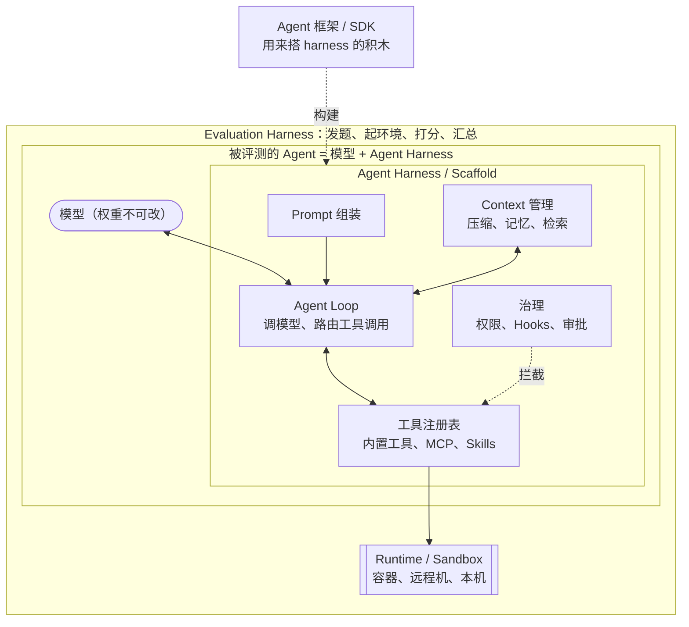
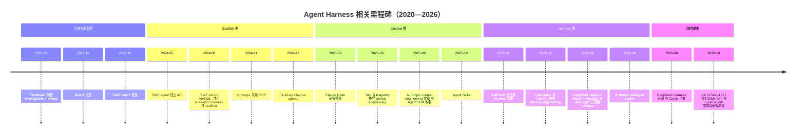
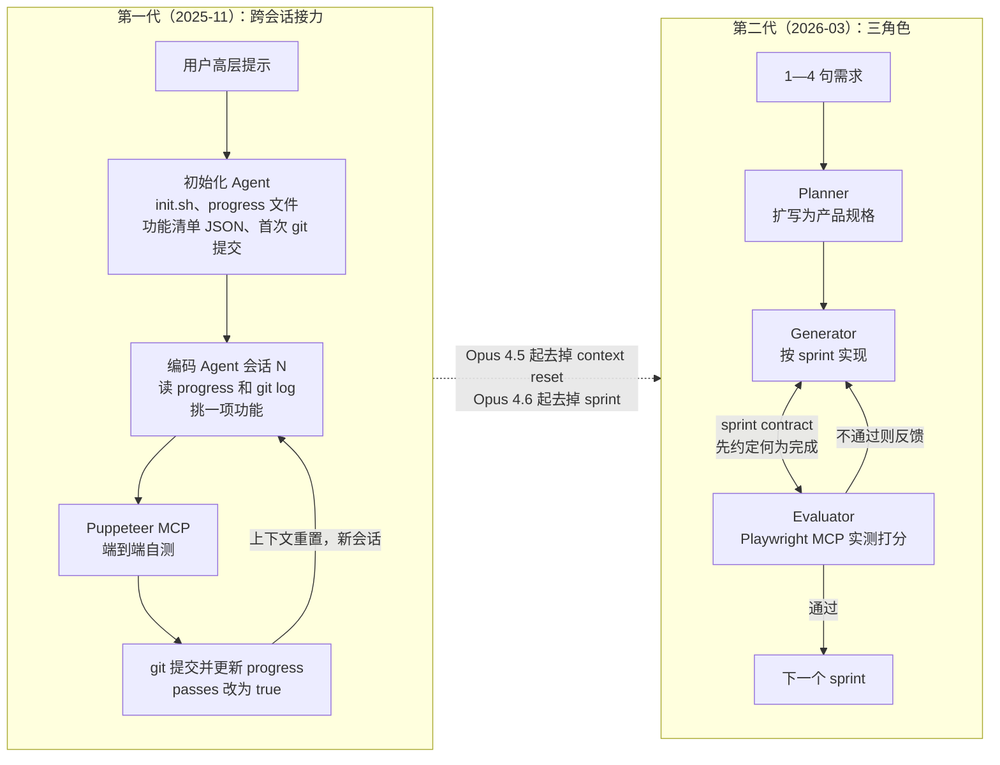
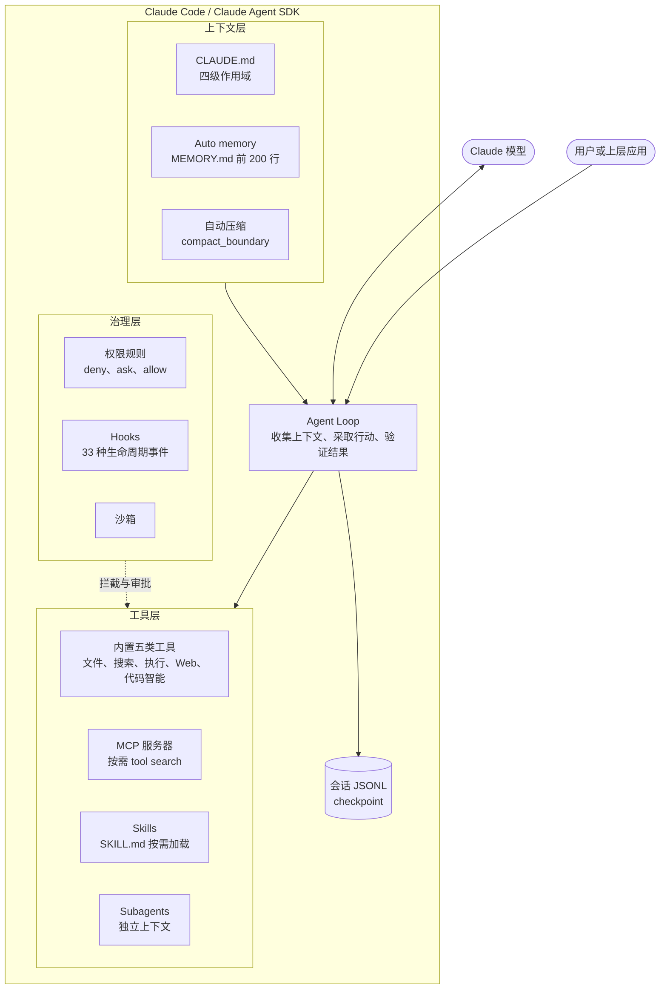
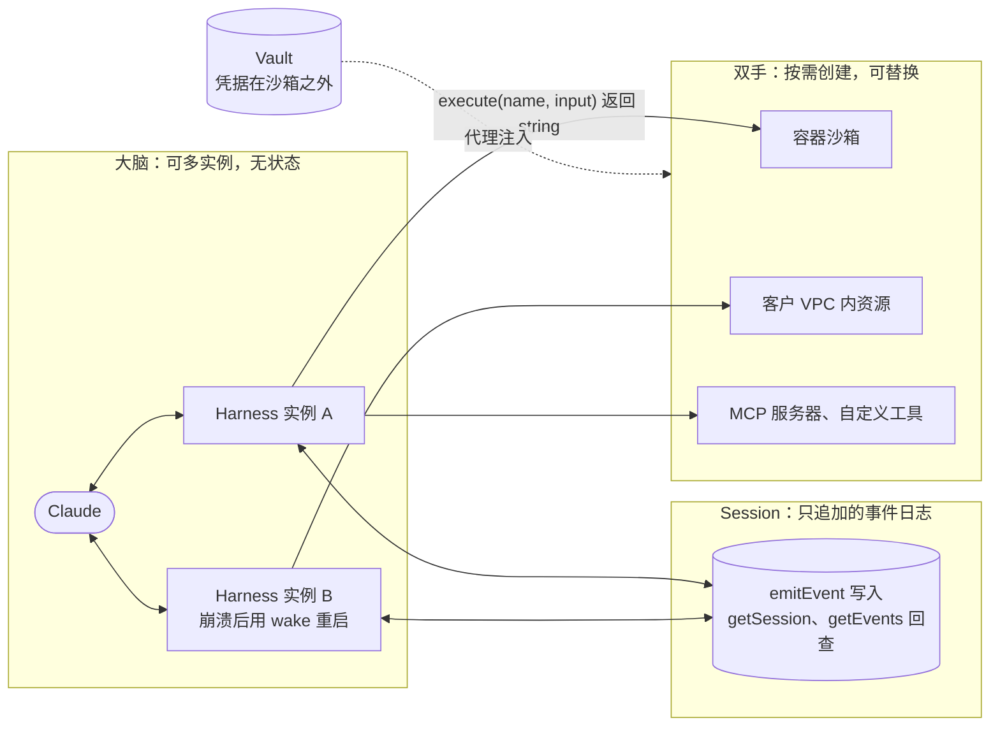
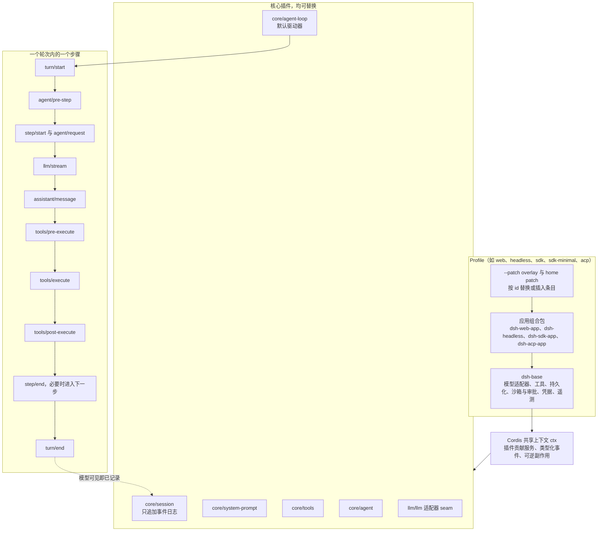
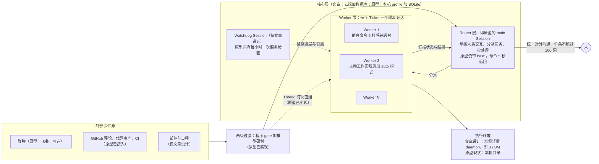
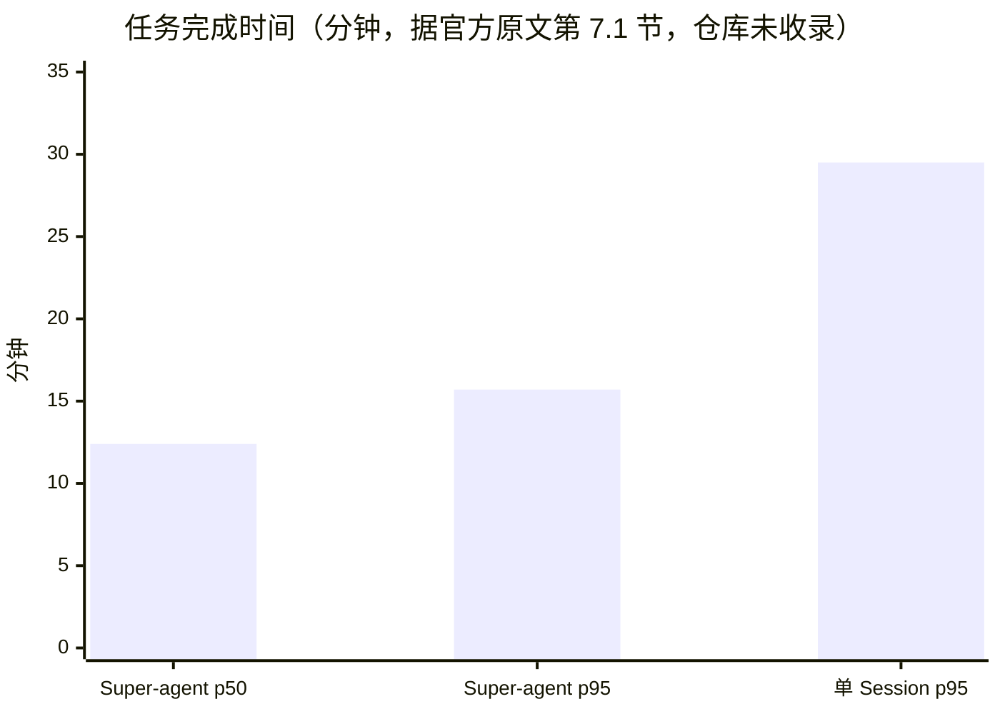

# 模型之外的那一层：Agent Harness 的概念、演进与工程实践

> 作者：HansenUp ｜ 2026 年 11 月 2 日
>
> 精炼图解版见：[一张图看懂 Agent Harness：2020—2026 的演进（精炼版）](2026-11-agent-harness-brief.md)
>
> **摘要**：「Harness」原义是马具和盔甲，后来在软件工程里指测试夹具（test harness），又在大模型评测中指评测框架（evaluation harness）。2025 年底到 2026 年上半年，Anthropic、OpenAI、LangChain 几乎同时把这个词用在一个新对象上：**包在模型外面、让模型能作为 Agent 干活的那一层系统**，并由此带出了「Harness Engineering」这一说法。本文先厘清 harness 与 Prompt、Agent 框架、Runtime、Scaffold 的边界，再按时间线梳理「Prompt → Context → Harness」的演进，然后拆解三个案例：Anthropic 的 Claude Code / Claude Agent SDK，DeepSeek 开源的 DeepSeek Harness（dsh），以及 DeepSeek Harness 团队 2026 年 10 月 31 日发布的 Super-agent 架构文章和原型。最后给出展望。
>
> **来源说明**：全文只使用公开网络资料，每个事实都附脚注链接。所有网页、版本号和 GitHub Star 数均在 2026-11-02（UTC+8）查询；Star 数用 GitHub API 实时读取，版本号用 npm / PyPI 实时读取。X（Twitter）上的原帖无法直接抓取，相关内容通过第三方镜像页阅读，正文会逐处注明。直接引文保留英文原文并给出链接，译文是笔者自译。标注「笔者观点」的段落是笔者个人分析，不代表任何厂商立场。文中所有图表均由笔者自行绘制。

---

## 目录

- [0. 引子：瓶颈从模型移到了模型外面](#0-引子瓶颈从模型移到了模型外面)
- [1. 概念：Harness 到底指什么](#1-概念harness-到底指什么)
  - [1.1 词源：从马具、盔甲到测试夹具](#11-词源从马具盔甲到测试夹具)
  - [1.2 评测语境：evaluation harness 与 scaffold](#12-评测语境evaluation-harness-与-scaffold)
  - [1.3 Anthropic 的用法：两篇 harness 文章及其他](#13-anthropic-的用法两篇-harness-文章及其他)
  - [1.4 OpenAI 与 LangChain 的用法](#14-openai-与-langchain-的用法)
  - [1.5 边界：Harness 与 Prompt、Agent 框架、Runtime、Scaffold](#15-边界harness-与-promptagent-框架runtimescaffold)
  - [1.6 一个 Agent Harness 由哪些部件组成](#16-一个-agent-harness-由哪些部件组成)
- [2. 演进：从 Prompt 到 Context 再到 Harness Engineering](#2-演进从-prompt-到-context-再到-harness-engineering)
  - [2.1 前史（2020—2023）：评测框架与 ReAct](#21-前史20202023评测框架与-react)
  - [2.2 2024：ACI、scaffold 与 MCP](#22-2024aciscaffold-与-mcp)
  - [2.3 2025：Claude Code 与 Context Engineering](#23-2025claude-code-与-context-engineering)
  - [2.4 2025 年 11 月—2026 年 4 月：Harness Engineering 成为显学](#24-2025-年-11-月2026-年-4-月harness-engineering-成为显学)
  - [2.5 2026 年下半年：DeepSeek 入场](#25-2026-年下半年deepseek-入场)
  - [2.6 时间线与对照表](#26-时间线与对照表)
- [3. 应用：三个案例的拆解](#3-应用三个案例的拆解)
  - [3.1 Anthropic 的长任务 harness 实验](#31-anthropic-的长任务-harness-实验)
  - [3.2 Claude Code 与 Claude Agent SDK：一个工业级 harness](#32-claude-code-与-claude-agent-sdk一个工业级-harness)
  - [3.3 Managed Agents：把 harness 从容器里拆出来](#33-managed-agents把-harness-从容器里拆出来)
  - [3.4 DeepSeek Harness：核验与拆解](#34-deepseek-harness核验与拆解)
  - [3.5 DeepSeek Super-agent：核验与拆解](#35-deepseek-super-agent核验与拆解)
  - [3.6 横向对比](#36-横向对比)
- [4. 展望](#4-展望)
  - [4.1 各方怎么看下一步](#41-各方怎么看下一步)
  - [4.2 笔者的判断](#42-笔者的判断)
  - [4.3 给实践者的检查清单](#43-给实践者的检查清单)
- [5. 结语](#5-结语)
- [附录 A：术语速查](#附录-a术语速查)
- [附录 B：检索记录与实时数据](#附录-b检索记录与实时数据)
- [参考资料](#参考资料)

---

## 0. 引子：瓶颈从模型移到了模型外面

先看两组数字。

第一组来自 OpenAI 2024 年 8 月发布 SWE-bench Verified 时的说明。同一个 GPT-4，在 SWE-bench Lite 上用一个基于 RAG 的 scaffold 只解决了 2.7% 的问题，换成名为 CodeR 的 scaffold 能解决 28.3%[^swev]。模型完全没变，差了十倍。

第二组来自 Anthropic 2026 年 3 月的工程博客。让 Claude 单独构建一个复古游戏制作器，花了 20 分钟、9 美元，结果「核心功能不能用」。换成一个「规划者—生成者—评审者」三角色的 harness，花了 6 小时、200 美元，得到的应用质量明显更高[^hd]。

两组数字说的是同一件事：**同一个模型，外面包的那一层不同，结果可以差一个数量级。** 2026 年上半年，这一层有了一个大家都认的名字，叫 **Agent Harness**；围绕它做的工程工作叫 **Harness Engineering**。

这个词流行得很快，用法也很杂。有人把它等同于「Agent 框架」，有人把它等同于「提示词 + 工具」，还有人沿用它在评测领域的老意思。国内的讨论又多了一层混乱：2026 年 8 月 DeepSeek 开源了一个就叫「DeepSeek Harness」的项目，10 月底又发布了一篇 Super-agent 架构文章，社交媒体上把两者传成了「DeepSeek 发布超级智能体产品」。

本文想做三件事：

1. 把概念讲清楚：harness 从哪儿来，和相邻概念的边界在哪里。
2. 把时间线理清楚：每个节点都给出日期和出处。
3. 把案例拆清楚：Claude Code 的 harness 由哪些部件组成，DeepSeek 的两个东西分别是什么、不是什么。

---

## 1. 概念：Harness 到底指什么

### 1.1 词源：从马具、盔甲到测试夹具

据 Etymonline，英语 harness 作名词最早见于约 1300 年，指「个人作战装备、盔甲」（personal fighting equipment, body armor），来自古法语 harnois；14 世纪早期出现「役畜的挽具」这一义项；动词的比喻义「加以控制以便用作动力」（to control for use as power）出现于 17 世纪 90 年代[^etym]。

这三个义项正好对应今天 agent harness 的三层意思：

- **挽具**：把一匹力气很大、但不会自己干活的马，接到车、犁或磨盘上。马就是模型，车和犁就是代码仓库、浏览器、终端。
- **盔甲**：保护和约束。今天的 harness 负责权限、沙箱、审批，防止 Agent 伤人伤己。
- **驾驭以作动力**：让原始的能力变成可控、可持续的产出。

软件工程里，harness 很早就是一个正式术语。维基百科对 test harness 的定义是「一组桩（stub）和驱动程序（driver），配置起来用于辅助测试一个应用或组件」（a collection of stubs and drivers configured to assist with the testing of an application or component）[^testharness]。它的要点是：被测对象本身不变，harness 负责喂输入、接输出、记录结果。

> 笔者观点：test harness 和 agent harness 的共同点是「被包裹的核心不归你改」。做测试的人改不了被测组件，做 Agent 的人（多数情况下）改不了模型权重。能改的只有外面那一圈。这也解释了为什么 harness 这个老词会被重新捡起来：当模型成为一个不能改的「被测件」，工程师的全部杠杆就集中在了外围。

### 1.2 评测语境：evaluation harness 与 scaffold

大模型评测领域早就在用 harness 一词，只是意思偏「测试夹具」。

- EleutherAI 的 `lm-evaluation-harness` 仓库创建于 2020-08-28（截至 2026-11-02 查询，Star 数 14,362）[^lmeval][^ghapi]。
- SWE-bench 论文于 2023-10-10 提交到 arXiv，包含来自 12 个 Python 仓库的 2,294 个真实 GitHub issue[^swebench]。仓库 README 记录了 2024-06-27 迁移到「完全容器化、基于 Docker 的评测 harness」（fully containerized evaluation harness using Docker），评测入口是 `swebench.harness.run_evaluation` 模块[^swebench-repo]。

这里的 harness 指**跑评测的那套设施**，不是被评测的 Agent。被评测的 Agent 外面那层，当时更常被叫作 **scaffold（脚手架）**。OpenAI 2024-08-13 的《Introducing SWE-bench Verified》把两个词放在同一篇文章里用[^swev]：

- 他们和 SWE-bench 作者合作，「develop a new evaluation harness for SWE-bench which uses containerized Docker environments」（为 SWE-bench 开发一个使用容器化 Docker 环境的新评测 harness）。
- 他们把 Agentless 称为「best performing open-source scaffold」（表现最好的开源 scaffold）；GPT-4o 配合它在 Verified 上解决了 33.2% 的样本。
- 前面引子里那组 2.7% 与 28.3% 的对比，原文用的也是 scaffold 一词。

SWE-bench Verified 本身是 500 个经人工筛选的样本，由 93 名专业开发者参与标注[^swev]。

所以到 2024 年，行业里有两套说法并存：

| 说法 | 指什么 | 例子 |
|---|---|---|
| evaluation harness | 运行评测的基础设施：发题、起环境、跑测试、打分、汇总 | lm-evaluation-harness；SWE-bench 的 Docker harness |
| scaffold / scaffolding | 包在模型外面、让模型能完成任务的程序 | Agentless、SWE-agent、CodeR、RAG scaffold |

*表 1：2024 年前后评测语境中的两个术语。据 OpenAI[^swev] 与 SWE-bench 仓库[^swebench-repo] 整理。*

### 1.3 Anthropic 的用法：两篇 harness 文章及其他

Anthropic 是把 harness 一词从「评测设施」推向「Agent 外层系统」的关键推手。下面按时间顺序列出它的几处关键表述。

**（1）2025-09-29，Claude Agent SDK 改名。** Anthropic 在《Building agents with the Claude Agent SDK》中写道：「the agent harness that powers Claude Code (the Claude Code SDK) can power many other types of agents, too. To reflect this broader vision, we're renaming the Claude Code SDK to the Claude Agent SDK.」（驱动 Claude Code 的那个 agent harness，也就是 Claude Code SDK，同样可以驱动许多其他类型的 Agent。为体现这一更大的愿景，我们把 Claude Code SDK 更名为 Claude Agent SDK。）[^sdk-rename] 这是笔者查到的 Anthropic 最早把「agent harness」当作产品层概念使用的公开表述之一。

**（2）2025-11-26，第一篇 harness 专文。** Justin Young 发表《Effective harnesses for long-running agents》[^eh]，开篇就把 Claude Agent SDK 称为「a powerful, general-purpose agent harness adept at coding」（一个强大、通用、擅长编程的 agent harness）。文章要解决的问题是：

> 「The core challenge of long-running agents is that they must work in discrete sessions, and each new session begins with no memory of what came before.」（长时运行 Agent 的核心挑战在于，它们必须在一个个离散的会话中工作，而每个新会话开始时都不记得之前发生过什么。）[^eh]

它还有一个容易被忽略的脚注：文中虽然把「初始化 Agent」和「编码 Agent」说成两个 Agent，但「We refer to these as separate agents in this context only because they have different initial user prompts. The system prompt, set of tools, and overall agent harness was otherwise identical.」（之所以称为两个 Agent，只是因为它们的初始用户提示不同；系统提示、工具集和整体 agent harness 完全相同。）[^eh] 这句话从反面给出了 harness 的范围：**系统提示、工具集以及围绕它们的整体机制，都属于 harness。**

**（3）2026-01-09，评测文章给出正式定义。** 《Demystifying evals for AI agents》同时定义了两种 harness[^evals]：

> 「An evaluation harness is the infrastructure that runs evals end-to-end. It provides instructions and tools, runs tasks concurrently, records all the steps, grades outputs, and aggregates results.」（评测 harness 是端到端运行评测的基础设施：它提供指令和工具，并发运行任务，记录所有步骤，给输出打分并汇总结果。）

> 「An agent harness (or scaffold) is the system that enables a model to act as an agent: it processes inputs, orchestrates tool calls, and returns results. When we evaluate "an agent," we're evaluating the harness and the model working together.」（agent harness，或称 scaffold，是让模型能作为 Agent 行动的系统：它处理输入、编排工具调用并返回结果。当我们评测「一个 Agent」时，我们评测的是 harness 与模型的协同。）

这段定义有两点很重要。第一，它明确说 **agent harness 和 scaffold 是同义词**。第二，它明确说**评测 Agent 就是评测「模型 + harness」的组合**。文中还举了一个例子：CORE-Bench 上的分数在修正评分问题和放宽 scaffold 限制后，从 42% 升到 95%[^evals]。

**（4）2026-03-24，第二篇 harness 专文。** 《Harness design for long-running application development》[^hd] 讨论如何用多 Agent 结构做长时间的应用开发（细节见 3.1 节）。它的核心论断是：

> 「every component in a harness encodes an assumption about what the model can't do on its own, and those assumptions are worth stress testing, both because they may be incorrect, and because they can quickly go stale as models improve」（harness 中的每个组件都编码了一个假设，即模型自己做不到某件事；这些假设值得做压力测试，一方面因为它们可能是错的，另一方面因为随着模型进步，它们会很快过时。）[^hd]

**（5）Claude Code 官方文档。** 《How Claude Code works》写道：「Claude Code is the layer around the model that provides the tools and manages the context the model sees. This surrounding layer is what the term agentic harness refers to.」（Claude Code 是模型外面的那一层，它提供工具，并管理模型看到的上下文。这个外围层就是 agentic harness 一词所指的东西。）[^cc-how]

把这几处放在一起，Anthropic 语境里的 agent harness 可以概括为：**模型之外，负责提供工具、管理上下文、编排循环、执行权限的那一整层系统。**

### 1.4 OpenAI 与 LangChain 的用法

**OpenAI。** 2026-02-11，OpenAI 的 Ryan Lopopolo 发表《Harness engineering: leveraging Codex in an agent-first world》[^oai-he]。文章讲的是一个内部团队在五个月里用 Codex 写出一个产品、人类不手写任何代码的实验，核心口号是「Humans steer. Agents execute.」（人类掌舵，Agent 执行。）

值得注意的是，这篇以 harness engineering 为标题的文章，正文里更多用的是 scaffolding、environment、feedback loop 这些词。例如：

- 工程师的工作变成了「design environments, specify intent, and build feedback loops」（设计环境、明确意图、搭建反馈回路）。
- 结尾一句是：「building software still demands discipline, but the discipline shows up more in the scaffolding rather than the code」（构建软件仍然需要纪律，只是纪律更多体现在脚手架上，而不是代码上）。[^oai-he]

换句话说，在 OpenAI 的用法里，harness engineering 的对象不只是 Agent 程序本身，还包括**代码仓库、文档、linter、CI、可观测性**这些让 Agent 能可靠工作的整个环境。

**LangChain。** 2026-03-10，LangChain 的 Vivek Trivedy 发表《The Anatomy of an Agent Harness》[^lc-anatomy]，给出了目前流传最广的公式：

> 「Agent = Model + Harness」
>
> 「If you're not the model, you're the harness. A harness is every piece of code, configuration, and execution logic that isn't the model itself.」（如果你不是模型，你就是 harness。harness 是除模型本身之外的每一段代码、配置和执行逻辑。）[^lc-anatomy]

这是一个非常宽的「减法定义」。LangChain 的另一篇博客《How to Build a Custom Agent Harness》也把 Deep Agents 和 Claude Agent SDK 并列为 harness，并说它们预先装配好了一套带取向的中间件栈，涵盖记忆、上下文管理、沙箱等能力[^lc-custom]。在《How Middleware Lets You Customize Your Agent Harness》里，LangChain 把 `AgentMiddleware` 定位为定制 harness 的方式：中间件暴露一组 hook，让开发者在模型调用和工具调用前后运行自定义逻辑[^lc-mw]。

**Mitchell Hashimoto。** 比 OpenAI 早 6 天，HashiCorp 联合创始人 Mitchell Hashimoto 在 2026-02-05 的个人博客《My AI Adoption Journey》里，把第 5 步命名为「Engineer the Harness」[^mitchell]：

> 「I don't know if there is a broad industry-accepted term for this yet, but I've grown to calling this "harness engineering." It is the idea that anytime you find an agent makes a mistake, you take the time to engineer a solution such that the agent never makes that mistake again.」（我不知道业内是否已有公认的说法，但我开始把它叫作「harness engineering」：每当你发现 Agent 犯了一个错，就花时间设计一个方案，让它永远不再犯这个错。）[^mitchell]

他说的两种做法是：更新 AGENTS.md 这类隐式提示，以及写真正的程序化工具（截图脚本、过滤测试的脚本等）[^mitchell]。

> 笔者观点：这几家的定义宽窄不一。LangChain 的「非模型即 harness」最宽，连仓库都算进去；Claude Code 文档的「提供工具、管理上下文的外围层」居中；Anthropic 评测文章的「处理输入、编排工具调用、返回结果」最窄，接近一个 agent loop。写作和讨论时最好先说清楚用的是哪一种。本文默认采用居中的定义：**agent harness = 模型之外、运行时直接参与「模型—工具—上下文」循环的那一层软件**；仓库、文档、CI 这类「环境」属于 harness engineering 的工作对象，但不算 harness 本身。

### 1.5 边界：Harness 与 Prompt、Agent 框架、Runtime、Scaffold

下面这张表是笔者根据上述来源整理的边界划分。

| 概念 | 回答的问题 | 典型形态 | 与 harness 的关系 |
|---|---|---|---|
| Prompt | 这一次该对模型说什么 | 系统提示、用户指令、few-shot 示例 | harness 的一个输入部件；harness 负责组装和维护它 |
| Context | 这一步模型窗口里该放什么 | 历史消息、工具结果、检索片段、记忆文件 | harness 的核心管理对象；Anthropic 称 context engineering 是 prompt engineering 的「natural progression」[^ctx] |
| Agent 框架（Framework） | 用什么积木来搭一个 Agent | LangChain / LangGraph、各类 SDK | 造 harness 的工具箱。LangChain 区分「framework」与「harness」：后者是预先装配好的、带取向的成品[^lc-custom] |
| Harness / Scaffold | 模型怎样作为 Agent 持续干活 | Claude Code、Codex CLI、Deep Agents、DeepSeek Harness | 本文主题；Anthropic 明确说两词同义[^evals] |
| Runtime / 执行环境 | 工具调用在哪里真正执行 | 容器、沙箱、远程虚拟机、用户本机 | harness 调用的「手」。Anthropic Managed Agents 把 harness、session、sandbox 拆成三个独立组件[^ma] |
| Evaluation harness | 怎样批量、可复现地评测 Agent | SWE-bench harness、lm-eval-harness | 外层再套一层；被评测对象是「模型 + agent harness」[^evals] |

*表 2：Harness 与相邻概念的边界。笔者根据 Anthropic[^evals][^ctx][^ma]、LangChain[^lc-custom] 等来源整理。*

*图 1：Agent Harness 与 Prompt、Context、框架、Runtime、评测 harness 的嵌套关系。笔者绘制。*

图 1 的要点是三层嵌套：

- **最内层**是模型。
- **中间**是 agent harness。Prompt 组装、Context 管理、Agent loop、工具注册、治理五个部件都在这一层。
- **最外层**是评测 harness，或者生产环境的监控与调度。

Agent 框架在图的外面，因为它是「用来造 harness 的东西」，不一定在运行时出现。Runtime 在 harness 下方，因为它是 harness 调用的执行环境。

### 1.6 一个 Agent Harness 由哪些部件组成

综合 Anthropic、LangChain 和 Claude Code 文档，一个现代 agent harness 一般有以下部件：

| 部件 | 职责 | Claude Code 中的对应 | 出处 |
|---|---|---|---|
| Agent loop | 调模型 → 执行工具 → 回填结果 → 再调模型，直到完成 | 「gather context → take action → verify results」三阶段循环 | [^cc-how][^sdk-loop] |
| 工具层 | 给模型可调用的能力，并定义输入输出格式 | 文件操作、搜索、执行、Web、代码智能五类内置工具 | [^cc-how] |
| 上下文管理 | 决定窗口里放什么、何时压缩、何时卸载 | 自动 compaction、`/compact`、MCP 工具定义延迟加载 | [^cc-how] |
| 记忆与指令 | 跨会话保留项目知识和用户偏好 | CLAUDE.md、auto memory | [^cc-mem] |
| 子 Agent / 多 Agent | 把子任务放到独立上下文里执行 | subagents（内置 Explore、Plan 等） | [^cc-sub] |
| 扩展机制 | 接入外部系统和可复用能力包 | MCP、Skills、Plugins | [^cc-mcp][^cc-skills] |
| 生命周期 hooks | 在固定事件点插入确定性逻辑 | PreToolUse、PostToolUse、Stop 等 hooks | [^cc-hooks] |
| 权限与沙箱 | 控制哪些操作可做、需审批、被禁止 | 权限模式、deny/ask/allow 规则、沙箱 | [^cc-perm] |
| 会话持久化 | 让会话可恢复、可分叉、可审计 | 会话以 JSONL 存储、checkpoint | [^cc-how] |

*表 3：现代 agent harness 的典型部件及其在 Claude Code 中的对应。笔者整理。*

LangChain 的拆法与此类似。它列出的 harness 组成包括系统提示、工具 / Skills / MCP、文件系统与沙箱等基础设施、编排逻辑（子 Agent、模型路由）以及 hooks / 中间件，并认为「Harnesses today are largely delivery mechanisms for good context engineering」（今天的 harness 很大程度上是交付良好 context engineering 的载体）[^lc-anatomy]。

---

## 2. 演进：从 Prompt 到 Context 再到 Harness Engineering

### 2.1 前史（2020—2023）：评测框架与 ReAct

这一阶段，「harness」主要还是评测术语。

- **2020-08-28**：EleutherAI 创建 `lm-evaluation-harness` 仓库[^lmeval]。
- **2022-10-06**：ReAct 论文提交到 arXiv（arXiv:2210.03629）。它提出让模型交替输出「推理（Reasoning）」和「行动（Acting）」，这成了后来几乎所有 agent loop 的原型[^react]。
- **2023-10-10**：SWE-bench 论文提交到 arXiv，第一次把「解决真实仓库的 GitHub issue」做成大规模基准[^swebench]。

这时的工程重心是 prompt：怎么写指令、怎么给示例、怎么让模型按格式输出。Agent 的外层通常是几十到几百行的胶水代码。

### 2.2 2024：ACI、scaffold 与 MCP

- **2024-05-06**：SWE-agent 论文提交到 arXiv（arXiv:2405.15793）。论文提出 **Agent-Computer Interface（ACI，Agent—计算机接口）** 的概念，认为应该像为人设计 UI 一样，为模型专门设计文件查看、编辑、搜索等接口[^sweagent]。截至 2026-11-02 查询，SWE-agent 仓库的 README 推荐新用户改用更轻量的 mini-swe-agent[^sweagent-repo]。
- **2024-06-27**：SWE-bench 评测迁移到全容器化的 Docker harness[^swebench-repo]。
- **2024-08-13**：OpenAI 发布 SWE-bench Verified，文中系统地使用了「evaluation harness」与「scaffold」两个词，并展示了 scaffold 对分数的巨大影响[^swev]。
- **2024-11-25**：Anthropic 发布 Model Context Protocol（MCP），称其为连接 AI 系统与数据源的「universal, open standard」（通用、开放标准）[^mcp]。
- **2024-12-19**：Anthropic 发布《Building effective agents》，区分了 workflow 与 agent[^bea]：

> 「Workflows are systems where LLMs and tools are orchestrated through predefined code paths. Agents, on the other hand, are systems where LLMs dynamically direct their own processes and tool usage, maintaining control over how they accomplish tasks.」（workflow 是通过预定义代码路径编排 LLM 和工具的系统；而 agent 是由 LLM 动态指挥自身流程和工具使用、自己掌控如何完成任务的系统。）[^bea]

> 笔者观点：2024 年是「scaffold」一词的高峰。人们已经意识到外层很重要，但还把它看成一次性搭好、撑完评测就可以拆的「脚手架」。ACI 和 MCP 是两个关键的思想准备：前者说明工具接口要为模型专门设计，后者让工具接入有了统一协议。它们后来都成了 harness 的标准部件。

### 2.3 2025：Claude Code 与 Context Engineering

- **2025-02-24**：Anthropic 发布 Claude 3.7 Sonnet，同时以「limited research preview」（有限研究预览）形式推出 Claude Code，称其为「our first agentic coding tool」（我们的第一个 agentic 编程工具）[^cc-launch]。
- **2025-06-19 / 06-25**：Shopify CEO Tobi Lütke 在 X 上表示，他更喜欢用「context engineering」而不是「prompt engineering」来描述核心技能[^tobi]。Andrej Karpathy 随后发帖表示赞同（「+1 for "context engineering" over "prompt engineering"」）[^karpathy]。（两条原帖通过第三方镜像阅读。）
- **2025-09-29**：Anthropic 发布《Effective context engineering for AI agents》，写道「At Anthropic, we view context engineering as the natural progression of prompt engineering.」（在 Anthropic，我们把 context engineering 看作 prompt engineering 的自然演进。）文章提出了 context rot（上下文腐化）和「attention budget」（注意力预算）的说法，并给出一个目标：「good context engineering means finding the smallest possible set of high-signal tokens that maximize the likelihood of some desired outcome」（好的 context engineering 意味着找到尽可能小、信号尽可能强的一组 token，使期望结果出现的概率最大）[^ctx]。同一天，Claude Code SDK 改名为 Claude Agent SDK[^sdk-rename]。
- **2025-10-16**：Anthropic 发布 Agent Skills[^skills]；2025-12-18 的更新把 Agent Skills 作为开放标准发布[^skills]。

这一阶段，关注点从「写好一段提示」变成「在多轮循环里管理好整个窗口」。上下文压缩、即时检索、子 Agent 隔离上下文、记忆文件等手段被系统化。这些手段需要一个**程序**来执行，这个程序就是 harness。LangChain 后来那句「harness 是交付良好 context engineering 的载体」[^lc-anatomy]，说的正是这层关系。

### 2.4 2025 年 11 月—2026 年 4 月：Harness Engineering 成为显学

这五个月里，harness 从一个附属词变成了主角。

| 日期 | 事件 | 要点 |
|---|---|---|
| 2025-11-26 | Anthropic《Effective harnesses for long-running agents》 | 初始化 Agent + 编码 Agent；进度文件、功能清单、git 提交作为跨会话记忆[^eh] |
| 2026-01-09 | Anthropic《Demystifying evals for AI agents》 | 正式区分 evaluation harness 与 agent harness，并说 agent harness 即 scaffold[^evals] |
| 2026-02-05 | Mitchell Hashimoto《My AI Adoption Journey》 | 提出「harness engineering」：每发现一次错误，就设计机制让它不再发生[^mitchell] |
| 2026-02-11 | OpenAI《Harness engineering》 | 约百万行代码、约 1,500 个 PR 全由 Codex 写；AGENTS.md 是地图而不是手册[^oai-he] |
| 2026-03-10 | LangChain《The Anatomy of an Agent Harness》 | 「Agent = Model + Harness」；Ralph Loop 等模式[^lc-anatomy] |
| 2026-03-24 | Anthropic《Harness design for long-running application development》 | 规划者 / 生成者 / 评审者；context anxiety；harness 组件即假设[^hd] |
| 2026-04-08 | Anthropic《Scaling Managed Agents》 | 把 session、harness、sandbox 解耦；「大脑」与「双手」分离[^ma] |

*表 4：Harness Engineering 的关键文献（2025-11 至 2026-04）。笔者整理。*

OpenAI 那篇文章里有几个数据被反复引用，这里按原文列出[^oai-he]：

- 空仓库的第一个提交在 2025 年 8 月下旬。
- 五个月后，仓库大约有一百万行代码。
- 大约 1,500 个 PR 被创建并合并。起初只有三名工程师驱动 Codex，平均每人每天 3.5 个 PR；团队后来扩到七人，吞吐反而上升。
- 他们估计用时约为手写代码的 1/10。
- 单次 Codex 运行常能在一个任务上工作超过六小时。

方法上，OpenAI 最常被引用的经验是「give Codex a map, not a 1,000-page instruction manual」（给 Codex 一张地图，而不是一本一千页的说明书）[^oai-he]：

- AGENTS.md 只有约 100 行，作为目录使用；真正的知识放在结构化的 `docs/` 目录里。
- linter 和 CI 负责检查文档是否新鲜、交叉链接是否正确。
- 一个「doc-gardening」Agent 定期扫描过时文档。

他们原先每周五（20% 的工作时间）用来清理「AI slop」，后来改为把「golden principles」编码进仓库，由后台任务持续「垃圾回收」[^oai-he]。

> 笔者观点：这五个月里，三类作者从三个方向收敛到了同一个词上。Anthropic 是从「长任务为什么会失败」出发，OpenAI 是从「人不写代码时工程师干什么」出发，LangChain 是从「框架之上还需要什么成品」出发。共同的认识是：**模型能力已经过了某个门槛，再往上的收益更多取决于外层系统，而外层系统需要被当作一门工程来做。**

### 2.5 2026 年下半年：DeepSeek 入场

据 DeepSeek API 文档的新闻页面和 GitHub 数据，DeepSeek 的相关节点如下（细节见 3.4、3.5 节）：

- **2026-04-24**：DeepSeek-V4 预览版发布。官方新闻称已与 Claude Code、OpenClaw、OpenCode 等 Agent 工具集成，并支持 Anthropic API 格式[^ds-0424]。
- **2026-08-13**：V4-Pro 正式版发布，中文新闻页说明 Code Agent 类评测「使用 DeepSeek Harness 极简模式」测试[^ds-0813]。同一天（UTC+8 19:56），GitHub 上的 `deepseek-ai/deepseek-harness` 仓库创建[^ghapi]。
- **2026-08-20**：InfoQ 英文站报道 DeepSeek Harness 开源[^infoq]。
- **2026-08-26**：介绍 DeepSeek Harness 底层框架 Cordis 设计思想的论文提交到 arXiv[^cordis-paper]。
- **2026-10-17**：V4.1-Flash-1017 发布，官方说明它「Optimized for DeepSeek Harness, Tencent CodeBuddy, WorkBuddy」，并建议升级到 DeepSeek Harness v0.2.1-rc.1 或更高版本[^ds-1017]。
- **2026-10-31**：DeepSeek 在 GitHub 开放 `dsh-superagent-prototype` 原型仓库（UTC+8 17:32 创建，20:05 提交唯一一次 commit）[^ghapi][^sa-commit]；20:29，微信公众号「DeepSeek Harness 团队」发布《Super-agent 设计探索：迈向更自主的 Agent 系统》[^sa-wx]。仓库 README 第一句就声明它是研究原型，不是正式产品[^sa-repo]。当晚媒体跟进，其中 AI寒武纪 用了「开源自用超级Agent底座」的标题，这个说法有夸大，见 3.5.1 节[^aicamb]。截至 2026-11-02 11:04（UTC+8），仓库没有新提交、release 或 tag[^ghapi]。

### 2.6 时间线与对照表

*图 2：Agent Harness 相关里程碑时间线。日期据正文各脚注，图由笔者绘制。*

| 阶段 | 工程重心 | 核心问题 | 代表性表述 |
|---|---|---|---|
| Prompt 期（约 2022—2024） | 单次输入 | 这句话怎么写，模型才能答对 | few-shot、思维链、ReAct[^react] |
| Scaffold 期（约 2024） | 任务专用外层 | 怎样包一层，让模型在基准上解决问题 | ACI[^sweagent]、scaffold[^swev] |
| Context 期（约 2025） | 多轮窗口 | 每一步窗口里放什么 | context rot、attention budget[^ctx] |
| Harness 期（约 2025 年末起） | 长期运行的系统 | 怎样让 Agent 连续数小时、跨会话、可控地干活 | Agent = Model + Harness[^lc-anatomy]；harness engineering[^mitchell][^oai-he] |
| 多 Agent / 常驻期（2026 年起的探索） | 多会话、事件驱动、常驻 | 怎样让一个 Agent 系统同时跟进许多事、节省人的注意力 | Managed Agents[^ma]；Super-agent（设计文章与研究原型）[^sa-wx][^sa-repo] |

*表 5：Prompt → Context → Harness 的演进对照。阶段划分是笔者的归纳，并非各方官方说法。*

> 笔者观点：这几个阶段不是替代关系，而是层层包含。Harness 里仍然有 prompt，也仍然要做 context engineering；只是它把这些动作从「人手工做一次」变成了「程序在循环里每一步自动做」。可以这样记：**prompt 是一句话，context 是一屏，harness 是一台持续运转的机器。**

---

## 3. 应用：三个案例的拆解

本章先看 Anthropic 公开的两代长任务 harness 实验，再拆解它的工业级产品 Claude Code 与 Claude Agent SDK，以及托管形态 Managed Agents。最后核验并拆解 DeepSeek 的两个项目。

### 3.1 Anthropic 的长任务 harness 实验

#### 3.1.1 第一代：初始化 Agent + 编码 Agent（2025-11）

《Effective harnesses for long-running agents》要解决的是跨多个上下文窗口的连续开发[^eh]。作者用 Claude Agent SDK 和 Opus 4.5 让 Agent 从一句高层提示开始，构建一个 claude.ai 的克隆。他观察到两类典型失败[^eh]：

1. **想一口气做完**（原文称为 one-shot the app）：Agent 在实现中途耗尽上下文，下一个会话接手时面对的是一个做了一半、没有文档的功能。
2. **过早宣布完工**：项目后期，新会话里的 Agent 看到已经有了不少进展，就宣布任务完成。

文章还指出：上下文压缩（compaction）有帮助，但「compaction isn't sufficient」（光靠压缩不够）[^eh]。

解决方案是两个角色。如前所述，它们只是初始提示不同，harness 完全相同：

- **初始化 Agent（Initializer agent）**：只在第一个会话运行。它负责：
  - 写一个能启动开发服务器的 `init.sh`；
  - 建一个记录进展的 `claude-progress.txt`；
  - 做一次初始 git 提交；
  - 把用户的提示扩写成一份结构化的功能清单。claude.ai 克隆的例子里有 200 多项功能，每项初始都标为 `"passes": false`。
- **编码 Agent（Coding agent）**：之后每个会话都按固定步骤「找方位」（get its bearings）[^eh]：
  1. 运行 `pwd`；
  2. 读 git 日志和进度文件；
  3. 读功能清单并挑一项未完成的；
  4. 启动开发服务器，先跑一遍基本的端到端测试；
  5. 只做这一项，用 Puppeteer MCP 像真实用户一样验证；
  6. 提交 git 并更新进度。

文中有几处细节值得记下[^eh]：

- 功能清单用 JSON 而不是 Markdown，因为模型「不太会去随意改写或覆盖 JSON 文件」。
- 提示里用了很重的措辞：「It is unacceptable to remove or edit tests because this could lead to missing or buggy functionality.」（删除或修改测试是不可接受的，因为这可能导致功能缺失或出错。）
- 文章最后用一张表总结了四种失败模式及其对策：过早宣布完工、留下有 bug 或无记录的环境、过早把功能标为完成、花时间摸索怎么运行应用。

#### 3.1.2 第二代：规划者 / 生成者 / 评审者（2026-03）

四个月后的《Harness design for long-running application development》借鉴 GAN（生成对抗网络）的思路，加了一个独立的评审者，最终形成三角色结构[^hd]：

| 角色 | 职责 | 关键设计 |
|---|---|---|
| Planner（规划者） | 把 1—4 句的需求扩写成完整产品规格 | 只写产品语境和高层技术设计，不写实现细节，避免规格里的错误向下游扩散 |
| Generator（生成者） | 按 sprint 逐块实现功能 | 每个 sprint 之前先和评审者谈好「sprint contract」，约定什么算完成 |
| Evaluator（评审者） | 像用户一样测试运行中的应用，并打分 | 用 Playwright MCP 点击界面、测 API、查数据库状态 |

*表 6：第二代 harness 的三个角色。据 Anthropic[^hd] 整理。*

这篇文章有三个重要发现[^hd]。

**（1）Context anxiety 与 context reset。** 有的模型在接近它「以为」的上下文上限时会提前收尾，作者称之为「context anxiety」（上下文焦虑）。第一代 harness 用的是 Sonnet 4.5，靠在会话之间清空窗口、通过交接文件重启（context reset）来应对。作者特意区分了两种手段：

> 「While compaction preserves continuity, it doesn't give the agent a clean slate, which means context anxiety can still persist.」（压缩保留了连续性，但不给 Agent 一个干净的起点，所以上下文焦虑可能依然存在。）[^hd]

到了 Opus 4.5，这种行为基本消失。作者于是彻底去掉了 reset，改为一个连续会话，由 Claude Agent SDK 的自动压缩处理上下文增长[^hd]。

**（2）评审者要单独调。** 原文写道：「Out of the box, Claude is a poor QA agent.」（开箱即用的 Claude 是个差劲的 QA。）早期它会发现真问题，然后说服自己「问题不大」并放行，测试也流于表面[^hd]。作者靠反复阅读评审日志、修改提示来调优。在复古游戏制作器的例子里，规格包含 16 项功能，分十个 sprint；仅 Sprint 3 就有 27 条验收标准[^hd]。对比结果是：

- 单 Agent 运行 20 分钟、花费 9 美元；
- 完整 harness 运行 6 小时、花费 200 美元，质量显著更好[^hd]。

**（3）模型变强后要给 harness「减负」。** Opus 4.6 发布后，作者先去掉了 sprint 结构，把评审改为在最后做一次。他保留规划者，因为没有规划者时生成者会「under-scope」（把范围做小）[^hd]。用简化版 harness 做一个浏览器里的数字音频工作站（DAW），共耗时 3 小时 50 分钟、花费 124.70 美元[^hd]。作者的结论是：

> 「The practical implication is that the evaluator is not a fixed yes-or-no decision. It is worth the cost when the task sits beyond what the current model does reliably solo.」（实际含义是，评审者不是一个固定的要或不要的决定。当任务超出当前模型能可靠独立完成的范围时，它才值得这份成本。）[^hd]

*图 3：Anthropic 两代长任务 harness 的结构对比。据 Anthropic 两篇文章[^eh][^hd]绘制，图由笔者绘制并简化。*

> 笔者观点：这两篇文章最有价值的不是具体结构，而是**一套删减 harness 的方法**。每加一个部件，都要说清楚它在弥补模型的哪项不足；每次换模型，都要重新检验这些不足是否还在。Anthropic 自己就把 context reset 和 sprint 先后删掉了。这和传统软件「功能只增不减」的惯性正好相反。

### 3.2 Claude Code 与 Claude Agent SDK：一个工业级 harness

Claude Code 是目前公开文档最完整的商业 agent harness。截至 2026-11-02 查询：

- npm 包 `@anthropic-ai/claude-code` 的最新版本是 2.1.316[^npm]；
- GitHub 仓库 `anthropics/claude-code` 的 Star 数为 154,174[^ghapi]；
- Claude Agent SDK 的 TypeScript 版 `@anthropic-ai/claude-agent-sdk` 为 0.3.316，Python 版 `claude-agent-sdk` 为 0.2.176[^npm]。

下面按部件逐一拆解，内容均来自 code.claude.com 官方文档。

#### 3.2.1 Agent loop

《How Claude Code works》把循环描述为三个阶段：gather context（收集上下文）→ take action（采取行动）→ verify results（验证结果），三者交织、反复进行，用户可以随时打断[^cc-how]。

Agent SDK 文档把同一个循环讲得更机械[^sdk-loop]：

1. 接收提示；
2. 模型评估并决定调用哪些工具；
3. 执行工具；
4. 把结果回填并重复；
5. 不再有工具调用时，返回最终结果（一条 `ResultMessage`）。

SDK 提供 `max_turns`、`max_budget_usd` 等选项限制循环的轮数和花费，也提供 `effort`（low / medium / high / xhigh / max）控制推理强度[^sdk-loop]。

#### 3.2.2 工具

内置工具分为五类：文件操作、搜索、执行、Web、代码智能[^cc-how]。工具是 harness 的「手」：没有工具，模型只能输出文字；有了工具，它才能读代码、改文件、跑测试。

#### 3.2.3 上下文管理与压缩

上下文窗口里装着对话历史、文件内容、命令输出、CLAUDE.md、auto memory、已加载的 skills 和系统指令[^cc-how]。接近上限时，Claude Code 会自动把对话压缩成摘要。文档提醒，早期的详细指令可能在压缩中丢失，所以持久规则应写进 CLAUDE.md。

控制压缩的方式有两种[^cc-how]：

- 在 CLAUDE.md 里加一个「Compact Instructions」小节；
- 用 `/compact` 带上关注点，例如 `/compact focus on the API changes`。

另外两个省上下文的机制[^cc-how][^sdk-loop]：

- MCP 工具定义默认延迟加载。只有工具名和服务器说明占用上下文，真正要用时才通过 tool search 载入。
- Agent SDK 在压缩发生时会发出一条 `compact_boundary` 消息，并提供 `PreCompact` hook；CLAUDE.md 会在每次请求时重新注入。

#### 3.2.4 记忆：CLAUDE.md 与 auto memory

CLAUDE.md 是写给 Agent 的项目说明书，分四个作用域[^cc-mem]：

- Managed policy：组织统一下发，例如 Linux 上的 `/etc/claude-code/CLAUDE.md`；
- User：`~/.claude/CLAUDE.md`；
- Project：`./CLAUDE.md` 或 `./.claude/CLAUDE.md`；
- Local：`./CLAUDE.local.md`。

文档建议每个文件控制在 200 行以内，支持用 `@path` 导入其他文件，也可以在 `.claude/rules/` 下按主题拆分规则；同时兼容 AGENTS.md[^cc-mem]。

Auto memory 是 Claude 在工作中自动记下的经验，例如用户偏好。每个会话开始时加载 MEMORY.md 的前 200 行或前 25KB，以先到者为准[^cc-how]。

#### 3.2.5 子 Agent

每个 subagent 有自己的上下文窗口、系统提示、工具集和权限[^cc-sub]。内置的 Explore 用于只读地搜索和理解代码库，让探索结果不进入主对话上下文；Plan 用于规划。Explore 和 Plan 启动时不加载 CLAUDE.md 和 git 状态快照，以保持快速、低成本[^cc-sub]。

这和 3.1 节 Anthropic 实验里的多角色思路一致：**用独立上下文隔离子任务，主对话只接收摘要。**

#### 3.2.6 Hooks

Hooks 是在 Agent 生命周期固定事件点运行的用户自定义逻辑，最常见的形式是一条 shell 命令。截至 2026-11-02 查询，官方 hooks 文档的事件表列出了 33 种事件[^cc-hooks]，按生命周期可以分为：

- **会话级**：SessionStart、Setup、SessionEnd；
- **输入**：UserPromptSubmit、UserPromptExpansion；
- **工具调用**：PreToolUse、PermissionRequest、PermissionDenied、PostToolUse、PostToolUseFailure、PostToolBatch；
- **子 Agent 与任务**：SubagentStart、SubagentStop、TaskCreated、TaskCompleted、TeammateIdle；
- **回合结束**：Stop、StopFailure；
- **上下文与环境**：InstructionsLoaded、ConfigChange、CwdChanged、DirectoryAdded、FileChanged、WorktreeCreate、WorktreeRemove、PreCompact、PostCompact、PreModelSwitch、PostModelSwitch；
- **交互**：Notification、MessageDisplay、Elicitation、ElicitationResult。

hook 以退出码 2 结束时，可以阻止对应动作；不同事件下退出码 2 的具体效果不同，文档有专门的表[^cc-hooks]。

> 笔者观点：hooks 是 Mitchell Hashimoto 所说「让 Agent 永远不再犯这个错」[^mitchell]最直接的落地手段。提示词是「劝」，hook 是「拦」。比如，在 PreToolUse 上拦截对生产配置的写入，或在 Stop 上强制跑一遍测试、不通过就不让结束。这样做把概率性的模型行为，变成了确定性的工程约束。

#### 3.2.7 权限与沙箱

权限规则按「deny → ask → allow」的顺序匹配，第一个匹配的规则决定结果，规则写得多具体都不改变这个顺序[^cc-perm]。文档还说明，PreToolUse hook 不能绕过 deny 和 ask 规则[^cc-perm]。

交互界面里可以用 Shift+Tab 在几种权限模式间切换[^cc-how]：

- **Auto**：由分类器在后台审查大多数操作，拦下有风险的操作，而不是每次都问用户。v2.1.283 及以后版本中，它是交互式会话的内置起始模式。
- **Manual**、**Accept edits** 和 **Plan**。

SDK 侧的权限模式包括 default、acceptEdits、plan、dontAsk、auto、bypassPermissions[^sdk-loop]。

#### 3.2.8 MCP、Skills 与插件

- **MCP**：文档称之为「an open source standard for AI-tool integrations」（AI 与工具集成的开源标准），用来接入数据库、工单系统、浏览器等外部系统[^cc-mcp]。
- **Skills**：每个 skill 是一个带 `SKILL.md` 的目录。frontmatter 告诉 Claude 何时使用，正文是执行时遵循的指令。正文只在 skill 被使用时才加载[^cc-skills]。Claude Code 的 skills 遵循 Agent Skills 开放标准（agentskills.io），旧的自定义命令已并入 skills[^cc-skills]。截至 2026-11-02 查询，Anthropic 的公开 skills 仓库 `anthropics/skills` 的 Star 数为 186,380[^ghapi]。
- **会话持久化与 checkpoint**：每条消息、每次工具调用和结果都写入 `~/.claude/projects/` 下的纯文本 JSONL 文件，支持回退、恢复和分叉会话。checkpoint 独立于 git，只覆盖本地文件改动[^cc-how]。

#### 3.2.9 Agent SDK：把 harness 当库用

Agent SDK 概览页的标题是「Build production AI agents with Claude Code as a library」（把 Claude Code 当作库，构建生产级 AI Agent）[^sdk-overview]。页面对比了四种形态[^sdk-overview]：

- Agent SDK：在自己的进程里嵌入 harness；
- CLI：交互式使用；
- Client SDK：直接调模型 API，自己写循环；
- Managed Agents：「A hosted agent harness that runs the agent loop」（运行 agent loop 的托管 agent harness）。

*图 4：Claude Code / Claude Agent SDK harness 的部件分层。据 Claude Code 官方文档[^cc-how][^cc-hooks][^cc-perm][^cc-mem][^sdk-loop]绘制，图由笔者绘制并简化。*

### 3.3 Managed Agents：把 harness 从容器里拆出来

2026-04-08，Anthropic 发布《Scaling Managed Agents: Decoupling the brain from the hands》[^ma]。文章开头又一次提到 context anxiety：Sonnet 4.5 需要 context reset，换成 Opus 4.5 后这种行为消失了，「The resets had become dead weight.」（那些重置已经成了累赘。）[^ma] 由此引出它的设计目标：harness 会随模型过时，所以托管平台不应绑定某一种 harness。

文章借用操作系统虚拟化硬件的思路，把 Agent「虚拟化」成三个组件[^ma]：

| 组件 | 原文定义 | 笔者理解 |
|---|---|---|
| Session | 「the append-only log of everything that happened」（发生过的一切的只追加日志） | 状态，存在 harness 之外 |
| Harness | 「the loop that calls Claude and routes Claude's tool calls to the relevant infrastructure」（调用 Claude 并把它的工具调用路由到相应基础设施的循环） | 大脑的一部分，可随时重启 |
| Sandbox | 「an execution environment where Claude can run code and edit files」（Claude 运行代码、编辑文件的执行环境） | 双手，按需创建 |

*表 7：Managed Agents 的三个组件。据 Anthropic[^ma] 整理。*

关键设计如下[^ma]：

- **从「宠物」到「牲口」**：最初把所有东西放在一个容器里，容器就成了不能丢的「pet」，容器一挂会话就丢。拆开之后，harness 像调用普通工具一样调用容器：`execute(name, input) → string`。容器挂了只算一次工具调用失败。
- **harness 也可以随时死**：session 日志在外面，新的 harness 用 `wake(sessionId)` 启动，用 `getSession(id)` 取回事件日志，从最后一个事件继续。运行中用 `emitEvent(id, event)` 写入事件。
- **安全边界**：在耦合设计中，Claude 生成的不可信代码和凭据在同一个容器里，提示注入只需让 Claude 读自己的环境变量。拆开后，Git token 在沙箱初始化时接入 remote，Agent 本身碰不到；其他凭据放在沙箱外的 vault 里。
- **上下文不再是不可逆的取舍**：session 作为窗口外的上下文对象，可以用 `getEvents()` 按位置切片回查，不必在压缩时就决定丢掉什么。
- **性能**：容器只在需要时通过工具调用创建，推理可以先开始。文章称，p50 首 token 时间（TTFT）大约下降 60%，p95 下降超过 90%。
- **一脑多手**：「The harness doesn't know whether the sandbox is a container, a phone, or a Pokémon emulator.」（harness 不知道、也不关心沙箱是容器、手机还是宝可梦模拟器。）

文章把 Managed Agents 称为一个「meta-harness」：它对接口的形状有主张，但对具体跑哪个 harness 没有主张，并说「Claude Code is an excellent harness」[^ma]。

*图 5：Managed Agents 中「大脑—会话—双手」的解耦。据 Anthropic[^ma]绘制，图由笔者绘制并简化。*

> 笔者观点：Managed Agents 回答的是「harness 本身会过时，平台怎么办」。它的答案和操作系统一样：把稳定的东西做成接口（session、execute），把易变的东西做成可替换的实现（harness、sandbox）。这一思路在半年后的 DeepSeek Super-agent 里几乎原样出现，即「计算、状态、环境分离」（见 3.5 节）。说明在长期运行的 Agent 系统上，业内正在收敛到相似的架构。

### 3.4 DeepSeek Harness：核验与拆解

#### 3.4.1 核验结论

**结论：DeepSeek Harness 真实存在，是 DeepSeek 官方开源的 agent harness。** 证据链如下（截至 2026-11-02 查询）：

| 证据 | 内容 | 来源 |
|---|---|---|
| GitHub 仓库 | `deepseek-ai/deepseek-harness`，创建于 2026-08-13 11:56:32 UTC（UTC+8 19:56）；仓库描述为「DeepSeek Harness: Everything is a Plugin.」 | GitHub API[^ghapi] |
| README | 「DeepSeek Harness (`dsh`) is an open-source agent harness developed by DeepSeek AI.」MIT 许可证 | 仓库 README[^dsh-repo] |
| 官网产品页 | deepseek.com/en/harness，称「DeepSeek Harness is now in public preview worldwide and open source」 | DeepSeek 官网[^dsh-site] |
| API 文档 | 首页称「DeepSeek Harness is now in developer preview for agent harness developers worldwide」 | DeepSeek API 文档[^ds-quick] |
| 模型发布说明 | 2026-07-31 更新日志首次提到「DeepSeek Harness minimal mode (to be released soon)」；2026-08-13 V4-Pro 正式版的 Code Agent 评测使用「DeepSeek Harness 极简模式」 | API 更新日志[^ds-updates]；中文新闻页[^ds-0813] |
| npm 包 | `@deepseek-ai/dsh`，最新版本 0.2.1-rc.5 | npm registry[^npm] |
| Release | GitHub 上共 35 个 release，最新为 v0.2.1-rc.5，发布于 2026-10-30 02:12 UTC（UTC+8 10:12） | GitHub API[^ghapi] |
| 学术论文 | 底层框架 Cordis 的论文《A Programming Paradigm for Spatiotemporal Composability》，arXiv 2608.25512 | arXiv[^cordis-paper] |
| 媒体报道 | InfoQ 2026-08-20 报道 | InfoQ[^infoq] |

*表 8：DeepSeek Harness 的核验证据。*

需要说明两点：

- **称谓不统一**：官网产品页写「public preview」（公开预览），API 文档和 README 写「developer preview」（开发者预览）。本文按 README 的说法称其为开发者预览。
- **Star 数异常高**：截至 2026-11-02 09:35 查询，仓库 Star 数为 268,401、Fork 数为 32,568[^ghapi]，比 `anthropics/claude-code` 的 154,174 还高。这是 GitHub API 返回的实时数据，笔者没有办法进一步核实其增长过程。

README 和安全说明都强调这是一个早期项目：

> 「DeepSeek Harness is in _developer preview_ and iterating rapidly. **THERE WILL BE COMPATIBILITY-BREAKING CHANGES.**」[^dsh-repo]

> 「实验性的开发者预览软件。它尚未接受安全审计，不得视为安全或可用于生产环境的软件。」[^dsh-safety]

上手方式是 `npx @deepseek-ai/dsh web`，默认在 `http://127.0.0.1:3080` 启动 Web UI[^dsh-repo]。官网也提供 macOS（Apple silicon）和 Windows 的桌面版下载[^dsh-site]。

#### 3.4.2 核心思想：一切皆插件

DSH 和 Claude Code 最大的不同在于架构哲学。它的架构文档开宗明义[^dsh-arch]：

> 「产品的每一部分都是插件，包括模型适配器、工具注册表、会话日志，以及 agent loop（智能体循环）本身，因此每个都可以从配置替换。」

> 「不存在需要打补丁的特权内核：扩展 dsh 的方式是把插件挂载到其他插件旁边，而各项注册都是副作用，会在其插件卸载时撤销。」

底层框架是 Cordis，它让插件向共享上下文（`ctx`）贡献服务、类型化事件和可逆的副作用[^dsh-arch]。截至 2026-11-02 查询，`cordiverse/cordis` 仓库创建于 2022-05-17，Star 数为 9,522[^ghapi]。也就是说，它早于 DSH 存在，不是为 DSH 新造的。

**Profile 与组合包（bundle）。** 一个运行中的 dsh 是一棵插件树，由启动时按顺序叠加的几层配置组合而成[^dsh-arch]：

- 发行版附带 `web`、`headless`、`sdk`、`sdk-minimal` 和 `acp` 五个 profile 模板。
- `dsh-base` 是共享的第一层，包含模型适配器、工具、持久化、沙箱与审批策略、设置、凭据和遥测。
- 在它之上，`dsh-web-app` 加浏览器应用，`dsh-headless` 加一次性运行器，`dsh-sdk-app` 加 SDK 的 JSON-RPC 服务器，`dsh-acp-app` 加 ACP 服务器。
- `dsh-sdk-minimal` 是刻意保留的例外：它拥有一棵完整的显式配置树，不依赖 `dsh-base`。

用 `dsh --profile web --dump-config` 可以打印出本机启动的配置树，「它打印出的任何条目，都可以由你自己的 patch 替换」[^dsh-arch]。

> 笔者推测：API 更新日志里用于评测的「DeepSeek Harness 极简模式」，很可能对应 `sdk-minimal` profile。仓库的 BENCHMARK.md 也要求跑基准时用 Python SDK 的「`jsonrpc-agent` minimal variant」[^dsh-bench]。但官方没有明说两者是同一个东西，这里只是推测。

**核心包。** 架构文档列出了七个核心包[^dsh-arch]：

| 包 | 职责 | `ctx` 键 |
|---|---|---|
| `core/session` | 只追加的 `SessionEvent` 日志和内存存储 | `ctx.sessions` |
| `core/system-prompt` | 组装提示词片段与工具 schema | `ctx.systemPrompt` |
| `core/tools` | 作用域化的工具注册表，以及带把关的执行流水线 | `ctx.tools` |
| `core/agent` | `Agent` 接口、活跃 agent 注册表和 `agent/*` 事件 | `ctx.agents` |
| `core/agent-loop` | 实现该接口的默认驱动器 | `ctx.agentLoop` |
| `core/scope` | 按 agent 划分作用域的注册原语 | 库，无 ctx 键 |
| `llm/llm` | 消息与流式词汇表，以及适配器 seam | `ctx.llm` |

*表 9：DeepSeek Harness 的核心包。据 DSH 架构文档[^dsh-arch]整理。*

注意 agent loop 本身也只是一个「默认驱动器」，可以被替换。

#### 3.4.3 事件、轮次与「模型可见即已记录」

DSH 把扩展点全部建立在事件上，分三个事件域[^dsh-arch]：

- **会话事件**：追加到日志的持久事实，在重新加载后仍然存在。
- **Agent 事件**（`agent/*`）：用于观察或拦截进行中的工作，包括 inbox、步骤、状态、请求、验证、续跑。
- **能力事件**（如 `fs/*`、`tools/*`、`telemetry/*`）：不必导入循环，就能给某个 seam 附加策略和适配器。

术语上，一个**步骤**（step）是「一次模型请求加上它调用的工具」，一个**轮次**（turn）包含零个或多个步骤[^dsh-arch]。一次工具调用依次经过 `tools/pre-execute → tools/execute → tools/post-execute` 三个瀑布式（waterfall）事件，每个监听器必须调用 `next()` 才能把调用交给下一个[^dsh-arch]。这和 Claude Code 的 PreToolUse / PostToolUse hooks、LangChain 的 `wrap_tool_call` 中间件[^lc-mw]是同一类设计。

架构文档里最值得记住的一条规则是[^dsh-arch]：

> 「**模型可见即已记录。** 每个模型请求都必须能从日志重建。」

这意味着，任何插件想让模型看到新的输入，都必须先写一条会话事件。fork、恢复、文本记录、遥测与持久化都从会话日志派生[^dsh-arch]。这和 Managed Agents 把 session 定义为「append-only log」[^ma]的思路一致，但 DSH 把它写成了一条硬性的工程纪律。

*图 6：DeepSeek Harness 的插件组装与轮次流程。据 DSH 架构文档[^dsh-arch]绘制，图由笔者绘制并简化。*

#### 3.4.4 能力 seam

DSH 把一项可替换的能力称为 **seam**。一个 seam 包含三种角色[^dsh-arch]：

- 声明接口的 **Service Definition**；
- 实现接口的 **Service Provider**；
- 使用它的 **Consumer**，通常是面向模型的工具。

文档举的例子很直观：

> 「文件系统与进程提供方共享同一个执行世界，因此把它们指向远程沙箱，也就把 Bash、PTY 和 LSP 一并搬了过去，无需提供方专用 fork。」[^dsh-arch]

这和 Managed Agents 的「harness 不关心沙箱是什么」[^ma]殊途同归。区别在于，Anthropic 的做法是在托管平台上做服务化，DSH 的做法是在本地进程里用插件做依赖注入。

#### 3.4.5 工具与扩展

截至 2026-11-02 查询，DSH 的工具 Schema 目录（由脚本生成，并经 CI 校验新鲜度）列出了 35 个已发布的工具包[^dsh-tools]，覆盖以下几类：

- 文件读写与搜索：`read`、`write`、`edit`、`apply_patch`、`glob`、`grep`；
- 命令执行：`bash`、`pwsh`、持久终端 `terminal_*`、代码执行 `run_code`；
- 规划与目标：`exit_plan_mode`、`todo_write`、`create_goal` 等；
- 子 agent：`subagent`、`send_message`、`interrupt_agent`；
- 定时任务 `schedule_*`、后台任务 `job_*`；
- `lsp`、`skill`、MCP 资源读取、会话日志查询 `session_*`；
- Web 搜索与抓取 `web_search`、`web_fetch`；
- 插件管理与插件市场；
- 实验性包：Stagehand 浏览器操作、git worktree、Agent Teams。

其中有一个直接以「Ralph」命名的工具，目录对它的描述是：围绕一个不可变目标运行使用全新 agent 的前台 Ralph 循环；每个 Round 都启动一个看不到父级对话的全新子级，共享工作区充当长期记忆[^dsh-tools]。这正是 LangChain 文章中描述的 Ralph Loop[^lc-anatomy]，也和 Anthropic 第一代长任务 harness「每次新会话从文件里找方位」的做法相同[^eh]。

多 agent 方面，实验性的 Agent Teams 通过显式启用的 `ctx.agentTeams`，在可继续的 subagent 之上提供持久 roster、任务状态和直接 inbox 消息协作[^dsh-arch]。

#### 3.4.6 与模型、生态的关系

DeepSeek 并不要求开发者只用 DSH：

- API 支持 Anthropic 格式，`base_url` 为 `https://api.deepseek.com/anthropic`[^ds-anth]。
- 官方提供 Claude Code 接入指南，配置项中包括 `CLAUDE_CODE_AUTO_COMPACT_WINDOW=786432`，用来调整 Claude Code 的自动压缩窗口[^ds-cc]。

同时，DeepSeek 明确在为 DSH 做模型优化。2026-10-17 的 V4.1-Flash-1017 更新说明写道：「We specifically optimized for DeepSeek Harness, Tencent CodeBuddy, WorkBuddy, and other platforms. Please upgrade to DeepSeek Harness 0.2.1-rc.1 or later for the best experience with the new model.」（我们专门针对 DeepSeek Harness、腾讯 CodeBuddy、WorkBuddy 等平台做了优化。请升级到 DeepSeek Harness 0.2.1-rc.1 或更高版本，以获得新模型的最佳体验。）[^ds-updates]

同一份说明还注明，Terminal-Bench 4.0 是用 Claude Code 框架测的，DeepSWE 是用 Mini-SWE-V2 框架测的[^ds-updates]。

> 笔者观点：在一份模型发布说明里，同时出现了三种 harness（自家的 DSH、Claude Code、Mini-SWE-V2），并逐项注明「这个分数是用哪个框架测的」。这本身就印证了 1.2 节的观点：评测的对象是「模型 + harness」，而不是孤立的模型。模型厂商下场做 harness，一个现实动机就是要有一个自己能控制变量的评测和优化平台。

### 3.5 DeepSeek Super-agent：核验与拆解

#### 3.5.1 核验结论

**结论：存在，但它不是一个叫「Super Agent」的产品，而是一篇设计文章加一个研究原型。**

- **一手来源有两份**：
  - **设计文章**：微信公众号「DeepSeek Harness 团队」发布的《Super-agent 设计探索：迈向更自主的 Agent 系统》。页面作者栏是「DeepSeek 产品部」，文末写明由 Yujia Qiao 完成系统实现和写作[^sa-wx]。文章开头第一句是：「本文是一篇面向工程实践的架构思路探讨，并非对 DeepSeek Harness 现有产品功能的介绍。」[^sa-wx] 英文版以 X 长文形式发布，标题是「Exploring Super-agent Design: Towards a More Autonomous Agent System」[^sa-x]。
  - **原型仓库**：`deepseek-ai/dsh-superagent-prototype`。下文凡说「仓库」，都指它在提交 `6337fc82` 时的内容。脚注给出具体文件，并附该提交下的 blob 链接。
- **写法**：官方写作「Super-agent」（a 小写，带连字符）[^sa-wx][^sa-repo]。TNW 等英文媒体写作「Super-Agent」[^tnw]。
- **发布顺序**（均为 UTC+8）：
  - 2026-10-31 17:32，仓库创建[^ghapi]。
  - 20:05，仓库唯一一次提交 `6337fc82`，提交说明是「feat: add the dsh-superagent research prototype」[^sa-commit]。
  - 20:29，公众号文章发布[^sa-wx]。
  - 22:35，第一财经报道[^yicai]。
  - 23:24，公众号 AI寒武纪（作者心兰）发布《突发！DeepSeek刚刚开源自用超级Agent底座：重新定义下一代自主系统》。这是二手来源[^aicamb]。
  - 2026-11-01 约 19:37，英文版 X 长文发布。这个时间是笔者按推文 ID 推算的，页面上没有直接显示[^sa-x]。
- **定性**：仓库 README 第一句是「Research prototype for reference only, not an official DeepSeek product.」（仅供参考的研究原型，不是 DeepSeek 的正式产品。）[^sa-repo] 文章结尾也说，这个插件「只是一种为了验证技术路线而提供的原型，并非 DeepSeek 的正式产品」[^sa-wx]。
- **「开源自用超级Agent底座」是媒体标题，说法夸大。** 这几个字出自 AI寒武纪 的标题[^aicamb]，DeepSeek 自己没有这么说。和仓库对照，有三处说过了头：
  1. **「自用」**：README 说公开版本为发布做过改编，「not identical to our internal version」（与我们的内部版本不同）[^sa-repo]。开源的并不是内部在跑的那一套。
  2. **「底座」**：README 说它「not production-ready」（不能直接用于生产），还说文章里的一些设计「are not implemented in this prototype」（原型中没有实现）[^sa-repo]。它是一个只服务单个 GitHub 仓库的编码 agent 插件，算不上通用底座。
  3. **「突发」「超级」**：官方用的词是「设计探索」和「原型」[^sa-wx][^sa-repo]。
- **10-31 之后的新情况**：截至 2026-11-02 11:04（UTC+8）用 GitHub API 查询，仓库 Star 8,559、Fork 861，open issue 为 0。仓库仍然只有 `6337fc82` 这一次提交，没有 release，也没有 tag[^ghapi]。

下表把 AI寒武纪 文章的主要说法逐条和仓库、原文对照。规则是：仓库能证实的，引用仓库；仓库没有、原文有的，引用原文；两处都没有的，写作「据 AI寒武纪 转述」；说法有冲突时，以仓库为准并注明差异。

| AI寒武纪 的说法[^aicamb] | 对应的仓库文件 | 仓库是否证实 | 本文采用的出处 |
|---|---|---|---|
| 是研究原型，不能直接当生产系统用 | `README.md` | 证实。README 原话是「not production-ready software」。AI寒武纪 说是「学术和技术验证」，README 里没有「学术」一词 | 仓库[^sa-repo] |
| 采用 MIT 协议 | `LICENSE` | 证实 | 仓库[^sa-repo] |
| 只服务单个 GitHub 仓库，能接 GitHub 和飞书 | `README.md`、`docs/006-deployment.md` | 证实。飞书是可选的 | 仓库[^sa-repo][^sa-deploy] |
| 把 `SETUP.md` 交给编码工具，它一次只问一个问题；`pnpm check` 跑类型检查、测试和构建 | `SETUP.md`、`package.json` | 证实 | 仓库[^sa-setup][^sa-pkg] |
| 大部分工程代码是 AI 写的 | `README.md` | 部分证实。README 原话是「much of the engineering done by coding agents」（相当多的工程由编码 agent 完成），没有说「大部分」 | 仓库[^sa-repo] |
| 内部天天在用 | `README.md` | 部分证实。README 只说代码「grew out of our team's day-to-day development work」（源自团队日常开发工作）；内部实例「已经在持续运行」只见于原文 | 仓库[^sa-repo] + 原文[^sa-wx] |
| 两级过滤：先跑代码规则，再让模型判断 | `docs/001-domain.md`、`docs/002-authorization.md` | 证实。每个 Eval 先过程序化的 gate（准入），再做模型研判（assessment） | 仓库[^sa-domain][^sa-auth] |
| 单次回复不超过 100 词 | `docs/004-prompts.md`、`prompts/replies.md` | 证实 | 仓库[^sa-prompts] |
| Router「不亲自写代码，甚至不挂载终端执行工具」 | `docs/003-execution.md`、`docs/007-architecture.md`、`cordis.patch.yml` | **冲突**。原型的主 Session 有 `bash`，只是命令 5 秒就返回；「不读代码」是提示词规则，不是工具限制。原文也只说「甚至可以不配备 Bash 工具」 | 仓库[^sa-exec][^sa-arch]，并注明差异 |
| Worker 相互隔离，不直接和人说话 | `docs/003-execution.md`、`docs/007-architecture.md` | 证实。每个 Ticket 有自己的 `worker-<ticket id>` 会话和目录；Worker 没有向人提问或展示内容的工具 | 仓库[^sa-exec][^sa-arch] |
| Worker 配推理能力最强的模型 | `docs/006-deployment.md`、`src/app/role-models.ts` | 未证实。仓库只允许为 Eval 和 Executor 分别选模型，不设置时用 profile 的默认模型 | 原文[^sa-wx] |
| 订阅事件流，把一串讨论当成一个整体 | `docs/001-domain.md`、`docs/007-architecture.md` | 证实。Thread 与 Ticket 之间是多对多的 Subscription | 仓库[^sa-domain] |
| 后台悄悄复现、修好才发，失败就不出声（投机执行） | `docs/000-philosophy.md`、`docs/002-authorization.md`、`src/policy.ts` | 部分证实。原型的主动工作要靠团队写好的规则，并且要切到 `auto` 模式；默认的 `observe` 模式只记录「would accept」（本会接受），不会动手。「静默复现并修复」是原文所说的内部群策略 | 仓库[^sa-auth][^sa-policy] + 原文[^sa-wx] |
| 存算分离：云端无状态容器、数据库、本地守护进程 | `docs/006-deployment.md`、`docs/007-architecture.md` | **未实现**。原型是本机上的一个 DSH profile，在 tmux 里运行，状态放在一个本地 SQLite 文件里 | 仓库（原型现状）[^sa-deploy] + 原文（设计）[^sa-wx] |
| 外部看门狗 Agent 盯住 Worker 是否跑偏，并「强行介入修复」 | `docs/006-deployment.md` | 部分证实。仓库只有每小时一次的服务状态检查，按退出码决定重启还是报告，不判断 Worker 有没有进展。原文的说法是「及时介入修复」，没有「强行」 | 仓库[^sa-deploy] + 原文[^sa-wx] |
| 实验用「真实群聊和CI集成测试的消息流」，约 300 条消息、约 20 条请求、四种方案；P50 12.4 分钟、P95 15.7 分钟，单会话 P95 29.5 分钟 | 无（笔者在全仓库中搜索过） | **仓库未收录**。数字与原文一致，但原文写明实验「基于合成负载与简化环境」，编码工作用「一个只消耗时间的工具代替」，与「真实」的说法冲突 | 原文[^sa-wx] |
| 「效率翻倍」 | 无 | 仓库和原文都没有这个说法 | 据 AI寒武纪 转述[^aicamb] |

*表 11：AI寒武纪 文章的说法与仓库、原文的核对。仓库文件均指提交 `6337fc82` 时的版本，查询时间为 2026-11-02（UTC+8）。*

DoNews、第一财经等其他媒体的报道，本文只用作发布时间和传播情况的旁证[^donews][^yicai]。

#### 3.5.2 问题：瓶颈是人的注意力

原文的出发点是：模型执行单个任务越来越少需要人干预，限制生产力的因素正在转向**人的注意力**。现有主流 Agent 设计以单一 Session 为基本单位，用户并行推进多项工作时，要手动切换并记住各个 Session 的上下文。原文写道：「据我们观察，一个人通常只能同时跟进 3 到 5 个活跃 Session。」[^sa-wx]

原文把目标形态归纳为四项基础特征[^sa-wx]：

| 特征 | 含义（据原文） |
|---|---|
| 连续 | 可以在 IM 聊天、GitHub 评论等熟悉的界面与它交互，感觉始终只有一个 Agent |
| 高效 | 交互响应快，能并行完成多个复杂任务，不必等上一个任务做完 |
| 主动 | 持续观察环境事件，主动推进值得处理的事；不需要介入时保持安静 |
| 持久 | 始终在线，直接接入用户真实的工作环境，长期运行中遇到异常能自动恢复 |

*表 10：Super-agent 的四项基础特征。据原文[^sa-wx]整理。*

原型仓库把同一个想法写成一句原则：「take as little human attention as possible, and give as much value as possible.」（尽可能少占用人的注意力，尽可能多地提供价值。）[^sa-repo]

#### 3.5.3 架构：五个部分

原文认为，支撑四项特征的基本框架由五个模块组成：双层架构、事件驱动、面向人的交互、计算与状态及环境分离、Watchdog[^sa-wx]。下面每一项先说原文的设计，再说原型做到了哪一步。

**（1）双层架构：Router + Worker。**

- **原文**：
  - Router 层是常驻的全局路由层，承接所有入口的人类交互，「不直接执行具体任务，只负责人类交互与任务分派，甚至可以不配备 Bash 工具」。原文还说，Router 的任务「常常没有想象中复杂，使用较轻量的模型往往就能兼顾速度与效果」[^sa-wx]。
  - Worker 彼此上下文隔离，挂载完整的执行工具，「通常需要配置能力最强的模型」。Worker 不直接与人交互，而是向 Router 汇报，由 Router 统一回复用户[^sa-wx]。
  - 单个 Router Session 不容易成为瓶颈，因为上一轮推理期间到达的 Trigger 会积压下来，在下一轮一并处理，形成批处理[^sa-wx]。
- **原型**：
  - Router 对应「main Session」，使用 `dsh-superagent-router` 预设。它**仍然有** `bash`、`read` 等工具，只是 shell 命令和作业等待 5 秒就返回；一个守卫会拒绝 `sleep`、超过 30 秒的 shell 超时和超过 5 秒的作业等待。架构文档写明，主 Session 不读代码「is a prompt rule, not a tool restriction」（是提示词规则，不是工具限制）[^sa-arch][^sa-exec]。这与 AI寒武纪「甚至不挂载终端执行工具」的说法冲突，本文以仓库为准。
  - Worker 对应「Executor Session」：每个 Ticket 一个，名为 `worker-<ticket id>`，有自己的目录[^sa-exec]。Worker 没有向人提问或展示内容的工具，也不能启动或给其他 Session 发消息[^sa-arch]。
  - 模型方面，仓库只允许为 Eval（研判）和 Executor（执行）分别指定模型，不指定时用 profile 的默认模型[^sa-deploy]。仓库没有规定「Worker 用最强模型」。
  - 批处理的机制在仓库里有对应：每个 Thread 同一时间只跑一个 Eval，期间到达的 Trigger 合并进下一批[^sa-domain]。

**（2）事件驱动。**

- **两级过滤**：原文把外部事件统称为 Trigger，先用程序层策略做快速准入（Fast Path），再交给模型按自然语言策略判断（Slow Path）[^sa-wx]。原型的对应做法是：每个 Eval 先过程序化的 gate，再由主 Session 研判；允许名单上一个人都没有时，任何请求都不会变成 Ticket[^sa-domain][^sa-auth][^sa-deploy]。
- **订阅与直通**：Router 为某个 Thread 创建 Worker 后，Worker 订阅这个 Thread，同一 Thread 的后续事件由程序直接发给它，不再经过 Router。订阅是多对多的[^sa-wx]。原型同样如此：Subscription 是 Ticket 与 Thread 之间的多对多关系，匹配的 Trigger 会扇出给每个订阅它的 Ticket，人在这条路径上发的消息不再经过 Eval[^sa-domain]。
- **上下文组织**：原文提出两个机制[^sa-wx]：
  - **Inline & Spill**：把近期可能用到的信息直接放进上下文窗口，超出预算或低频使用的内容留在窗口外，只留引用或摘要。
  - **链式召回（Chain of Recall）**：给 Trigger、Thread、Worker Session 等对象分配唯一 ID，每次召回的对象里又带着下一跳对象的 ID，模型可以沿引用一步步找回历史。
  
  原型里能找到对应的规则：送给 Worker 的消息有长度上限，被截断时才附带续读指针；页面上出现的每个 id 都能用读取工具打开，「so a Session walks from one object to the next」（会话可以从一个对象走到下一个对象）[^sa-arch]。
- **提前行动（投机执行）**：原文的例子是，在内部用户群里配置一条「静默复现并修复」策略，有人反馈问题时 Agent 先在后台尝试复现和修复，只有确认问题并找到简单修复方案后才交付，否则全程保持安静[^sa-wx]。原型的主动工作受规则约束：接受模式分 `off`、`observe`、`auto` 三档，默认是 `observe`，只把正面的研判记成「would accept」，什么也不接；内置的两条示例规则是文案修正和视觉修正[^sa-auth][^sa-policy]。也就是说，原型默认不会主动动手，要团队看过记录后自己切到 `auto`。

**（3）面向人的交互。**

- **异步 ReAct Loop**：原文把耗时的工具调用改成异步的 `start()` 和 `stop()`。启动后台任务后立即返回「已启动」，结果随后作为新事件进入会话。原文特别说明，这一机制「已经在 DeepSeek Harness 中实现，但尚未默认开启」[^sa-wx]。原型没有这组接口，但用了相近的办法：Worker 预设会在 5 秒后把前台 shell 命令转为后台作业，让 Worker 在下一步就能收到新消息[^sa-exec]。
- **多信道交互**：原文说，IM 信道要像人类同事一样低打扰，「我们验证过的一条简单有效的硬性规定是单次回复不超过 100 词」[^sa-wx]。原型把它写进了提示词设计：「Chat messages are one sentence by default, with a hard limit of 100 words.」（群聊消息默认一句话，硬上限 100 词。）[^sa-prompts]

**（4）计算、状态与环境分离。** 原文分两步解耦：先把推进 Agent Loop 的计算放进云端无状态容器，把 Session 等状态存进数据库；再让执行环境留在原地，端侧只部署一个不保存会话状态、只负责执行命令和返回结果的轻量 daemon。这样既支持 **BYOM**（Bring Your Own Machine，把自己的电脑接入云端 Agent），也支持云端托管机器。原文说这一思路与 Anthropic 的「脑手分离」一致[^sa-wx]。

**原型没有实现这一部分。** 它运行在本机一个专用的 DSH profile 里，由 tmux 托管，面板只监听 `127.0.0.1`，全部状态放在 `<stateDir>/orchestrator.sqlite` 这一个文件里[^sa-deploy][^sa-arch]。两个预设都以 `danger-full-access` 权限、用操作者本人的系统账号运行；文档提醒，账号包装器只决定用哪套凭据，「they do not isolate the process」（并不隔离进程）[^sa-deploy]。

**（5）Watchdog。** 原文在主架构之外设一个独立的 Watchdog Session，用定时消息驱动，形成外部控制回路。它除了处理接口报错、状态恢复失败等基础设施故障，还用模型判断各个 Worker 有没有实质进展、方向是否偏离目标，发现异常时及时介入修复。维护者也可以用自然语言问它故障原因[^sa-wx]。

原型只有一个简化版：在另一个 DSH profile 里建一个每小时运行的检查，执行 `scripts/dsh-superagent --profile superagent status`，退出码为 0 时什么都不做，为 2 或 3 时报告问题，为 1 时重启服务[^sa-deploy]。它只管服务是否活着，不判断 Worker 的进展。

*图 7：Super-agent 的架构示意。按原文[^sa-wx]绘制，括号内注明原型仓库的实现情况[^sa-arch][^sa-deploy]。图由笔者绘制并简化。*

#### 3.5.4 实验数据

本节的设置和数字都来自原文第 7 节[^sa-wx]。**仓库没有收录这些实验**：笔者在全仓库中搜索过 12.4、15.7、29.5、p95 等字样，均无结果。

- **设置**：用群聊和 GitHub CI 消息流同时驱动四种方案。单次实验约含 300 条消息，其中约 20 条是工作请求，其余是闲聊、跟进、叫停和 CI 消息。编码工作用一个只消耗时间的工具代替，所以实验衡量的是调度与协作，不是单个任务的执行能力。消息间隔和工作时长按 1/4 缩放，模型调用耗时是真实值。每种方案重复运行 5 次[^sa-wx]。
- **四种方案**：Super-agent、去掉直通的 Super-agent，以及两种提示词配置下的「单 Session + Subagent 工具」（「中性提示」和「提示优先委派」）[^sa-wx]。
- **任务完成时间**：Super-agent 的 p50 为 12.4 分钟，p95 为 15.7 分钟。中性提示下，模型在 5 次运行中一次都没有调用 Subagent，p95 达到 29.5 分钟；改成提示优先委派后，5 次中有 4 次委派，完成时间缩短，但整体仍慢于 Super-agent[^sa-wx]。
- **直通的作用**：去掉直通后，任务完成时间与完整版基本一致，但 Router 要做的决定增加约 30%，总读缓存 token 从 2323 万增加到 3177 万，增幅约 37%[^sa-wx]。原文同时承认，Super-agent 因为维护多个会话，读缓存 token 高于单 Session，是「以更多的 token 消耗换取更短且更稳定的完成时间」[^sa-wx]。
- **Router 压力测试**：Router 调用真实模型、Worker 用 Mock 模型。Trigger 到达速率从每分钟约 1 条升到约 40 条时，平均 batch 大小从 1.0 升到 2.8，单次请求耗时从 2.5 秒增至 3.9 秒，单个决定分摊的推理时间从 6.4 秒降到 1.6 秒[^sa-wx]。

原文对这些结果的限定是：实验「基于合成负载与简化环境，部分设置还可以更加严谨，以下结果仅作为初步参考」[^sa-wx]。据 AI寒武纪 转述，这组对比用的是「真实群聊和CI集成测试的消息流」，结论是「效率翻倍」[^aicamb]。这两点都与原文不符：原文写的是合成负载，也没有「翻倍」的说法。

*图 8：Super-agent 与单 Session 方案（中性提示）的任务完成时间对比。数据来自官方原文第 7.1 节[^sa-wx]，原型仓库未收录这组实验，图由笔者绘制。注意这是合成负载下的调度实验，编码工作由只消耗时间的工具代替。*

#### 3.5.5 原型仓库与开放问题

原型 `dsh-superagent`（仓库名 `dsh-superagent-prototype`，版本 0.1.0）是一个面向单个 GitHub 仓库的主动式编码 agent，以 DSH 组合包的形式打包[^sa-repo][^sa-pkg]：

- 监听 GitHub，可选监听飞书。
- 被授权的人提出工作请求时，它新建一个 Ticket，在自己的会话和目录里完成工作，再回到原对话答复，例如提交一个 pull request。
- 有一个 Web 面板，显示哪些事需要人处理。
- 安装时，README 建议把 `SETUP.md` 交给你正在用的编码 agent，由它一次问一个问题、带你配置[^sa-repo][^sa-setup]。

README 还提醒，公开版本已为发布做过改编，「not identical to our internal version or the implementation described in」那篇文章，文中有些设计是未来方向，原型里并没有实现[^sa-repo]。对照 3.5.3 节，这些未实现的部分主要是存算分离、BYOM daemon 和判断 Worker 进展的 Watchdog。

原文第 8 节列出的待解问题包括[^sa-wx]：

- 双层架构如何扩展：Router 层何时需要水平切分，同层 Worker 之间何时需要直接通信；
- 运行周期跨月乃至更长时的长程记忆；
- 脱离 Session 之后，人如何与 Agent 协作；
- 如何划分上下文边界，以及不同实例之间的 A2A 通信；
- 安全与隐私，尤其是云端 Agent Loop 被攻破后端侧设备面临的风险，以及凭据泄露。

原型的架构文档也列了两个开放问题：哪些 Trigger 字段可信，以及如何让 agent 的 profile 使用一套单独锁定版本的 DSH 安装，免得别处升级 DSH 把它弄坏[^sa-arch]。

原文还说，基于这套思路构建的内部 Super-agent 实例「已经在持续运行，日常参与问题复现与修复、代码审查响应与 DeepSeek Harness 自身的迭代」[^sa-wx]。这个内部实例不是开源的原型。

TNW 转述 Bloomberg 的报道称，DeepSeek 把这个 agent 瞄准 Anthropic 的 Claude Code[^tnw]。这是媒体的解读，DeepSeek 官方材料中笔者没有看到这样的表述。

> 笔者观点：Super-agent 的设计和 Managed Agents 在三点上高度相似：状态与计算分离、执行环境可替换、harness 实例可以随时重启。原文自己也引用了 Anthropic 的「脑手分离」。不同的是，Super-agent 在 harness 之上又加了一层「调度 harness 的 harness」（Router + Watchdog）。如果说第一代 harness 管理的是一个上下文窗口，那么 Super-agent 管理的是一组会话，优化目标也从「模型的 token」换成了「人的注意力」。不过要分清楚：开源原型只落地了其中的路由、订阅和沟通规则，存算分离和 Watchdog 目前还停留在文章里。

### 3.6 横向对比

| 维度 | Claude Code / Agent SDK | Managed Agents | DeepSeek Harness | Super-agent（原型） |
|---|---|---|---|---|
| 形态 | 终端、IDE 扩展、桌面与 Web，以及 SDK 库[^cc-overview][^sdk-overview] | 托管服务，「meta-harness」[^ma] | 开源本地应用、桌面版、SDK[^dsh-repo][^dsh-site] | DSH 组合包，研究原型[^sa-repo] |
| 扩展方式 | hooks、skills、MCP、subagents、插件 | 工具接口 `execute(name, input)` | 一切皆插件，Cordis 的 `ctx` 注入[^dsh-arch] | Source 扩展（见仓库 cookbook）[^sa-repo] |
| 状态 | 本地 JSONL 会话 + checkpoint[^cc-how] | 外置只追加 session 日志[^ma] | 只追加 SessionEvent 日志，「模型可见即已记录」[^dsh-arch] | 原型：本地单个 SQLite 文件[^sa-deploy]；文章设计：云端数据库[^sa-wx] |
| 执行环境 | 本地或沙箱 | 可替换的「手」[^ma] | 通过 seam 替换，例如远程沙箱[^dsh-arch] | 原型：本机 tmux 中的 DSH profile，每个 Ticket 一个目录[^sa-deploy][^sa-exec]；文章设计：BYOM 轻量 daemon[^sa-wx] |
| 多 agent | subagents[^cc-sub]；agent teams（hooks 文档有 TeammateIdle 事件[^cc-hooks]） | 多脑多手[^ma] | subagent、实验性 Agent Teams[^dsh-arch] | 原型：main Session 加每个 Ticket 一个 `worker-<id>` 会话，外加每小时一次服务检查[^sa-exec][^sa-deploy]；文章设计：Router + Worker + Watchdog[^sa-wx] |
| 优化目标 | 单会话里的开发者效率 | 长任务的可靠性与延迟 | 可组合、可替换、可复现 | 人的注意力 |

*表 12：四种 harness 的横向对比。据各自官方文档整理，「优化目标」一行为笔者的概括；Super-agent 一列分开写原型现状和文章设计。另外，DSH 与 Super-agent 原型均为 MIT 许可[^dsh-repo][^sa-repo]。*

---

## 4. 展望

### 4.1 各方怎么看下一步

本节只转述各方已经公开表达的观点，不代表笔者立场。

- **Anthropic：harness 的空间不会缩小，只会移动。** 《Harness design》一文的结尾写道：「the space of interesting harness combinations doesn't shrink as models improve. Instead, it moves」（随着模型变强，有意思的 harness 组合空间不会缩小，而是会移动）[^hd]。Managed Agents 一文则把思路推到平台层：做一个对接口有主张、对具体 harness 没有主张的「meta-harness」，以适应「programs as yet unthought of」（尚未被构想出来的程序）[^ma]。
- **OpenAI：工程师的工作变成搭脚手架。** 《Harness engineering》一文的口号是「Humans steer. Agents execute.」（人掌舵，Agent 执行。）文中说，在这样的团队里，纪律「shows up more in the scaffolding rather than the code」（更多体现在脚手架上，而不是代码上）[^oai-he]。
- **LangChain：harness 是上下文工程的交付载体。** 《The Anatomy of an Agent Harness》认为，「Harnesses today are largely delivery mechanisms for good context engineering.」（今天的 harness 很大程度上是良好上下文工程的交付载体。）[^lc-anatomy]
- **Mitchell Hashimoto：每犯一次错，就改一次 harness。** 他把「Engineer the Harness」列为自己采用 AI 的一个阶段：每当 Agent 犯错，就投入时间设计一个方案，让它再也不犯同样的错[^mitchell]。
- **DeepSeek：从单 Session 走向常驻、多任务、事件驱动。** Super-agent 文章认为，在新的形态下，「Agent 不再只是一个被动等待指令的对话窗口，而是演进为数字环境中持续在线的自主协作者」[^sa-wx]。

### 4.2 笔者的判断

> 笔者观点：以下五点都是笔者个人的判断，不是任何一方的公开表态。

1. **Harness 会分层，「harness 的 harness」会成为新的竞争点。** Managed Agents 的 meta-harness、Super-agent 的 Router + Watchdog、Claude Code 的 subagents 和 agent teams，都在单个 agent loop 之上加了一层调度。未来的竞争很可能不在「谁的循环写得好」，而在「谁能稳定地同时管十个、一百个循环」。

2. **「可删除性」会成为 harness 设计的一等公民。** Anthropic 先后删掉了 context reset 和 sprint[^hd][^ma]，DSH 把每个部件都做成可卸载的插件[^dsh-arch]。两者背后是同一个判断：今天为弥补模型缺陷而加的部件，明天可能就是累赘。所以 harness 的部件要能被单独证明有用，也要能被单独拆掉。

3. **日志即真相会成为行业共识。** Managed Agents 的只追加 session、DSH 的「模型可见即已记录」、Claude Code 的 JSONL 会话，三家在这一点上已经殊途同归。笔者预计，可重放、可 fork、可审计的事件日志，会像数据库的 WAL（预写日志）一样，成为 harness 的标准部件。它也是做评测、做 RL 训练数据、做安全审计的共同基础。

4. **模型厂商和 harness 的绑定会越来越深，但接口会走向开放。** 一方面，DeepSeek 在发布说明里写明为 DSH 专门优化[^ds-updates]，Anthropic 的模型和 Claude Code 一起迭代。另一方面，MCP、Agent Skills、AGENTS.md、ACP 这些开放格式在不同 harness 之间流通。最终的格局可能是：「循环」各家自己做，「插座」大家共用。

5. **安全将从「权限弹窗」走向「架构隔离」。** 当 Agent 从「用户盯着的单会话」变成「常驻、主动、跨设备」，提示注入的攻击面会成倍扩大。Managed Agents 把凭据放在沙箱之外[^ma]，Super-agent 文章把安全与隐私列为待解问题[^sa-wx]。笔者认为，下一阶段 harness 安全的重心会从「问用户要不要允许」，转向「让 Agent 结构上就拿不到不该拿的东西」。

### 4.3 给实践者的检查清单

下面的清单是笔者根据前文各家公开实践归纳的，供自建或选型时参考：

| # | 问题 | 依据 |
|---|---|---|
| 1 | 每个 harness 部件对应弥补模型的哪项不足？换模型后重新验证过吗？ | Anthropic 先后删掉 reset 和 sprint[^hd] |
| 2 | Agent 每次新开会话时，能否只靠仓库里的文件找到方位？ | 进度文件、git log、功能清单[^eh] |
| 3 | 给 Agent 的说明是一张「地图」还是一本「千页手册」？ | OpenAI 的 AGENTS.md 约 100 行[^oai-he]；Claude Code 建议 CLAUDE.md 少于 200 行[^cc-mem] |
| 4 | 关键约束是写在提示里，还是由 hook、权限规则或 linter 强制执行？ | hooks 的退出码 2[^cc-hooks]；deny 优先[^cc-perm] |
| 5 | 有没有独立于生成者的验证者，并且单独调过它？ | 「Out of the box, Claude is a poor QA agent.」[^hd] |
| 6 | 模型看到的每一样东西，能否从日志里重建？ | 「模型可见即已记录」[^dsh-arch] |
| 7 | 凭据是否放在 Agent 生成的代码碰不到的地方？ | Managed Agents 的 vault 设计[^ma] |
| 8 | 换掉执行环境（本地、容器、远程机器）要改多少代码？ | seam[^dsh-arch]；`execute(name, input)`[^ma] |
| 9 | 评测分数是在哪个 harness 下测的？换一个 harness 结论还成立吗？ | 评测 Agent 就是在评测 harness 与模型的组合[^evals]；DeepSeek 逐项注明测试框架[^ds-updates] |

*表 13：Agent Harness 实践检查清单。笔者根据前文各家公开实践归纳。*

---

## 5. 结语

回到本文开头的问题：模型之外的那一层到底是什么？

从词源看，harness 是把马的力气接到车上的那套挽具。到了评测领域，它是把模型接到基准上的测试夹具。到了今天的 Agent 工程，它是把模型的推理能力接到真实世界的一切：循环、工具、上下文、记忆、权限、日志、沙箱，以及调度这一切的规则。

两年里，这个词从评测圈的行话变成了工程师的日常用语，三家厂商用了三种不同的方式回答「harness 该怎么做」：

- Anthropic 用一系列长任务实验证明 harness 能决定上限，又用 Managed Agents 证明 harness 本身也应该可以被替换。
- DeepSeek 用「一切皆插件」把 harness 拆成了可以逐个替换的零件，又用 Super-agent 把视线从单个会话移到了人的注意力上。
- OpenAI 和 LangChain 等则把这些实践总结成了「harness engineering」这门手艺。

模型还会继续变强，今天精心设计的许多部件明天可能会被删掉。但正如 Anthropic 所说，有意思的组合空间不会消失，只会移动[^hd]。对工程师而言，值得长期投资的不是某一个具体的 harness，而是判断「哪一层该交给模型、哪一层该留在 harness」的能力。

---

## 附录 A：术语速查

| 术语 | 中文 / 释义 |
|---|---|
| Agent Harness | 包裹模型、使其能作为 Agent 行动的那一层系统：循环、工具、上下文、权限、日志等 |
| Evaluation harness | 评测框架：端到端运行评测的基础设施 |
| Scaffold | 脚手架；在评测语境下与 agent harness 基本同义 |
| Agent loop | 「模型决策 → 调工具 → 回填结果」的循环 |
| Context engineering | 上下文工程：管理每一步放进上下文窗口的内容 |
| Context rot | 上下文腐化：上下文越长，模型回忆和利用信息的能力越弱 |
| Compaction | 上下文压缩：把旧对话就地摘要，让同一个 agent 继续 |
| Context reset | 上下文重置：清空窗口，用交接文件启动新 agent |
| Context anxiety | 上下文焦虑：模型接近它以为的上下文上限时提前收尾 |
| Sprint contract | 生成者和评审者在动手前约定「什么算完成」 |
| ACI | Agent-Computer Interface，面向 Agent 设计的计算机接口 |
| MCP | Model Context Protocol，AI 与工具集成的开放协议 |
| Skills | 以 `SKILL.md` 为核心、按需加载的能力包；Agent Skills 开放标准 |
| Hooks | 在 Agent 生命周期事件点运行的自定义逻辑 |
| Subagent | 拥有独立上下文窗口的子 agent |
| Ralph loop | 每轮启动一个全新 agent、靠文件系统传递记忆的循环 |
| Meta-harness | 对接口有主张、对具体 harness 没有主张的托管层 |
| Session / Harness / Sandbox | Managed Agents 的三组件：日志、循环、执行环境 |
| Cordis | DeepSeek Harness 底层的插件框架 |
| Profile / Bundle | DSH 的具名组装 / 组合包 |
| Seam | DSH 中可替换的能力：Definition + Provider + Consumer |
| Router / Worker | Super-agent 的双层架构 |
| Trigger / Thread | Super-agent 中的外部事件 / 事件流 |
| Inline & Spill | 近期信息放进窗口、其余留在窗口外按需读取 |
| Chain of Recall | 链式召回：沿对象间的引用 ID 找回历史 |
| BYOM | Bring Your Own Machine，把自己的机器接入云端 Agent（文章设计，原型未实现） |
| Watchdog | 独立于主架构、监控进展与偏离的外部控制回路（文章设计；原型只有每小时一次的服务检查） |

## 附录 B：检索记录与实时数据

**B.1 实时数据**（查询时间：2026-11-02 09:34—09:36，UTC+8；DeepSeek 两个仓库在 11:04 重新查询过，表中这两行用的是 11:04 的数据；Star 和 Fork 数用 GitHub REST API `GET /repos/{owner}/{repo}` 查询，版本号用 npm registry 和 PyPI 查询）

| 仓库 / 包 | Star | 创建时间（UTC） | 备注 |
|---|---|---|---|
| deepseek-ai/deepseek-harness | 268,524 | 2026-08-13T11:56:32Z | Fork 32,584；最新 release 为 dsh-v0.2.1-rc.5（2026-10-30 10:12，UTC+8）；11:04 查询 |
| deepseek-ai/dsh-superagent-prototype | 8,559 | 2026-10-31T09:32:46Z | Fork 861；open issue 0；唯一一次提交 `6337fc82`（2026-10-31 20:05，UTC+8）；无 release、无 tag；11:04 查询。09:35 时为 7,667 Star、776 Fork |
| deepseek-ai/awesome-deepseek-agent | 6,346 | — | — |
| anthropics/claude-code | 154,174 | 2025-02-22 | — |
| anthropics/claude-agent-sdk-python | 8,404 | — | — |
| anthropics/claude-agent-sdk-typescript | 1,856 | — | — |
| anthropics/skills | 186,380 | — | — |
| modelcontextprotocol/modelcontextprotocol | 9,585 | — | — |
| langchain-ai/langchain | 148,842 | — | — |
| langchain-ai/deepagents | 30,867 | — | — |
| openai/codex | 132,745 | — | — |
| SWE-bench/SWE-bench | 6,129 | — | — |
| SWE-agent/SWE-agent | 20,708 | — | — |
| SWE-agent/mini-swe-agent | 9,018 | — | — |
| EleutherAI/lm-evaluation-harness | 14,362 | 2020-08-28 | — |
| cordiverse/cordis | 9,522 | 2022-05-17 | — |

| 包 | 最新版本（截至 2026-11-02 查询） |
|---|---|
| npm `@anthropic-ai/claude-code` | 2.1.316 |
| npm `@anthropic-ai/claude-agent-sdk` | 0.3.316 |
| PyPI `claude-agent-sdk` | 0.2.176 |
| npm `@deepseek-ai/dsh` | 0.2.1-rc.5（alpha 标签为 0.2.2-alpha.2） |

**B.2 DeepSeek 两个项目的检索范围**（2026-11-02 查询）

- 中英文网页搜索：关键词包括「DeepSeek Harness」「DeepSeek super agent」「Super-agent 设计探索」「dsh-superagent」。
- GitHub API：查询 `deepseek-ai` 组织下的仓库列表、release 列表和仓库元数据。
- DeepSeek 官网（deepseek.com/en/harness）与 API 文档（首页、更新日志、各期新闻页、Anthropic API 指南、Claude Code 接入指南）。
- DSH 仓库文档（README、architecture、glossary、tool-catalog、agent-lifecycle、SAFETY、BENCHMARK）。
- 媒体报道：InfoQ、TNW、第一财经、DoNews。环球网有相关报道，但笔者没有抓取全文。VentureBeat 的页面在查询时返回限流错误，未能读取，因此未引用。
- X：英文版 Super-agent 长文通过第三方镜像阅读。
- 微信公众号：通过搜狗微信搜索找到并读取了两篇全文。一篇是官方原文，即公众号「DeepSeek Harness 团队」的《Super-agent 设计探索：迈向更自主的 Agent 系统》，发布于 2026-10-31 20:29（UTC+8）[^sa-wx]；另一篇是二手来源 AI寒武纪 的转述文章，发布于 2026-10-31 23:24（UTC+8）[^aicamb]。
- 原型仓库：在提交 `6337fc82` 下通读了 README、SETUP.md 和 docs/000 至 007；docs/008（新增 Source 类型的操作手册）只看了目录和引言。还在全仓库中搜索了实验数字（12.4、15.7、29.5、p95 等），没有找到。
- DeepSeek 官网和 API 文档新闻页：截至查询时，没有找到关于 Super-agent 的页面。API 文档新闻页最新一期仍是 2026-10-17。

## 参考资料

[^swev]: OpenAI, "Introducing SWE-bench Verified", 2024-08-13. https://openai.com/index/introducing-swe-bench-verified/
[^hd]: Anthropic Engineering, "Harness design for long-running application development". https://www.anthropic.com/engineering/harness-design-long-running-apps
[^etym]: Online Etymology Dictionary, "harness". https://www.etymonline.com/word/harness
[^testharness]: Wikipedia, "Test harness". https://en.wikipedia.org/wiki/Test_harness
[^lmeval]: EleutherAI, lm-evaluation-harness（GitHub）. https://github.com/EleutherAI/lm-evaluation-harness
[^ghapi]: GitHub REST API，仓库元数据（stargazers_count、created_at 等）。查询地址形如 https://api.github.com/repos/{owner}/{repo}，查询时间为 2026-11-02 09:35（UTC+8）；DeepSeek 两个仓库以及 dsh-superagent-prototype 的提交、release、tag 列表在 2026-11-02 11:04（UTC+8）重新查询。https://docs.github.com/en/rest/repos/repos#get-a-repository
[^swebench]: Jimenez et al., "SWE-bench: Can Language Models Resolve Real-World GitHub Issues?", arXiv:2310.06770. https://arxiv.org/abs/2310.06770
[^swebench-repo]: SWE-bench（GitHub 仓库 README）. https://github.com/SWE-bench/SWE-bench
[^sdk-rename]: Anthropic, "Building agents with the Claude Agent SDK". https://claude.com/resources/articles/building-agents-with-the-claude-agent-sdk
[^eh]: Anthropic Engineering, "Effective harnesses for long-running agents". https://www.anthropic.com/engineering/effective-harnesses-for-long-running-agents
[^evals]: Anthropic Engineering, "Demystifying evals for AI agents". https://www.anthropic.com/engineering/demystifying-evals-for-ai-agents
[^cc-how]: Claude Code Docs, "How Claude Code works". https://code.claude.com/docs/en/how-claude-code-works
[^oai-he]: OpenAI, "Harness engineering". https://openai.com/index/harness-engineering/
[^lc-anatomy]: LangChain Blog, "The Anatomy of an Agent Harness". https://blog.langchain.com/the-anatomy-of-an-agent-harness/
[^lc-custom]: LangChain Blog, "How to build a custom agent harness". https://blog.langchain.com/how-to-build-a-custom-agent-harness/
[^lc-mw]: LangChain Blog, "How middleware lets you customize your agent harness". https://blog.langchain.com/how-middleware-lets-you-customize-your-agent-harness/
[^mitchell]: Mitchell Hashimoto, "My AI Adoption Journey". https://mitchellh.com/writing/my-ai-adoption-journey
[^ctx]: Anthropic Engineering, "Effective context engineering for AI agents". https://www.anthropic.com/engineering/effective-context-engineering-for-ai-agents
[^ma]: Anthropic Engineering, "Scaling Managed Agents with stable interfaces". https://www.anthropic.com/engineering/managed-agents
[^sdk-loop]: Claude Agent SDK Docs, "How the agent loop works". https://code.claude.com/docs/en/agent-sdk/agent-loop
[^cc-mem]: Claude Code Docs, "How Claude remembers your project"（memory）. https://code.claude.com/docs/en/memory
[^cc-sub]: Claude Code Docs, "Create custom subagents". https://code.claude.com/docs/en/sub-agents
[^cc-mcp]: Claude Code Docs, "Connect Claude Code to tools via MCP". https://code.claude.com/docs/en/mcp
[^cc-skills]: Claude Code Docs, "Extend Claude with skills". https://code.claude.com/docs/en/skills
[^cc-hooks]: Claude Code Docs, "Hooks reference". https://code.claude.com/docs/en/hooks
[^cc-perm]: Claude Code Docs, "Configure permissions". https://code.claude.com/docs/en/permissions
[^react]: Yao et al., "ReAct: Synergizing Reasoning and Acting in Language Models", arXiv:2210.03629. https://arxiv.org/abs/2210.03629
[^sweagent]: Yang et al., "SWE-agent: Agent-Computer Interfaces Enable Automated Software Engineering", arXiv:2405.15793. https://arxiv.org/abs/2405.15793
[^sweagent-repo]: SWE-agent（GitHub）. https://github.com/SWE-agent/SWE-agent
[^mcp]: Anthropic, "Introducing the Model Context Protocol", 2024-11-25. https://www.anthropic.com/news/model-context-protocol
[^bea]: Anthropic, "Building effective AI agents", 2024-12-19. https://www.anthropic.com/research/building-effective-agents
[^cc-launch]: Anthropic, "Claude 3.7 Sonnet and Claude Code", 2025-02-24. https://www.anthropic.com/news/claude-3-7-sonnet
[^tobi]: Tobi Lütke 在 X 上的帖子. https://x.com/tobi/status/1935533422589399127
[^karpathy]: Andrej Karpathy 在 X 上的帖子. https://x.com/karpathy/status/1937902205765607626
[^skills]: Anthropic, "Equipping agents with Agent Skills"（含 2025-12-18 开放标准更新）. https://www.anthropic.com/research/equipping-agents-for-the-real-world-with-agent-skills ；另见 "Introducing Agent Skills" https://claude.com/resources/articles/skills ；规范站点 https://agentskills.io
[^ds-0424]: DeepSeek API Docs，新闻 2026-04-24（V4 预览版）. https://api-docs.deepseek.com/news/news260424
[^ds-0813]: DeepSeek API 文档（中文），新闻 2026-08-13（V4-Pro 正式版）. https://api-docs.deepseek.com/zh-cn/news/news260813
[^infoq]: InfoQ, "The Open-Sourcing of DeepSeek Harness Opens the Door to Modular, Unbundled AI Agent Infrastructure", 2026-08-20. https://www.infoq.com/news/2026/08/deep-seek-harness/
[^cordis-paper]: "A Programming Paradigm for Spatiotemporal Composability", arXiv:2608.25512（Cordis 设计论文）. https://arxiv.org/abs/2608.25512
[^ds-1017]: DeepSeek API Docs，新闻 2026-10-17. https://api-docs.deepseek.com/news/news261017
[^sa-commit]: deepseek-ai/dsh-superagent-prototype，提交 6337fc82「feat: add the dsh-superagent research prototype」，2026-10-31 20:05（UTC+8）. https://github.com/deepseek-ai/dsh-superagent-prototype/commit/6337fc823ce20251c8de8085948165c81aaa701e
[^sa-wx]: DeepSeek Harness 团队（微信公众号），《Super-agent 设计探索：迈向更自主的 Agent 系统》，2026-10-31 20:29（UTC+8），文末署名 Yujia Qiao 等. https://mp.weixin.qq.com/s/zoS7GlReWPhfCjENGxXCdg
[^sa-repo]: deepseek-ai/dsh-superagent-prototype，README.md（提交 6337fc82）. https://github.com/deepseek-ai/dsh-superagent-prototype/blob/6337fc823ce20251c8de8085948165c81aaa701e/README.md ；许可证见 https://github.com/deepseek-ai/dsh-superagent-prototype/blob/6337fc823ce20251c8de8085948165c81aaa701e/LICENSE
[^aicamb]: 【二手来源】AI寒武纪（微信公众号，作者心兰），《突发！DeepSeek刚刚开源自用超级Agent底座：重新定义下一代自主系统》，2026-10-31 23:24（UTC+8）. 本文引用时一律视为媒体转述. https://mp.weixin.qq.com/s/qVGx_Dq8AmMW6IrecQfw5w
[^npm]: npm / PyPI 注册表元数据（截至 2026-11-02 查询）：https://registry.npmjs.org/@anthropic-ai/claude-code ；https://registry.npmjs.org/@anthropic-ai/claude-agent-sdk ；https://registry.npmjs.org/@deepseek-ai/dsh ；https://pypi.org/project/claude-agent-sdk/
[^sdk-overview]: Claude Agent SDK Docs, "Agent SDK overview". https://code.claude.com/docs/en/agent-sdk/overview
[^dsh-repo]: deepseek-ai/deepseek-harness（GitHub，README）. https://github.com/deepseek-ai/deepseek-harness
[^dsh-site]: DeepSeek Harness 官网. https://www.deepseek.com/en/harness/
[^ds-quick]: DeepSeek API Docs, Quick Start. https://api-docs.deepseek.com/
[^ds-updates]: DeepSeek API Docs, Change Log. https://api-docs.deepseek.com/updates
[^dsh-safety]: DeepSeek Harness, SAFETY.zh.md. https://github.com/deepseek-ai/deepseek-harness/blob/master/SAFETY.zh.md
[^dsh-arch]: DeepSeek Harness, docs/architecture.zh.md. https://github.com/deepseek-ai/deepseek-harness/blob/master/docs/architecture.zh.md
[^dsh-bench]: DeepSeek Harness, BENCHMARK.md. https://github.com/deepseek-ai/deepseek-harness/blob/master/BENCHMARK.md
[^dsh-tools]: DeepSeek Harness, docs/tool-catalog.zh.md. https://github.com/deepseek-ai/deepseek-harness/blob/master/docs/tool-catalog.zh.md
[^ds-anth]: DeepSeek API Docs, "Anthropic API". https://api-docs.deepseek.com/guides/anthropic_api
[^ds-cc]: DeepSeek API Docs, "Claude Code" 接入指南. https://api-docs.deepseek.com/quick_start/agent_integrations/claude_code
[^sa-x]: @DeepSeekHarness, X 文章 "Exploring Super-agent Design: Towards a More Autonomous Agent System". https://x.com/DeepSeekHarness/status/2116857257245987236 （x.com 需登录，笔者通过公开镜像 https://threadnavigator.com/thread/2116857257245987236/ 阅读）
[^tnw]: The Next Web, DeepSeek Super-agent 报道, 2026-11-01. https://thenextweb.com/news/deepseek-super-agent-open-source-coding-agent
[^yicai]: 第一财经关于 DeepSeek Super-agent 设计探索的报道. https://www.yicai.com/news/103419784.html
[^sa-deploy]: dsh-superagent-prototype，docs/006-deployment.md. https://github.com/deepseek-ai/dsh-superagent-prototype/blob/6337fc823ce20251c8de8085948165c81aaa701e/docs/006-deployment.md
[^sa-setup]: dsh-superagent-prototype，SETUP.md. https://github.com/deepseek-ai/dsh-superagent-prototype/blob/6337fc823ce20251c8de8085948165c81aaa701e/SETUP.md
[^sa-pkg]: dsh-superagent-prototype，package.json（版本 0.1.0；`check` 脚本为 `pnpm typecheck && pnpm test && pnpm build`）. https://github.com/deepseek-ai/dsh-superagent-prototype/blob/6337fc823ce20251c8de8085948165c81aaa701e/package.json
[^sa-domain]: dsh-superagent-prototype，docs/001-domain.md. https://github.com/deepseek-ai/dsh-superagent-prototype/blob/6337fc823ce20251c8de8085948165c81aaa701e/docs/001-domain.md
[^sa-auth]: dsh-superagent-prototype，docs/002-authorization.md；另见 docs/000-philosophy.md https://github.com/deepseek-ai/dsh-superagent-prototype/blob/6337fc823ce20251c8de8085948165c81aaa701e/docs/000-philosophy.md . https://github.com/deepseek-ai/dsh-superagent-prototype/blob/6337fc823ce20251c8de8085948165c81aaa701e/docs/002-authorization.md
[^sa-prompts]: dsh-superagent-prototype，docs/004-prompts.md；另见 prompts/replies.md（「100 words is a hard ceiling, not a writing target.」）https://github.com/deepseek-ai/dsh-superagent-prototype/blob/6337fc823ce20251c8de8085948165c81aaa701e/prompts/replies.md . https://github.com/deepseek-ai/dsh-superagent-prototype/blob/6337fc823ce20251c8de8085948165c81aaa701e/docs/004-prompts.md
[^sa-exec]: dsh-superagent-prototype，docs/003-execution.md. https://github.com/deepseek-ai/dsh-superagent-prototype/blob/6337fc823ce20251c8de8085948165c81aaa701e/docs/003-execution.md
[^sa-arch]: dsh-superagent-prototype，docs/007-architecture.md；预设与工具配置见 cordis.patch.yml https://github.com/deepseek-ai/dsh-superagent-prototype/blob/6337fc823ce20251c8de8085948165c81aaa701e/cordis.patch.yml . https://github.com/deepseek-ai/dsh-superagent-prototype/blob/6337fc823ce20251c8de8085948165c81aaa701e/docs/007-architecture.md
[^sa-policy]: dsh-superagent-prototype，src/policy.ts（默认的两条示例规则 `copy` 与 `visual`）. https://github.com/deepseek-ai/dsh-superagent-prototype/blob/6337fc823ce20251c8de8085948165c81aaa701e/src/policy.ts
[^donews]: DoNews 关于 DeepSeek Super-agent 的报道. https://www.donews.com/news/detail/1/6760986.html
[^cc-overview]: Claude Code Docs, "Overview". https://code.claude.com/docs/en/overview

---

*本文由 HansenUp 撰写，文中图表均由笔者绘制，事实与数据截至 2026-11-02（UTC+8）查询，均附出处链接。*
