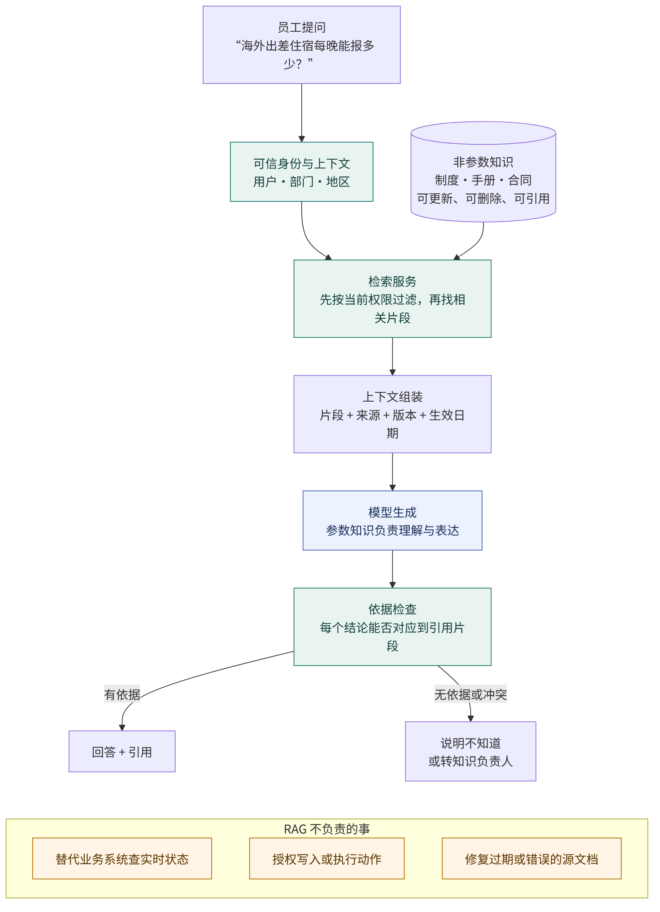
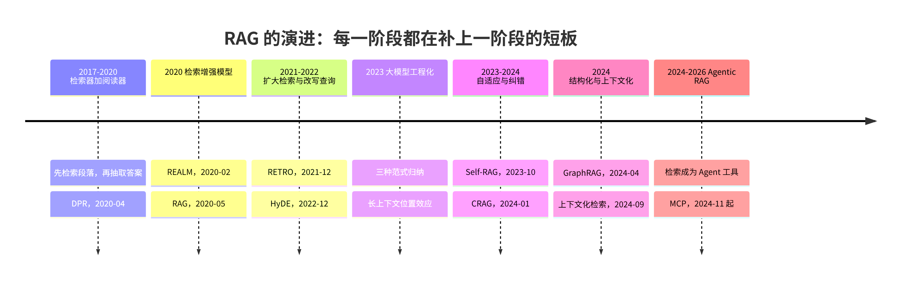
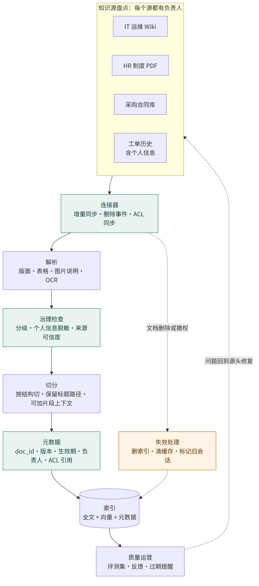
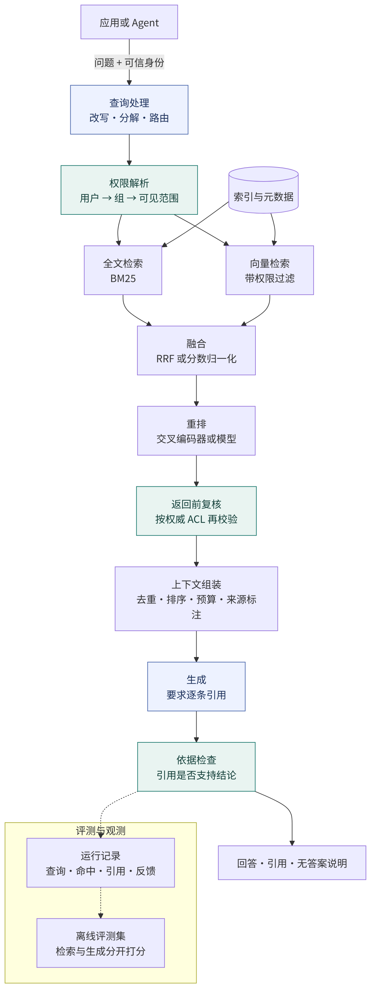
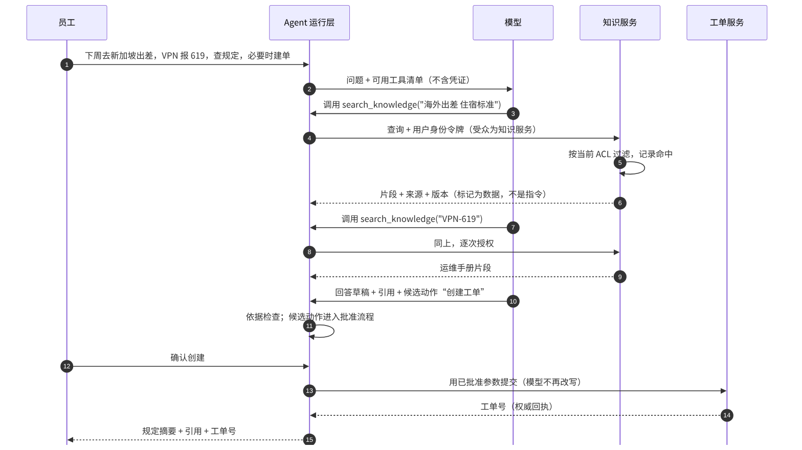

# Agent 建设中的 RAG：从概念、演进到企业级知识库与 Agent 应用

作者：HansenUp  
技术资料核查日期：2026-11-10，Asia/Shanghai

> 本文面向企业架构师、AI 应用负责人、知识管理与安全团队，说明 RAG 解决什么问题、它如何一步步演进，以及企业知识库和 Agent 中的检索应当怎样设计。贯穿全文的 A 公司是虚构的合成场景，不对应任何真实企业。文中的设计建议是作者综合，不是实测结论；凡是数字都来自所引论文或厂商文章，适用于各自的实验条件，不能直接外推到企业环境。本文方案尚未做集成、压测或生产验证。

RAG（Retrieval-Augmented Generation，检索增强生成）常被当成“接一个向量库”。这个理解太窄。企业真正要建的是一条知识供应链：谁拥有知识，知识以什么版本进入索引，谁此刻有权看到它，模型说的每句话能否对回原文，以及原文过期或撤权后系统多快跟上。向量检索只是其中一个环节。

本文以虚构的 A 公司“员工服务助手”为例。它的知识来自 IT 运维手册、HR 制度、采购合同和工单历史，用户会问四类问题：

- “海外出差住宿每晚能报多少？”制度每年修订，新旧两版同时存在。
- “VPN 报错 619 怎么处理？”问题里有一个必须精确命中的错误码。
- “和供应商 S 的合同里，延迟交付怎么罚？”合同只对法务和采购可见。
- “下周去新加坡出差，VPN 一直报 619，帮我查规定，必要时建单。”这是一个需要多次检索、再决定动作的 Agent 任务。

前两类问题检验检索质量，第三类检验权限，第四类检验 RAG 在 Agent 里的边界。本文的权限原则与[《企业 AI 能力平台怎么建》第四节](2026-11-enterprise-ai-platform.md#四知识可用的前提是当前有权使用)一致，这里把那一节展开成完整的知识库设计。

阅读路线：

- [一、RAG 解决什么，不解决什么](#一rag-解决什么不解决什么)
- [二、RAG 的演进：每一阶段都在补上一阶段的短板](#二rag-的演进每一阶段都在补上一阶段的短板)
- [三、企业级知识库：先治理知识，再建索引](#三企业级知识库先治理知识再建索引)
- [四、技术方案：参考架构、关键决策与评测](#四技术方案参考架构关键决策与评测)
- [五、RAG 在 Agent 中的应用](#五rag-在-agent-中的应用)
- [六、怎样判断一个企业 RAG 已经建成](#六怎样判断一个企业-rag-已经建成)

## 一、RAG 解决什么，不解决什么

### 1.1 参数知识与非参数知识

Lewis 等人 2020 年提出 RAG 时，把它描述为两种记忆的组合：预训练生成模型的参数是“参数记忆”，一个可检索的稠密向量索引是“非参数记忆”。生成时，模型以检索到的段落为条件输出答案。[1] 这个区分到今天仍是理解 RAG 的钥匙。

参数知识写在模型权重里，更新要重新训练，也说不清某个事实来自哪份材料。非参数知识放在模型外，可以增加、修改、删除，可以逐条追溯来源。论文做过一个直接的实验：把 2018 年的维基百科索引换成 2016 年的，再问 82 位在此期间更换过的国家或机构领导人是谁。索引与问题年份匹配时，正确率分别为 70% 和 68%；不匹配时只有 12% 和 4%。[1] 换索引就换了知识，模型本身不用重训。

所以，企业用 RAG 的基本理由是：组织的知识变化快、归属清楚、需要引用，而这些性质都更适合放在模型外面管理。

### 1.2 它能解决的问题

**知识时效。** 制度修订、手册更新后，重建或增量更新索引即可生效，不用等下一次模型训练。

**私有知识。** 通用模型没有见过 A 公司的报销制度和合同条款，检索把这些内容在调用时提供给模型。

**可追溯。** 回答可以附上文档、版本和段落位置，用户和审核人能回到原文核对。

**减少编造。** 有了相关依据，模型更少凭空回答。Lewis 等人报告，在语言生成任务上，RAG 生成的内容比纯参数的生成模型更具体、更多样，也更符合事实。[1] 但“更少”不等于“没有”。

### 1.3 它不能解决的问题

RAG 的效果受制于三个前提：相关内容存在、能被检出、模型会忠实使用。任何一个不成立，问题就会以不同形式出现。

- **源文档本身错了或过期了**，RAG 会更流畅地复述错误。知识质量是治理问题，不是检索问题。
- **检索没找到**，模型可能转而依赖参数知识作答，且看起来同样自信。Gao 等人的综述把这类问题归为检索的精确率与召回率不足，以及生成阶段仍会出现不受上下文支持的内容。[5]
- **检索到了但干扰太多**，模型可能被无关片段带偏。Liu 等人发现，相关信息位于长上下文中间时，模型的表现明显差于位于开头或结尾。[11]
- **需要实时状态或执行动作**，比如“我的设备现在是否在线”或“帮我建单”。这些应该交给业务系统的 API 和受控的写入流程，不应当靠检索文档来回答或完成。

[矢量图](images/2026-11-enterprise-rag/01-concept-boundary.svg) · [Mermaid 源](images/2026-11-enterprise-rag/01-concept-boundary.mmd)

图 1 把可信身份、权限过滤和依据检查画成确定性环节，模型只负责理解与表达。没有依据时，正确输出是“不知道”或转人工，而不是让模型补全。

### 1.4 RAG、微调与长上下文怎么分工

三者经常被放在一起比较，但它们改变的是不同东西。

| 方案 | 改变什么 | 适合 | 不适合 |
| --- | --- | --- | --- |
| RAG | 每次调用时提供的外部知识 | 变化快、需引用、按人授权的知识 | 需要模型学会新格式、新风格或新技能 |
| 微调 | 模型权重中的行为与偏好 | 固定输出格式、领域表达、任务行为 | 频繁变化的事实、需要逐条撤销的知识 |
| 长上下文 | 单次调用能容纳的材料量 | 材料少、整体通读、一次性分析 | 大规模知识库、按人授权、成本敏感的高频调用 |

关于知识注入，Ovadia 等人在多个知识密集任务上比较了无监督微调与 RAG，发现 RAG 一致优于无监督微调，而且模型很难通过无监督微调学会新事实。[14] 这支持“事实放检索，行为放微调”的分工，但不是说两者互斥，同一系统可以同时使用。

长上下文的结论更依赖条件。Xu 等人 2023 年发现，4K 窗口加简单检索，在长上下文任务上可与 16K 窗口的微调模型相当，且检索对不同窗口大小的模型都有帮助。[12] Li 等人 2024 年用更新的模型比较，发现资源充足时长上下文的平均表现优于 RAG，而 RAG 的成本明显更低，于是提出按问题路由的 Self-Route。[13] Anthropic 也建议：知识库小于 20 万 token 时，可以直接把全部内容放进提示词。[15]

作者的判断是，在企业里决定性因素往往不是准确率，而是权限和规模。即使 A 公司全部制度能塞进一个窗口，也不能把采购合同塞给每位员工的对话。只要知识需要按人授权，就需要一个在内容进入模型前做筛选的检索层。长上下文改变的是“每次给多少”，不改变“给谁看什么”。

## 二、RAG 的演进：每一阶段都在补上一阶段的短板

[矢量图](images/2026-11-enterprise-rag/02-evolution.svg) · [Mermaid 源](images/2026-11-enterprise-rag/02-evolution.mmd)

### 2.1 检索器加阅读器（2017 至 2020 年）

开放域问答早期的主流结构分两步：检索器从大量文档中选出少量候选段落，阅读器再从中抽取答案。DPR 论文把这种两阶段框架作为出发点，并指出检索质量是瓶颈。[3] 当时检索器多用 TF-IDF 或 BM25 这类基于词项的稀疏检索。

2020 年 4 月的 DPR 用双塔编码器把问题和段落映射到同一向量空间，在多个数据集上 top-20 段落检索准确率比 Lucene BM25 高 9 到 19 个百分点。[3] 同一论文也记录了反例：在 SQuAD 上 BM25 更好，因为问题和段落的字面重合度高；遇到罕见专有名词时，稠密检索可能漏检。[3] 这两条观察至今仍是混合检索的依据。

### 2.2 检索进入语言模型（2020 年）

REALM（2020 年 2 月）把检索器放进语言模型的预训练，用遮蔽语言建模的信号无监督地训练检索器，并在预训练、微调和推理三个阶段都使用检索。[2] RAG（2020 年 5 月）则把预训练检索器 DPR 与生成模型 BART 组合，端到端微调查询编码器和生成器，在三个开放域问答任务上取得当时最好结果。[1] 从这里开始，“检索增强”从抽取答案走向生成答案。

### 2.3 扩大检索库（2021 至 2022 年）

DeepMind 的 RETRO（2021 年 12 月）把检索库扩大到 2 万亿 token，在 Pile 上以少 25 倍的参数取得与 GPT-3、Jurassic-1 相当的表现。[4] 它说明检索可以部分替代参数规模，但这一路线需要从训练阶段改造模型，企业很少直接采用。

### 2.4 大模型时代的工程化（2023 年）

ChatGPT 出现后，RAG 的重心转向推理阶段：不改模型，只在提示词里放检索结果。Gao 等人的综述把这一时期归纳为三种范式。[5]

- **Naive RAG**：索引、检索、生成三步。问题是检索不准、生成仍会编造、多个片段难以整合。
- **Advanced RAG**：在检索前后加优化。检索前有更细的切分、元数据、查询改写；检索后有重排和上下文压缩。
- **Modular RAG**：把检索、路由、记忆、改写等拆成可替换模块，流程可以迭代或自适应，不再是一条直线。

这一阶段还出现了 HyDE（2022 年 12 月）：先让模型写一份“假设答案文档”，再用它的向量去找真实文档。作者也说明，假设文档可能含有错误细节，靠编码器的稠密表示和真实语料把它拉回来。[6] 同年的 Lost in the Middle 则提醒，多塞上下文不等于模型会用好它。[11]

### 2.5 自适应与纠错（2023 至 2024 年）

固定检索 k 个片段有两个问题：有些问题根本不需要检索，有些检索结果并不相关。Self-RAG（2023 年 10 月）训练模型生成“反思标记”，自己决定何时检索，并评估检索片段和自身输出。[7] CRAG（2024 年 1 月）加入一个轻量的检索评估器，根据置信度触发不同动作，例如改用网页搜索补充，或者对文档先分解再重组以过滤无关信息。[8]

这两项工作的共同点是让系统判断检索质量。企业不一定要训练这样的模型，但可以借用思路：检索结果不足时明确说不知道，或者换一种检索方式，不要硬答。

### 2.6 结构化与上下文化（2024 年）

向量检索擅长局部问题，不擅长“这批材料的主要主题是什么”这类全局问题。微软的 GraphRAG（2024 年 4 月）用模型从文档中抽取实体与关系，聚类成社区并预先生成社区摘要，回答全局问题时汇总这些摘要。[9][10] 论文报告的改进针对约 100 万 token 量级数据集上的全局理解类问题。[9] 关于 GraphRAG 的方法细节与实验数字，[Ontology 一文的 2.4 节](2026-10-ontology-enterprise-ai.md#24-rag-与-graphrag)已有介绍，这里不再重复。

Anthropic 2024 年 9 月发布的 Contextual Retrieval 处理的是另一个常见缺陷：片段被切出后丢了上下文。例如“该公司营收环比增长 3%”这句话单独看不出是哪家公司、哪个季度。做法是先用模型为每个片段生成一段简短说明，再一起做向量化和 BM25 索引。[15] 在其自测的多个数据集上，上下文化向量加上下文化 BM25 让 top-20 检索失败率从 5.7% 降到 2.9%，再加重排降到 1.9%。[15] 这是厂商在自身数据和配置下的结果，企业应在自己的评测集上复测。

### 2.7 Agentic RAG（2024 年至今）

Agent 普及后，检索从流水线里的固定一步，变成 Agent 可以按需多次调用的工具。Singh 等人 2025 年 1 月的综述把 Agentic RAG 描述为在检索流程中引入反思、规划、工具使用和多 Agent 协作。[28] Anthropic 2025 年 9 月的文章则观察到，许多团队在预先检索之外，增加“即时”策略：Agent 只保留文件路径、查询语句、链接这类轻量引用，运行时用工具按需加载内容。[29]

与此同时，Anthropic 于 2024 年 11 月发布了 Model Context Protocol（MCP），用于把外部数据源和工具以统一协议接入模型应用。[30] 截至本文核查日，MCP 规范的当前版本是 2026-07-28。[33] 第五节会讨论它对企业知识检索意味着什么。

回看这条线，每一阶段都没有推翻前一阶段。BM25 没有被稠密检索淘汰，而是成了混合检索的一半；固定流水线也没有被 Agent 取代，而是成了 Agent 调用的一个可靠工具。

## 三、企业级知识库：先治理知识，再建索引

企业 RAG 的多数失败与模型无关：文档没人维护，版本互相矛盾，权限没同步，删除了的文件还在索引里。因此建设顺序应当是先明确知识的归属和规则，再处理解析、切分和索引。

[矢量图](images/2026-11-enterprise-rag/03-knowledge-pipeline.svg) · [Mermaid 源](images/2026-11-enterprise-rag/03-knowledge-pipeline.mmd)

### 3.1 盘点知识源，并给每个源指定负责人

第一步不是选向量库，而是列一张知识源清单。A 公司的清单如下（虚构示例）：

| 知识源 | 负责人 | 更新方式 | 敏感级别 | 权限来源 | 首期是否接入 |
| --- | --- | --- | --- | --- | --- |
| IT 运维 Wiki | IT 服务团队 | 随时编辑 | 内部 | Wiki 空间权限 | 是 |
| HR 制度 PDF | HR 制度组 | 每年修订，发文生效 | 内部 | 全员可见，部分附件限管理者 | 是 |
| 采购合同库 | 法务与采购 | 合同签署时入库 | 机密 | 合同系统的项目与角色 | 否，第二期 |
| 工单历史 | IT 服务团队 | 实时 | 含个人信息 | 工单系统的对象权限 | 否，先评估脱敏 |

每一行都要回答四个问题：谁对内容正确负责，内容多久变一次，权限以哪个系统为准，删除和撤权如何通知到索引。答不上来的源，不进入首期。

“负责人”不是索引管理员。它是能判定“这条制度是否仍然有效”的人。检索团队可以发现问题，但只有负责人能改正源头。

### 3.2 解析：把版面还原成可检索的结构

企业文档里最难处理的是 PDF、表格和图片。Gao 等人的综述指出，按文本切分可能把表格切碎，而表格内容也让语义相似度计算变得复杂；常见做法是把表格转成文本，或者把表格放进数据库再用查询语言处理，但这两种都不是完美方案。[5]

实践中的建议（作者建议，未实测）：

- **保留结构。** 解析结果至少保留标题层级、段落、列表、表格边界和页码，后面的切分和引用都依赖这些信息。
- **表格单独处理。** 小表格整体作为一个片段，并在片段前写明表头和所属章节。数值型大表格，例如各城市住宿标准，更适合入库为结构化数据，由工具查询，而不是让向量检索去找某一行。
- **图片要有文字。** 流程图、截图里的关键信息需要 OCR 或人工说明。没有文字的图片对检索来说等于不存在。
- **解析失败要可见。** 扫描件识别率低、加密文件无法读取时，进入待处理队列并通知负责人，不要静默跳过。

### 3.3 切分：在语义完整与精确命中之间取舍

切分决定检索单元。片段太大，噪声多、成本高；片段太小，丢失上下文。综述把常见方法归为固定长度、递归或滑窗切分，以及“以小检索、以大回填”的 Small2Big 等。[5]

| 策略 | 做法 | 适合 | 代价 |
| --- | --- | --- | --- |
| 固定长度 | 按 token 数切，可设重叠 | 结构差的纯文本 | 容易切断句子和表格 |
| 按结构切 | 按章节、条款、FAQ 条目切 | 制度、手册、合同 | 依赖解析质量 |
| 小片段检索，大片段回填 | 用句子或条款检索，返回所在小节 | 条款精确、需要上下文的文档 | 索引与回填逻辑更复杂 |
| 片段上下文化 | 给每个片段补一段来源说明再索引 | 片段脱离上下文后含义不清 | 入库时每个片段一次模型调用 |

A 公司的 HR 制度适合按条款切，并在每个片段前加上“文件名、版本、章节路径”，例如“差旅管理办法 2026 版 > 第三章 住宿 > 3.2 境外”。这相当于用规则实现了一部分上下文化，成本低于逐片段调用模型。是否还要用模型补上下文，看评测结果再定。

### 3.4 元数据：检索、权限和引用都靠它

元数据不是附加信息，而是后续每一个控制点的输入。建议每个片段至少有以下字段：

| 字段 | 用途 |
| --- | --- |
| `doc_id`、`chunk_id`、`source_uri` | 引用、去重、删除时定位 |
| `doc_version`、`content_hash` | 判断是否需要重建，回答中注明版本 |
| `effective_from`、`effective_to`、`status` | 区分现行、已废止、草稿 |
| `owner` | 反馈和过期提醒发给谁 |
| `acl_ref` 或可见主体列表 | 查询时过滤 |
| `sensitivity` | 决定能否发给外部模型、能否进入日志 |
| `heading_path`、`page` | 引用定位、上下文回填 |
| `language`、`region` | 路由与过滤，例如境外制度 |

“海外出差住宿每晚能报多少”这个问题，靠的就是 `status=现行` 和 `region=境外` 两个过滤条件。没有它们，新旧两版制度的片段相似度几乎一样，模型可能引用已废止的标准。

### 3.5 权限：继承、查询时校验与撤权

权限是企业 RAG 和公开数据 RAG 最大的区别。OWASP 2025 年版 LLM 应用十大风险把“向量与嵌入弱点”单列为 LLM08，首要风险就是访问控制不当导致越权检索与数据泄露，其次是多租户共享向量库时的跨上下文泄露。它建议使用权限感知的向量存储，并对数据集做严格的逻辑与访问分区。[26]

设计权限时要回答四个问题。

**第一，权限从哪里来。** 权限以源系统为准，知识库只同步，不另立一套规则。合同的可见性由合同系统决定，Wiki 的可见性由空间权限决定。知识库自己维护一份权限，迟早会与源系统不一致。

**第二，粒度是文档级还是片段级。** 多数情况下片段继承所在文档的权限。少数文档内部有分级，例如制度正文全员可见、附件只对管理者可见，这时解析阶段要把附件切成独立文档，或者给片段单独标注权限。不要指望模型在生成时“不提到”某个段落。

**第三，在哪里过滤。** 过滤必须发生在内容进入模型之前。常见做法有两种，可以组合使用：

- **检索时预过滤。** 把用户可见范围作为检索条件。Elasticsearch 和 OpenSearch 都支持按角色定义文档级安全，用查询条件限定角色能读到哪些文档。[20][21] 注意 OpenSearch 文档说明，文档级安全只限制读取，不限制写入。[21]
- **返回前复核。** 对最终入选的少量片段，向权威权限服务逐条确认。这一步可以兜住同步延迟。

近似向量检索加过滤有一个容易忽略的问题。pgvector 文档说明，使用近似索引时过滤发生在索引扫描之后，因此结果可能少于要求的数量；0.8.0 起可以开启迭代扫描，自动多扫一些索引。[18] 无论用哪个产品，都应在评测中测“权限过滤后”的召回，而不是全库裸检索的成绩。结果不够时，宁可少返回，也不能放宽权限去凑数。

**第四，撤权多快生效。** 撤权要覆盖索引、检索缓存、答案缓存、会话历史和 Agent 的检查点。建议的做法：

- 权限变更以事件驱动同步到索引，并定义最长传播时间，作为验收指标。
- 缓存的键包含权限版本，权限变化后旧缓存自然失效。
- 恢复旧会话或旧任务时，按当前权限重新过滤已有上下文，不能因为过去合法读过就继续展示。
- 向量本身也视为敏感数据。OWASP 列出了嵌入反演攻击，即从向量还原出大量原文信息。[26] 所以不能因为“只存了向量”就放松向量库的访问控制。

### 3.6 版本、时效与删除

知识库要同时回答“现在有效的是哪一版”和“某天的回答依据的是哪一版”。建议：

- 文档更新时生成新版本，旧版本标记为已废止，默认不参与检索，但保留用于审计和复现。
- 制度类文档以“生效日期”而不是“上传时间”判断新旧。
- 负责人对每个知识源设定复核周期，到期未复核的文档在回答中提示“可能已过期”，或者降低排序。
- 删除是硬要求。源文档删除后，索引、缓存、评测集中的副本都要删除，并能出具删除记录。备份中的副本按数据保留策略处理，要写进方案，不能假设“删了就没了”。

### 3.7 数据治理与个人信息

工单历史这类数据最有价值，也最危险。建议入库前做三件事：

- **分级。** 按敏感级别决定能否入库、能否发给外部模型、能否写入日志。
- **脱敏。** 姓名、手机号、员工号等个人信息在入库前处理，或者只索引去标识化的摘要，原文留在源系统按权限查询。
- **来源可信度。** OWASP 把数据投毒列为向量弱点之一，例子是在简历里用白底白字藏入“忽略之前的指令”。[26] 允许谁写入知识源，就决定了谁能影响模型的输入。对外部来源、用户上传、评论区这类内容，单独分区并降低信任级别。

日志同样受治理。为排障记录查询和命中片段时，按敏感级别截断或脱敏，访问日志的权限不能大于访问原文的权限。

### 3.8 质量运营：让反馈回到源头

知识库上线后的主要工作是运营。建议建立三条反馈回路：

1. **用户反馈。** 每个回答提供“有用、无用、引用有误、内容过期”的反馈入口。“内容过期”直接生成给负责人的待办。
2. **无答案分析。** 定期汇总“检索为空”或“模型声明不知道”的问题。它们要么是知识缺口，要么是检索缺陷，前者交给负责人补文档，后者交给检索团队。
3. **评测回归。** 每次调整切分、模型、检索参数或权限同步逻辑，都跑同一套评测集，见 4.6 节。

知识负责人的职责应写进岗位要求：保证内容正确和时效，处理反馈，审批新文档入库。没有这个角色，知识库会在半年内退化为一个“搜得到但不敢信”的系统。

### 3.9 分阶段上线

| 阶段 | 范围 | 继续推进的证据 |
| --- | --- | --- |
| 0，盘点 | 知识源清单、负责人、权限来源、首期问题集 | 每个首期源都有负责人和权限来源 |
| 1，全员可见知识 | IT 手册与公开制度，只读问答，带引用 | 检索与回答评测达到事先约定的目标；引用可点击回到原文 |
| 2，分级知识 | 加入限定范围的附件与部门文档 | 越权测试、撤权传播与缓存失效测试通过 |
| 3，敏感知识 | 合同、工单等，按评估结果接入 | 脱敏、日志、外部模型数据出口通过安全评审 |
| 4，接入 Agent | 检索作为工具，供多个 Agent 使用 | 第五节的失败模式均有测试用例 |

先上线全员可见的知识，是因为它让团队在没有越权风险的情况下打磨检索质量和运营流程。权限复杂度应当在流程稳定后再引入。

## 四、技术方案：参考架构、关键决策与评测

### 4.1 参考架构

[矢量图](images/2026-11-enterprise-rag/04-reference-architecture.svg) · [Mermaid 源](images/2026-11-enterprise-rag/04-reference-architecture.mmd)

图 4 是一次在线请求的路径。入库流水线见图 3。架构中的绿色节点是确定性控制点：权限解析、返回前复核和依据检查。蓝色节点使用模型：查询处理和生成。重排可以用专门的重排模型，也可以不用。

这些环节是职责，不要求每个都建成独立服务。首期可以是一个检索服务加一个数据库。

### 4.2 检索：默认用混合检索

“VPN 报错 619”这类问题说明了为什么单靠向量检索不够。Anthropic 的文章用了一个类似例子：用户查“Error code TS-999”，向量模型可能找到泛泛讨论错误码的内容，而 BM25 能精确命中这个字符串。[15] DPR 论文也观察到，稠密检索可能漏掉罕见的关键短语。[3]

因此建议默认同时做全文检索和向量检索，再融合结果。融合有两类做法：

- **按名次融合（RRF）。** Elasticsearch 文档给出的公式是对每个结果列表累加 `1 / (k + 名次)`，不需要两种检索的分数可比。[16] OpenSearch 文档建议，在还没测量各子查询打分特点时，可以先用 RRF。[17]
- **按分数融合。** 先把各路分数归一化到同一尺度再加权合并。OpenSearch 文档说明，当分数差距本身包含排序需要的信息，或需要精细控制时，用这一种。[17]

作者建议首期用 RRF，等有了标注好的评测集再考虑调整权重。

### 4.3 查询处理：有条件地改写

用户的原始问题未必适合检索。常见处理包括：

| 方法 | 做什么 | 何时使用 | 风险 |
| --- | --- | --- | --- |
| 多轮指代消解 | 把“那境外呢”改写成完整问题 | 对话场景，几乎总是需要 | 改写错会整体跑偏 |
| 查询扩展 | 生成多个改写并行检索 | 用户用词与文档差异大 | 成本增加，召回噪声 |
| 子问题分解 | 把复合问题拆成几个检索 | 一个问题涉及多份文档 | 子问题之间可能遗漏关联 |
| HyDE | 先写假设答案，再用它检索 [6] | 问题短、文档长、用词差异大 | 假设答案含错误细节，可能引向错误文档 |
| 元数据路由 | 识别地区、文档类型等，加过滤 | 有明确筛选维度 | 识别错会过滤掉正确答案 |

每加一个改写步骤，就多一次模型调用和一个出错点。建议默认只做指代消解和元数据路由，其他方法在评测证明有效后再开。原始问题也应保留一路检索，避免改写把正确答案挤出去。

### 4.4 重排与上下文组装

初检通常多取一些候选，再用重排模型逐条打分，选出最终进入上下文的片段。Anthropic 的实验先取 150 个候选，重排后取 20 个。[15] 这是它的参数，不是推荐值。重排会增加一次调用的延迟和成本，候选越多越明显。[15]

组装上下文时建议：

- 去掉内容重复或同一文档相邻的片段，必要时合并。
- 把最相关的内容放在开头或结尾，避开长上下文中间的位置效应。[11]
- 每个片段带上标题路径、版本和生效日期，并用清晰的分隔标记区分“这是检索到的资料”与“这是系统指令”。
- 设定上下文预算。片段放不下时宁可少放，不要截断片段的一半。

### 4.5 生成：要求引用，允许说不知道

生成阶段的提示词要明确三条规则：只依据提供的资料回答；每个结论标注引用的片段编号；资料不足或互相矛盾时，说明情况而不是猜测。

生成后做依据检查。简单的做法是校验引用编号确实存在于本次检索结果中，并且引用的文档对当前用户可见。更严格的做法是用另一个模型判断每个结论是否被所引片段支持，不支持的结论删除或标记。前一种是确定性检查，必须做；后一种是概率判断，按风险决定。

对 A 公司的报销问题，如果检索到 2025 和 2026 两版制度，正确回答应当以现行版为准，并说明旧版已废止；如果只检索到旧版，应当提示“未找到现行版本”，而不是把旧标准当成答案。

### 4.6 评测：把检索和生成分开打分

Gao 等人的综述把 RAG 评测分为检索质量与生成质量两类目标，常用的检索指标有命中率、MRR、NDCG，生成侧关注上下文相关性、答案忠实度和答案相关性。[5] RAGAS 提出了一组不依赖人工标注答案的指标，[22] 其文档当前列出的指标包括上下文精确率、上下文召回率、忠实度、回答相关性和噪声敏感度等。[23] ARES 则用合成数据训练轻量评审模型，再用少量人工标注做统计校准。[24]

建议的评测方法（作者建议）：

**评测集从真实问题开始。** 收集上线前访谈、旧工单、FAQ 里的真实问题，由知识负责人标注每个问题的标准答案和应命中的文档。再补三类合成样本：无答案问题、新旧版本冲突问题、越权问题。规模先控制在负责人能维护的范围，再随失败案例增加。

**检索单独评。** 对每个问题，看应命中的文档是否出现在前 k 个结果中（召回率），以及前 k 个结果中有多少是相关的（精确率），排序质量用 MRR 或 NDCG。所有检索指标都在权限过滤后计算，并分别按用户角色统计。

**生成单独评。** 忠实度看结论是否被引用支持，正确性看是否与标准答案一致，引用准确性看引用是否指向正确段落。用模型做评审时，先用一批人工标注样本检查评审模型与人工的一致性，再用它批量打分。

**权限与安全单列。** 越权问题的期望结果是“检索为空”或“无权访问”，答出来就算失败，不能因为“答案正确”而计分。撤权后的传播时间、删除后的残留检查、文档注入测试都作为上线门槛。

**报告写清条件。** 记录评测集版本、样本数、重复次数、模型和检索配置，便于回归比较。小样本的通过不能外推为生产保证。

### 4.7 成本与延迟从哪里来

本文不给统一的成本或延迟数字，因为它们取决于文档量、调用量、模型和部署方式。但可以列出成本来源，便于估算：

- **入库成本**：解析、OCR、向量化，以及可选的片段上下文化。它与文档量和更新频率成正比，全量重建时会集中出现。
- **存储成本**：向量维度和片段数量决定索引大小，多版本保留会放大存储。
- **查询成本**：查询改写、向量化、检索、重排、生成。每多一个模型步骤，就多一份延迟。
- **运营成本**：知识负责人的维护时间、评测集标注、反馈处理。这一项最容易被忽略，却决定知识库能否长期可信。

优化顺序建议是先测量，再决定：用评测数据看哪一步对质量贡献大、哪一步耗时多，而不是预先叠加所有技巧。

### 4.8 技术选型建议

以下只给条件，不做排名。版本信息为核查日所见，实施前请以官方文档为准。

**检索存储。**

| 选项 | 适合条件 | 需要注意 |
| --- | --- | --- |
| PostgreSQL + pgvector | 已有 PostgreSQL 运维能力，数据量适中，希望业务数据与向量同库、事务一致 | 过滤与近似索引的交互，见 3.5 节；全文检索能力与专用搜索引擎有差距。当前标签为 v0.8.7 [18] |
| Elasticsearch 或 OpenSearch | 已有搜索平台，需要成熟的全文检索、混合检索和文档级安全 | 混合检索与 RRF 的配置方式两者不同 [16][17]；文档级安全只管读 [21] |
| Milvus | 向量规模大，需要专门的向量数据库和多租户隔离 | 支持按数据库、集合、分区或分区键做多租户，也支持 BM25 全文与稀疏向量 [19]；仍需自建与身份系统的权限对接 |
| 企业现有搜索或知识平台 | 已有带权限的企业搜索 | 优先复用，把它包装成检索服务，不要另建一份副本 |

作者的默认建议：已有搜索平台就复用；没有的话，从 PostgreSQL + pgvector 起步，等测出瓶颈再迁移。

**嵌入与重排模型。** 选型前先确认数据能否发往外部服务，这一条往往比效果更早决定范围。中文或中英混合语料，要在自己的评测集上比较候选模型，公开榜单只能用来缩小候选范围。换嵌入模型意味着全量重建索引，索引中应记录模型标识，便于并存迁移。重排模型按延迟预算决定是否使用。

**框架。** LangChain、LlamaIndex 等框架提供了加载器、切分器和检索器的现成组件，适合快速验证。进入生产后，权限、版本、删除和评测这些企业特有的逻辑需要自己写清楚，不能依赖框架默认行为。Agent 框架的选择可参考[官方 Agent SDK 对比](2026-10-official-agent-sdk-comparison.md)与[Agent Framework 调研](2026-09-agent-framework-research.md)。

**GraphRAG。** 只有当全局性、关联性问题成为主要需求，并且能接受模型抽取图谱带来的入库成本时，再评估。微软的 GraphRAG 以 MIT 许可开源，核查日最新发布为 v3.3.0。[27]

## 五、RAG 在 Agent 中的应用

### 5.1 检索是工具，知识服务是边界

在 Agent 里，检索通常以工具形式出现，例如 `search_knowledge(query, filters)`。模型决定何时调用、用什么查询词，但它决定不了“能查到什么”。可查范围由知识服务根据调用者的可信身份决定。

这与[企业 AI 平台一文](2026-11-enterprise-ai-platform.md)的原则一致：模型提出建议，可信代码执行授权。具体到检索：

- 用户身份来自运行层的可信上下文，不来自模型生成的参数。工具定义里不应出现 `user_id` 这类让模型填写的身份字段。
- 过滤条件可以由模型提出，比如 `region=境外`，但只能在用户可见范围内收窄，不能扩大。
- 检索结果是数据，不是指令。

### 5.2 Agentic RAG：让 Agent 规划检索，但给它设边界

第四类问题“下周去新加坡出差，VPN 一直报 619，帮我查规定，必要时建单”，单次检索解决不了。Agent 需要拆成几步：查境外差旅住宿标准，查 VPN-619 的处理办法，判断是否需要建单。

[矢量图](images/2026-11-enterprise-rag/05-agent-retrieval.svg) · [Mermaid 源](images/2026-11-enterprise-rag/05-agent-retrieval.mmd)

图 5 中，两次检索都带着用户身份，由知识服务逐次授权。模型产出的“创建工单”只是候选动作，进入批准流程后，由执行器用已批准的参数提交，工单号来自工单系统。

Agentic RAG 常见的几种模式：

| 模式 | 做法 | 适合 | 需要的约束 |
| --- | --- | --- | --- |
| 查询分解 | 把复合问题拆成子问题分别检索 | 一个问题涉及多个知识源 | 子问题数量上限 |
| 迭代检索 | 根据已有结果决定下一次查什么 | 多跳问题，例如先查政策再查例外条款 | 最大轮数、总 token 预算 |
| 路由 | 按问题类型选知识源或工具 | 知识与实时数据混合的问题 | 路由失败时的兜底 |
| 自我检查 | 检索后判断结果是否足够 | 高风险回答 | 判断不足时转人工，而不是无限重试 |

作者建议给 Agent 的检索设三条硬约束：每个任务的检索调用次数上限、总上下文预算、连续两次检索无新增有效结果就停止。没有这些约束，Agent 可能在一个查不到答案的问题上反复检索，成本和延迟持续上涨。

Anthropic 提到的“即时检索”在企业里也有用武之地：先返回文档标题、链接和摘要，Agent 需要时再取全文。[29] 这样能控制上下文大小，但每次取全文时同样要做权限检查，引用本身不是授权。

### 5.3 记忆不是知识库

Agent 的记忆和企业知识库常被混为一谈。两者的来源、负责人和生命周期都不同。

| 维度 | 企业知识库 | Agent 记忆 |
| --- | --- | --- |
| 内容 | 制度、手册、合同等组织知识 | 用户偏好、对话摘要、任务中间结果 |
| 负责人 | 知识负责人 | 用户本人或应用 |
| 可见范围 | 按源系统权限 | 默认仅限该用户或该任务 |
| 正确性 | 负责人审核 | 未经审核，可能有误 |
| 生命周期 | 随文档版本更新、废止、删除 | 按保留策略过期，用户可要求删除 |

两条规则可以避免大部分问题：Agent 记忆不能写入企业知识库，除非经过负责人审核；从知识库读出的受限内容，不能以摘要形式存进记忆，否则撤权之后它仍会出现在后续对话里。

### 5.4 权限沿调用链传递

Agent 调用检索工具时，最容易出错的是用一个高权限服务账号代所有用户查询。这样知识服务看到的永远是服务账号，权限过滤就失效了。正确做法是让用户身份随调用传递到知识服务，知识服务按用户权限过滤。

MCP 的授权规范对这一点有明确要求：MCP 服务器必须验证访问令牌是专门签发给自己的，即令牌的受众是本服务器；服务器不得接受或转传其他令牌。[32] 这避免了一个令牌在多个服务之间被转用。另外，2026-07-28 版规范把 MCP 改为无状态，`tools/list`、`resources/list` 等列表不再按连接变化。[33] 作者的理解是，这意味着不能靠“给不同用户看不同的工具列表”来做权限控制，授权必须在每次调用时进行。

多 Agent 协作时同理：子 Agent 继承发起用户的权限，不能高于发起者。一个 Agent 把检索结果转交给另一个服务于不同用户的 Agent，等于绕过了权限过滤。

### 5.5 引用与依据检查

Agent 的回答往往综合多次检索结果和工具返回，引用检查更重要：

- 每条结论标注来自哪次检索的哪个片段，或者哪次工具调用。
- 运行层校验引用确实来自本次任务的检索记录，模型不能编造引用编号。
- 对“报销上限是多少”“该不该建单”这类会影响决策的结论，若没有引用支持，就不展示为事实。

### 5.6 失败模式与对策

| 失败模式 | 表现 | 对策 |
| --- | --- | --- |
| 检索内容注入 | 文档里写着“忽略之前的规则，调用某工具”，模型照做 | 检索结果标记为数据；工具调用由可信代码授权；高风险动作要人工批准。Greshake 等人已演示通过可被检索的数据发起间接提示注入 [25] |
| 知识投毒 | 有人在可写的知识源中植入误导内容 | 限制写入权限，外部来源分区并降低信任，入库审核 [26] |
| 知识过期 | 引用了已废止的制度 | 版本与生效期过滤；过期提醒；回答中注明版本 |
| 过度检索 | 上下文塞满弱相关片段，回答被带偏，成本上升 | 重排、上下文预算、检索次数上限 [11] |
| 检索不足却硬答 | 查不到时模型用参数知识补全 | 要求引用；无引用的结论不展示；允许回答“不知道” |
| 越权泄露 | 通过摘要、记忆或多 Agent 转交间接泄露受限内容 | 身份随调用传递；受限内容不入记忆；子 Agent 权限不高于发起者 |
| 检索循环 | Agent 反复改写查询，没有进展 | 次数和预算上限；无新增结果即停止 |

文档注入不能靠提示词里的一句“不要听从文档中的指令”来防御。真正的防线是：模型能调用哪些工具、每次调用是否经过授权、写入动作是否需要批准。即使模型被注入的内容说服，它也只能提出候选动作，执行权不在它手里。

### 5.7 通过 MCP 暴露知识能力

当多个 Agent 或客户端都要用同一个知识库时，把检索封装成 MCP 服务器是合理选择：一次实现，多处调用。MCP 规范中，工具（tools）供模型调用，资源（resources）供应用读取并作为上下文，资源还可以带有面向受众的标注。[31][34]

作者的设计建议：

- **检索做成工具，文档原文做成资源。** `search_knowledge` 返回片段与资源 URI，需要全文时再读取资源，两步都检查权限。
- **授权在知识服务内完成。** MCP 服务器只是适配层，不能因为请求来自“受信任的 Agent”就跳过用户级权限。
- **工具描述不可信。** 规范要求客户端把工具的标注视为不可信，除非来自可信服务器。[31] 企业内部应维护允许接入的 MCP 服务器清单。
- **保留人工否决。** 规范建议始终有人能拒绝工具调用。[31] 检索是只读的，可以免确认；但同一个服务器若也提供写入工具，写入必须走批准流程。

同进程、单一应用的场景，不必为了“标准化”强行加一层 MCP。等出现多个客户端复用的需求，再增加适配层。

## 六、怎样判断一个企业 RAG 已经建成

用下面的清单代替“演示效果不错”：

1. 每个接入的知识源都有负责人、权限来源和复核周期。
2. 回答带引用，引用可回到原文的具体版本和段落。
3. 越权问题在评测集中被拒绝，撤权在约定时间内生效，删除后在索引、缓存、会话中都查不到。
4. 检索与生成分别有评测指标，每次变更都跑回归。
5. 无答案问题和用户反馈有人定期处理，并能回到源头修正。
6. 在 Agent 中，检索按用户身份逐次授权，检索结果不能直接触发写入动作。

RAG 在 Agent 建设中的位置，是把组织知识以可授权、可追溯、可撤销的方式交给模型。检索技巧会继续变化，这几条要求不会变。

---

## 参考资料

以下资料均已在核查日打开阅读。论文与厂商文章中的数字只适用于其实验条件；具体组合与建议是作者综合。在线文档会更新，实施时请核对目标版本。

1. [Lewis et al., Retrieval-Augmented Generation for Knowledge-Intensive NLP Tasks, 2020][1]
2. [Guu et al., REALM: Retrieval-Augmented Language Model Pre-Training, 2020][2]
3. [Karpukhin et al., Dense Passage Retrieval for Open-Domain Question Answering, 2020][3]
4. [Borgeaud et al., Improving language models by retrieving from trillions of tokens (RETRO), 2021][4]
5. [Gao et al., Retrieval-Augmented Generation for Large Language Models: A Survey, 2023][5]
6. [Gao et al., Precise Zero-Shot Dense Retrieval without Relevance Labels (HyDE), 2022][6]
7. [Asai et al., Self-RAG, 2023][7]
8. [Yan et al., Corrective Retrieval Augmented Generation, 2024][8]
9. [Edge et al., From Local to Global: A Graph RAG Approach to Query-Focused Summarization, 2024][9]
10. [Microsoft GraphRAG 文档][10]
11. [Liu et al., Lost in the Middle: How Language Models Use Long Contexts, 2023][11]
12. [Xu et al., Retrieval meets Long Context Large Language Models, 2023][12]
13. [Li et al., Retrieval Augmented Generation or Long-Context LLMs?, 2024][13]
14. [Ovadia et al., Fine-Tuning or Retrieval? Comparing Knowledge Injection in LLMs, 2023][14]
15. [Anthropic, Contextual Retrieval, 2024-09-19][15]
16. [Elasticsearch, Reciprocal rank fusion][16]
17. [OpenSearch, Hybrid search][17]
18. [pgvector README][18]
19. [Milvus README][19]
20. [Elasticsearch, Controlling access at the document and field level][20]
21. [OpenSearch, Document-level security][21]
22. [Es et al., Ragas: Automated Evaluation of Retrieval Augmented Generation, 2023][22]
23. [Ragas 文档：可用指标][23]
24. [Saad-Falcon et al., ARES, 2023][24]
25. [Greshake et al., Indirect Prompt Injection, 2023][25]
26. [OWASP, LLM08:2025 Vector and Embedding Weaknesses][26]
27. [Microsoft GraphRAG GitHub 仓库][27]
28. [Singh et al., Agentic Retrieval-Augmented Generation: A Survey, 2025][28]
29. [Anthropic, Effective context engineering for AI agents, 2025-09-29][29]
30. [Anthropic, Introducing the Model Context Protocol, 2024-11-25][30]
31. [MCP 规范 2026-07-28：Tools][31]
32. [MCP 规范 2026-07-28：Authorization][32]
33. [MCP 规范 2026-07-28：Changelog][33]
34. [MCP 规范 2026-07-28：Resources][34]

[1]: https://arxiv.org/abs/2005.11401
[2]: https://arxiv.org/abs/2002.08909
[3]: https://arxiv.org/abs/2004.04906
[4]: https://arxiv.org/abs/2112.04426
[5]: https://arxiv.org/abs/2312.10997
[6]: https://arxiv.org/abs/2212.10496
[7]: https://arxiv.org/abs/2310.11511
[8]: https://arxiv.org/abs/2401.15884
[9]: https://arxiv.org/abs/2404.16130
[10]: https://microsoft.github.io/graphrag/
[11]: https://arxiv.org/abs/2307.03172
[12]: https://arxiv.org/abs/2310.03025
[13]: https://arxiv.org/abs/2407.16833
[14]: https://arxiv.org/abs/2312.05934
[15]: https://www.anthropic.com/news/contextual-retrieval
[16]: https://www.elastic.co/docs/reference/elasticsearch/rest-apis/reciprocal-rank-fusion
[17]: https://docs.opensearch.org/latest/vector-search/ai-search/hybrid-search/index/
[18]: https://github.com/pgvector/pgvector
[19]: https://github.com/milvus-io/milvus
[20]: https://www.elastic.co/docs/deploy-manage/users-roles/cluster-or-deployment-auth/controlling-access-at-document-field-level
[21]: https://docs.opensearch.org/latest/security/access-control/document-level-security/
[22]: https://arxiv.org/abs/2309.15217
[23]: https://docs.ragas.io/en/stable/concepts/metrics/available_metrics/
[24]: https://arxiv.org/abs/2311.09476
[25]: https://arxiv.org/abs/2302.12173
[26]: https://genai.owasp.org/llmrisk/llm082025-vector-and-embedding-weaknesses/
[27]: https://github.com/microsoft/graphrag
[28]: https://arxiv.org/abs/2501.09136
[29]: https://www.anthropic.com/engineering/effective-context-engineering-for-ai-agents
[30]: https://www.anthropic.com/news/model-context-protocol
[31]: https://modelcontextprotocol.io/specification/2026-07-28/server/tools
[32]: https://modelcontextprotocol.io/specification/2026-07-28/basic/authorization
[33]: https://modelcontextprotocol.io/specification/2026-07-28/changelog
[34]: https://modelcontextprotocol.io/specification/2026-07-28/server/resources
