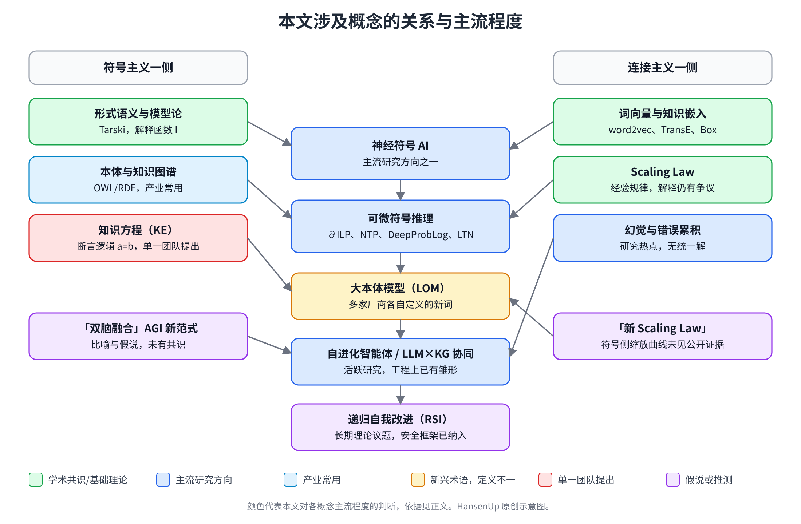
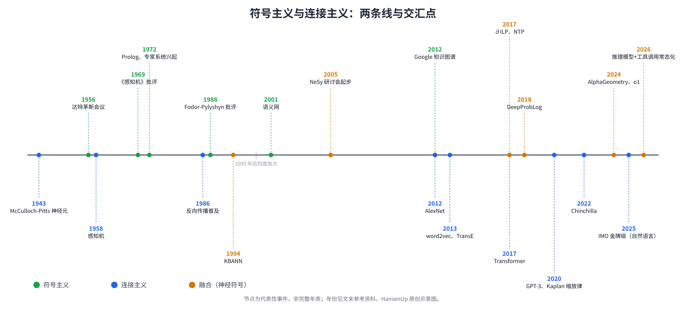
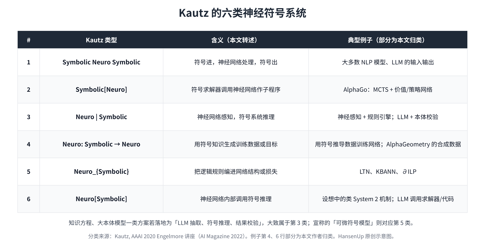
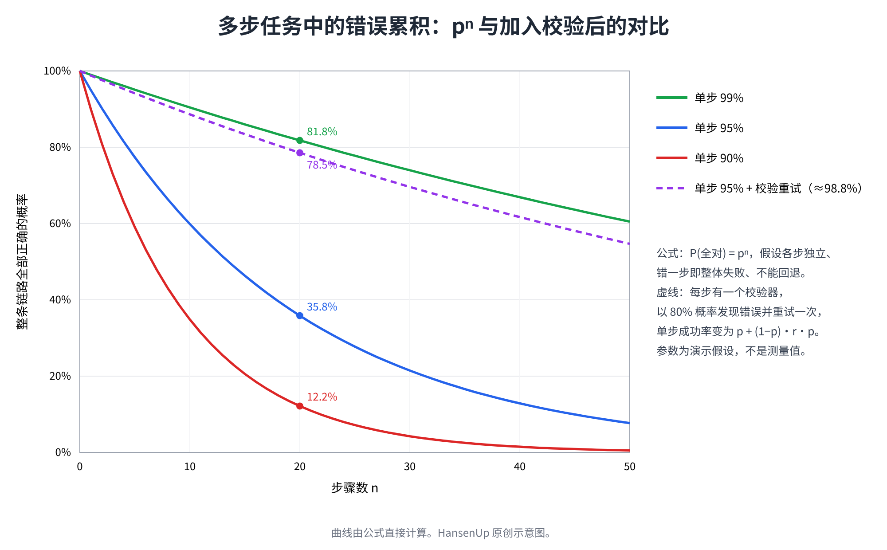
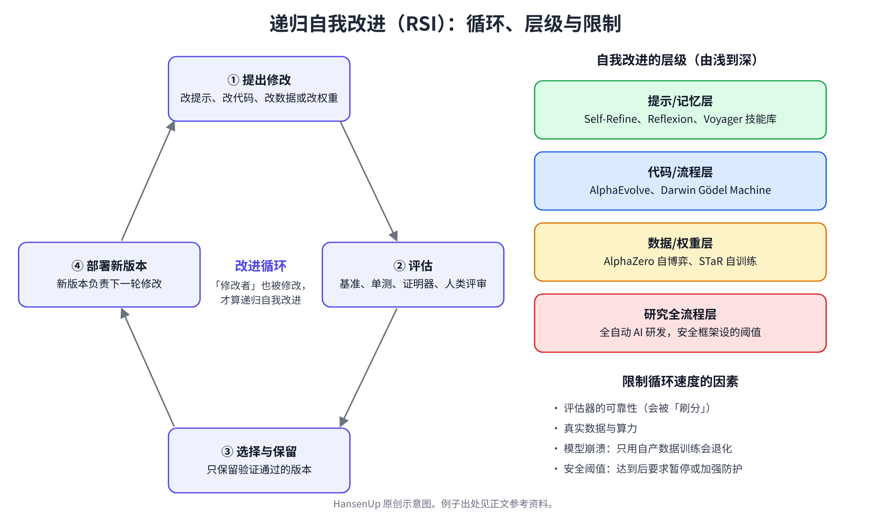

# 「符号 + 连接」双脑融合是主流吗：神经符号 AI、知识方程、Scaling Law 与 RSI 概念核查

作者：HansenUp  
技术资料核查日期：2026-11-17，Asia/Shanghai

> 最近在一些介绍「知识方程」「大本体模型」路线的材料里，看到一组很密集的概念：可微符号模型、大本体模型（LOM）、可靠性 ≈ 知识覆盖率 × 知识准确度、步骤耦合损失、新 Scaling Law、自进化智能体、LOM 与 LLM 协同进化、符号与连接「双脑融合」的 AGI 新范式。本文逐个回答三个问题：这个概念在学界和业界算不算主流；它从哪里来、怎么发展到今天；材料里的说法哪些有公开证据，哪些还没有。最后补上一个相关但常被混用的概念：递归自我改进（Recursive Self-Improvement，RSI）。
>
> 判断口径如下。「学术共识」指教科书级、有大量独立复现的内容；「主流研究方向」指有专门会议、期刊或多家顶级机构持续投入；「产业常用」指已有成熟产品和标准；「新兴术语」指 2025 年以后才出现、不同机构定义不一的叫法；「单一团队提出」指目前主要由一个团队发表和推广；「假说或推测」指尚无可检验证据的判断。本文区分「未经核实」和「错误」：没找到公开证据，不等于说法是错的。所有数字都来自文末所列来源，各自适用于原文的实验条件。本文是案头调研，没有复现任何实验。

阅读路线：

- [一、先给结论](#一先给结论)
- [二、背景：符号主义与连接主义的八十年](#二背景符号主义与连接主义的八十年)
- [三、神经符号 AI](#三神经符号-ai)
- [四、可微符号模型与可微推理](#四可微符号模型与可微推理)
- [五、本体、知识图谱与形式语义](#五本体知识图谱与形式语义)
- [六、知识方程](#六知识方程)
- [七、大本体模型（LOM）](#七大本体模型lom)
- [八、知识嵌入：从词向量到盒嵌入](#八知识嵌入从词向量到盒嵌入)
- [九、Scaling Law 及其解释](#九scaling-law-及其解释)
- [十、可靠性、错误累积与幻觉](#十可靠性错误累积与幻觉)
- [十一、自进化智能体与 LLM、知识图谱的协同进化](#十一自进化智能体与-llm知识图谱的协同进化)
- [十二、递归自我改进（RSI）](#十二递归自我改进rsi)
- [十三、AGI 路线之争与未来几年的看点](#十三agi-路线之争与未来几年的看点)
- [十四、读这类材料时可以问的问题](#十四读这类材料时可以问的问题)

## 一、先给结论

| 概念 | 主流程度 | 一句话说明 |
|---|---|---|
| 符号主义 / 连接主义 | 学术共识 | AI 史上两大流派的标准叫法，教科书内容。 |
| 神经符号 AI（Neuro-symbolic AI） | 主流研究方向 | 有专门会议（NeSy）和期刊，DeepMind 的 AlphaGeometry 等系统属于此类；但「它是通向 AGI 的必经之路」仍是少数派观点。 |
| 可微符号推理（∂ILP、NTP、DeepProbLog、LTN 等） | 主流研究方向，偏学术 | 2017 年后发展起来的一个子方向，规模化和工业落地仍是难点。 |
| 可微编程（Differentiable programming） | 学术共识 / 产业常用 | 深度学习框架的底层能力，本身不等于「符号可微」。 |
| 本体（Ontology）与知识图谱 | 产业常用 | 有 W3C 标准和大量产品；准确率和覆盖率都远不到 100%。 |
| 形式语义 / 模型论语义（解释函数 I） | 学术共识 | Tarski 以来的逻辑学基础，「a=b 当且仅当 I(a)=I(b)」是标准写法。 |
| 知识方程（Knowledge Equations, KE） | 单一团队提出 | 中国科大知识计算实验室基于「断言逻辑」提出，有论文和应用；公开论文中的 KE 是规则化符号表示，未见「可微」版本的公开论文。 |
| 大本体模型（Large Ontology Model, LOM） | 新兴术语，定义不一 | 用友 AI Lab 2026 年发表了同名论文，其他厂商也在用这个词；基于知识方程的 LOM 未见公开论文。 |
| 词向量 / 知识图谱嵌入（word2vec、TransE、盒嵌入） | 学术共识 | 2013 年起的成熟方法；词向量类比「king − man + woman ≈ queen」的效果有被夸大的成分。 |
| Scaling Law（缩放定律） | 学术共识（作为经验规律） | 损失随参数、数据、算力呈幂律下降已被反复验证；为什么是幂律，仍有多种解释。 |
| 齐普夫定律、数据流形维度对 Scaling Law 的解释 | 主流研究方向 | 有 Sharma & Kaplan、Michaud 等论文支持，但都是理论模型，未成定论。 |
| 「步骤耦合」解释 Scaling Law | 未见公开论文 | 不是文献里的常见解释，需要提出方给出推导。 |
| 可靠性 ≈ 覆盖率 × 准确度；多步错误累积 | 常识性模型 | 分解思路合理，但依赖独立性假设；对比表中的具体数字未见出处。 |
| 幻觉（Hallucination） | 学术共识（现象），研究热点（成因与对策） | 普遍承认存在；能否根除有争议。 |
| 自进化智能体（Self-evolving agents） | 主流研究方向 | 2023 年后的热点，已有综述；多数工作改的是提示、记忆、代码，不是模型权重。 |
| LLM 与知识图谱协同（KG 增强 LLM、LLM 构建 KG、GraphRAG） | 主流研究方向 / 产业常用 | 有路线图综述和成熟工具；「协同进化」作为长期闭环仍在探索。 |
| 「双脑融合」AGI 新范式 | 比喻与假说 | 对应 Kahneman 的系统 1/系统 2 和神经符号 AI；「左脑逻辑、右脑直觉」本身是被神经科学质疑的通俗说法。 |
| 「新 Scaling Law」（符号模型的缩放曲线） | 未经核实 | 未找到公开数据或论文。 |
| 递归自我改进（RSI） | 长期理论议题，正在变成工程与治理议题 | 1965 年就被提出；2025 年起三家头部实验室的安全框架都把「AI 自动化 AI 研发」列为阈值。 |

[矢量图](images/2026-11-neurosymbolic-scaling-rsi/01-concept-map.svg)

简单说：材料用到的底层概念大多是主流的，比如神经符号、可微推理、本体、嵌入、Scaling Law、自进化智能体。把这些概念组合起来的具体主张，比如可微的知识方程、基于知识方程的大本体模型、符号侧的新 Scaling Law、对比表中的百分比，目前还找不到公开论文或可复现的数据。它们属于「未经核实」，不能直接判为「错误」。

## 二、背景：符号主义与连接主义的八十年

### 2.1 两个流派

符号主义认为智能就是对符号的操作：知识写成逻辑公式或规则，推理就是按规则推导。代表成果有 1956 年达特茅斯会议后的通用问题求解器、Prolog 语言和 1970—1980 年代的专家系统。

连接主义认为智能来自大量简单单元的连接：知识存在连接权重里，靠数据学习得到。代表成果有 1943 年 McCulloch 和 Pitts 的神经元模型、1958 年 Rosenblatt 的感知机、1986 年后普及的反向传播，以及 2012 年后的深度学习和今天的大语言模型。

两派的消长有几个关键节点：

- 1969 年 Minsky 和 Papert 出版《感知机》，指出单层感知机的局限，神经网络研究进入低谷。
- 1980 年代专家系统商业化，又因为「知识获取瓶颈」（规则要专家一条条写）和维护成本陷入停滞。
- 1988 年 Fodor 和 Pylyshyn 在《Cognition》上发文，批评连接主义缺乏系统性和组合性。[F1] 这个批评今天仍被神经符号阵营引用。
- 2012 年 AlexNet 之后，连接主义成为绝对主流；2020 年 GPT-3 和 Kaplan 缩放律之后，「扩大规模」成为主导路线。

[矢量图](images/2026-11-neurosymbolic-scaling-rsi/02-timeline.svg)

### 2.2 「双脑」比喻从哪里来

材料把大语言模型比作「右脑」、把可微符号模型比作「左脑」。这个比喻有三层来源：

1. **Kahneman 的系统 1 与系统 2。** 《思考，快与慢》（2011）把人的思维分成快速直觉的系统 1 和缓慢审慎的系统 2。[K1]
2. **Bengio 的「从系统 1 深度学习到系统 2 深度学习」。** 2019 年 NeurIPS 主题演讲中，Bengio 主张深度学习要从感知类任务走向推理、规划、因果和系统性泛化。[B1] 这是把系统 1/2 引入 AI 讨论影响最大的一次。
3. **中国科大周熠教授的公开演讲。** 2023 年他在墨子沙龙和新华网撰文中，把大模型对应快系统，把专家系统和知识推理对应慢系统，主张两者结合。[Z2][Z3]

需要提醒的是，「左脑管逻辑、右脑管直觉」是通俗心理学说法。2013 年 Nielsen 等人分析了 1011 人的静息态功能连接，没有发现人群中存在「左脑型」或「右脑型」个体。[N1] 所以「双脑」只能当比喻用，不能当神经科学依据。

## 三、神经符号 AI

### 3.1 概念

神经符号 AI 指把神经网络的学习能力和符号系统的推理、可解释能力结合起来的方法总称。Garcez 和 Lamb 2020 年的文章把它称为 AI 的「第三波」：第一波是符号 AI，第二波是深度学习，第三波是两者的融合。[G1]

### 3.2 由来

融合的尝试几乎和两派对立一样久。1990 年代的 KBANN（Towell & Shavlik，1994）把命题规则翻译成神经网络的初始结构，再用数据微调。[T1] 2005 年起，「神经符号学习与推理」（NeSy）研讨会每年举办，后来发展为 NeSy 会议系列；2023 年 IOS Press 创办了《Neurosymbolic Artificial Intelligence》期刊。[S1]

### 3.3 Kautz 的六类划分

2020 年 Henry Kautz 在 AAAI 的 Engelmore 纪念讲座中提出了一个被广泛引用的分类（文字版发表于 2022 年《AI Magazine》）。[K2]

[矢量图](images/2026-11-neurosymbolic-scaling-rsi/03-kautz-taxonomy.svg)

用这个分类看今天的系统：

- AlphaGo 是第 2 类，蒙特卡洛树搜索里调用神经网络估值。
- 「LLM 把自然语言翻成形式语言，再交给求解器或证明器」属于第 3 类。知识方程的 KELPS 框架就是这样做的，详见第六节。
- AlphaGeometry 用符号推导引擎生成了 1 亿条合成定理和证明来训练语言模型，推理时由语言模型提出辅助构造，符号引擎做推导。[D1] 它同时有第 3 类和第 4 类的特征。
- 材料中「可微符号模型」的设想，对应第 5 类：把符号结构直接编进可训练的网络。

### 3.4 发展到 2026 年的状态

神经符号方法在数学和形式验证领域取得了最醒目的成果。AlphaGeometry 在 2024 年《Nature》论文中解出 30 道奥赛几何题里的 25 道；[D1] AlphaGeometry2 把 2000—2024 年 IMO 几何题的解题率从 54% 提到 84%。[D2]

另一面的证据同样重要。2025 年 7 月，Google DeepMind 的 Gemini Deep Think 在 IMO 上以 35/42 分达到金牌线，官方说明它在比赛时限内端到端用自然语言完成解题和证明。[D3] 这说明纯神经网络路线在数学推理上也在快速前进，神经符号并不是唯一可行的路线。

工程上，今天的大模型应用大多已经是「事实上的神经符号系统」：模型调用代码解释器、SQL、规则引擎、Lean 证明器或本体校验器，由确定性程序给出结果。区别只在于符号部分是外挂工具，还是和网络联合训练。

### 3.5 未来

可以预期的趋势有三个：第一，「LLM + 形式化验证器」在数学、代码、合规等可验证领域继续扩大；第二，神经符号作为提高可靠性和可审计性的工程手段，在企业场景里普及；第三，「是否必须把符号结构内化进模型」这个问题会继续争论，2020 年 Marcus 主张的混合路线[M1]和以规模为主的路线都还拿不出决定性证据。

### 3.6 对材料说法的评估

「符号与连接融合」本身是有学术基础的主流方向。「双脑融合是 AGI 新范式」则是一个判断，不是共识。业内对 AGI 路线没有统一结论，不宜把任何一家的路线写成「范式」已经确立。

## 四、可微符号模型与可微推理

### 4.1 概念

可微编程指程序中的每一步都能求导，从而可以用梯度下降优化整个程序。深度学习框架（PyTorch、JAX）就是可微编程的工具。可微符号推理更进一步：把逻辑规则、证明过程或程序结构变成连续可微的形式，让符号推理和神经网络一起端到端训练。

符号系统天然不可微：一条规则要么成立要么不成立，一个证明要么存在要么不存在。可微化的办法通常是「松弛」：把真/假换成 0 到 1 之间的真值，把离散选择换成概率或注意力权重。

### 4.2 代表工作

| 工作 | 年份 | 做法 |
|---|---|---|
| Neural Turing Machine（Graves 等）[A1] | 2014 | 给神经网络加可微的外部存储，读写用注意力。 |
| Neural Theorem Prover（Rocktäschel & Riedel）[A2] | 2017 | 把 Prolog 式反向链推理做成可微计算，符号匹配换成向量相似度。 |
| ∂ILP（Evans & Grefenstette）[A3] | 2017 | 可微的归纳逻辑编程，从带噪声的数据里学出规则。 |
| DeepProbLog（Manhaeve 等）[A4] | 2018 | 在概率逻辑程序 ProbLog 中加入「神经谓词」，神经网络输出概率，逻辑部分做推理，整体可训练。 |
| Logic Tensor Networks（Badreddine 等）[A5] | 2020 预印本，2022 年刊于 AIJ | 用模糊逻辑把一阶逻辑公式变成可微的损失函数。 |

### 4.3 现状与难点

这一方向的论文持续增长，但有三个公认难点：

- **规模。** 可微证明要在所有可能的规则和替换上做软组合，计算量随规则数和推理深度迅速增长，NTP 和 ∂ILP 的原始版本都只能处理小规模问题。
- **松弛带来的语义变化。** 0.7 真的「真」不再是经典逻辑里的真，推理结论的可靠性需要重新论证。
- **和大模型的关系。** 大模型出现后，很多研究转向「LLM 生成符号程序，外部求解器执行」，绕开了可微化本身。

### 4.4 对材料说法的评估

材料认为「可微符号模型才是 AGI 需要的左脑」，并把「可微」列为知识方程相对于知识图谱的优势。两点值得注意：

1. 可微推理是真实存在的研究方向，这一点没有问题。
2. 本文找到的知识方程公开论文（断言逻辑 2017、KERE 2024、KELPS 2025）里，知识方程都是规则化的符号表示：KERE 是类似产生式系统的推理引擎，用改进的 Rete 算法做模式匹配；KELPS 用人工设计的规则把知识方程翻译成 Lean、Coq、Isabelle。[Z4][Z5] 这些论文都没有描述可微的知识方程。可微版本可能是尚未公开的工作，目前只能标为「未经核实」。

## 五、本体、知识图谱与形式语义

本体的概念、演进和企业落地，在本仓库的[《从「存在之学」到「可执行本体」》](2026-10-ontology-enterprise-ai.md)里已经展开，这里只补充和本文判断有关的两点：形式语义，以及知识图谱的真实质量。

### 5.1 形式语义：I(a) = I(b) 是什么意思

材料中的「语法/语义建模」一页写着：个体、概念、算子对应集合论里的元素、集合、函数；a=b 的语义是 I(a)=I(b)。这是标准的模型论语义。

1930 年代，Tarski 给出了形式语言中「真」的定义：一个句子是否为真，要放在一个「模型」（结构）里看。模型由一个论域和一个解释函数 I 组成，I 把常量符号映射到论域里的对象，把谓词映射到关系，把函数符号映射到函数。[T2] 在这个框架下，等式 a=b 为真，当且仅当 a 和 b 在该解释下指向同一个对象，也就是 I(a)=I(b)。

所以这一页的内容属于学术共识，是逻辑学教科书的写法。断言逻辑的特点在于把所有知识统一写成 a=b 这一种形式，而不是发明了新的语义理论。

### 5.2 知识图谱的覆盖率和准确率

材料的对比表把知识图谱写成「覆盖率约 80%、准确度约 100%、耦合损失约 100%（即不损失）」。公开数据不支持「准确度约 100%」：

- **准确率。** YAGO2 是学术界质量最高的知识库之一，它的人工评估抽查了 5,864 条事实，加权后准确率约 95.4%（±3.69%）。[Y1] 自动抽取构建的图谱通常更低。
- **覆盖率。** Google 的 Knowledge Vault 论文指出，截至 2013 年 10 月，Freebase 中 71% 的人物没有出生地信息。[V1] 覆盖率高度依赖领域和属性，一个笼统的「80%」没有意义。

可以成立的说法是：在一个人工审定、封闭范围内的小型知识库里，给定前提正确，符号推理的推导步骤不会引入新错误。这是「推理的可靠性」（soundness），不是「知识的准确度」。两者混在一起，是这张对比表最需要澄清的地方。

## 六、知识方程

### 6.1 公开资料里能确认的内容

- **理论基础：断言逻辑。** 周熠 2017 年在 AGI 会议上发表《From First-Order Logic to Assertional Logic》。论文认为一阶逻辑用于知识表示有若干问题，提出把所有语法对象归为集合论构造（个体、概念、算子），把所有知识写成等式断言。[Z1]
- **「知识方程」的提出。** 2023 年 8 月，周熠在新华网撰文介绍：知识方程在建模层面把领域对象统一抽象为个体、概念、算子三类语法元素，在知识层面把所有知识统一表示为「a=b」形式的知识等式；在此基础上建立新型专家系统，并与深度学习结合。[Z2]
- **推理引擎 KERE（2024）。** 论文提出基于断言逻辑和知识方程的推理引擎，采用类似产生式系统的「知识—动作」对和改进的 Rete-KE 匹配算法，在 Conic10K 圆锥曲线数据集上与纯数据驱动方法对比。[Z4]
- **KELPS（2025）。** 用 LLM 把自然语言数学题翻译成知识方程，再用人工设计的规则翻译到 Lean、Coq、Isabelle，合成了 6 万多道题的平行语料，在 MiniF2F 上语法正确率（pass@1）为 88.9%。论文还提到，所用数学本体覆盖 6 个主题、40 个核心概念、180 个算子，由两名数学研究生花约三周人工构建。[Z5]
- **团队与公司。** 周熠是中国科大教授、知识计算实验室主任。[Z6] 公开招聘信息显示，合肥真知人工智能应用软件有限公司（真知智能）成立于 2025 年 3 月，由中国科大知识计算实验室核心团队创办，岗位方向包括「Agent/LOM 融合」。[Z7]

### 6.2 是否主流

知识方程是一个由单一团队提出并持续发表的知识表示方法，有同行评审论文和可运行的系统，学术上是严肃的工作。它目前还不是知识表示领域的通用方法，也没有被其他团队广泛采用。把它定位为「有特色的少数派方案」比较准确。

### 6.3 发展与未来

从公开论文看，知识方程的应用集中在数学（解题、自动形式化）和少量领域推理（金融、网络运维）。这类领域的共同点是概念边界清楚、规则可写、结果可验证。往开放领域扩展时，它会遇到符号方法的老问题：本体要人工构建（KELPS 的 40 个概念花了两人三周），知识覆盖面越大，构建和维护成本越高。

### 6.4 对材料说法的评估

| 说法 | 公开证据 | 本文判断 |
|---|---|---|
| 个体/概念/算子，a=b 的统一表示 | 断言逻辑论文、新华网文章 | 有公开依据 |
| 语义上 I(a)=I(b) | 标准模型论语义 | 正确，属于共识 |
| 知识方程是「可微符号模型」 | 公开论文中均为规则化表示 | 未经核实 |
| 知识覆盖率约 99%、准确度约 100%、耦合损失约 100% | 未找到出处 | 未经核实；准确度需区分推理可靠性与知识正确性 |
| 符号侧存在自己的 Scaling 曲线 | 未找到数据 | 未经核实 |

还有一点可以从 KELPS 论文本身推出：知识方程系统的输入是由 LLM 从自然语言翻译得到的，这一步的语法正确率是 88.9%，语义正确率不会更高。所以即便符号推理一步不错，端到端准确率也受 LLM 翻译环节限制，不会是 100%。

## 七、大本体模型（LOM）

### 7.1 名字在外面已经被用了

搜索「Large Ontology Model」，检索到的公开论文主要来自用友：

- 2026 年 1 月，用友 AI Lab 的论文《Construct, Align, and Reason: Large Ontology Models for Enterprise Knowledge Management》提出「构建—对齐—推理」框架：从数据库和文本构建双层企业本体，再基于 Qwen3-4B 做三阶段训练（本体指令微调、文本—本体对齐、课程式多任务微调）。论文报告 4B 参数的 LOM 在自建基准上准确率 89.47%（190 题答对 170 题），复杂图推理优于 DeepSeek-V3.2。[L1]
- 2026 年 3—4 月的第二篇论文把三阶段统一为端到端架构，加入图感知编码器和强化学习，报告 LOM-4B 本体补全准确率 88.8%、复杂图推理 94%。[L2]
- 同盾（PayEgis）等公司也在用「大本体模型」描述自己的方案。[L3]

### 7.2 是否主流

「大本体模型」是 2026 年前后出现的新兴术语，至少有两三家机构在用，含义并不相同。用友的 LOM 是「图编码器 + 小参数 LLM」的训练方案，和知识方程没有关系。基于知识方程的 LOM 目前只在招聘信息中出现过「LOM」字样，未见论文或技术报告。

### 7.3 怎么理解这个方向

把这些用法放在一起看，「大本体模型」想解决的问题是一致的：让模型在一个结构化、可校验的业务语义空间里推理，而不是只靠文本统计。这和前面讲的神经符号 AI、本体 + LLM 是同一条线上的不同落点。是否成立，要看三件事：本体能否自动构建和更新；在公开基准上能否复现；在企业真实数据上端到端准确率是多少。上面两篇论文都用自建基准，尚缺独立复现。

## 八、知识嵌入：从词向量到盒嵌入

材料第二页用词向量类比（king − man + woman ≈ queen）说明「右脑」的表示方式，又提出「左脑」用「表达式嵌入」。这里涉及三类方法。

**词向量。** 2013 年 Mikolov 等人提出 word2vec，展示了向量运算可以捕捉类比关系。[E1] 这个例子流传很广，但有两个常被忽略的细节：Linzen 2016 年指出，类比评测的标准做法会把输入的三个词从候选中排除，否则最近邻常常就是输入词本身；[E2] Nissim 等人 2019 年进一步说明，这个排除规则会制造出看起来很有意义的偏见类比。[E3] 所以类比效果是真实存在的，但没有宣传中那么干净。

**知识图谱嵌入。** 2013 年 Bordes 等人的 TransE 把关系建模为向量平移：头实体 + 关系 ≈ 尾实体。[E4] 后来出现了大量变体。为了表达层级和集合关系，又有了「区域嵌入」：Vilnis 等人 2018 年用盒子（超矩形）表示概念，[E5] Query2box（2020）用盒子回答多跳逻辑查询，[E6] BoxE（2020）用盒子做知识库补全。[E7] 用盒子表示概念，正好对应集合论语义里「概念是集合」的观点，这和知识方程的「概念 → 集合」在思路上一致。

**表达式嵌入。** 把整个逻辑表达式或公式嵌入向量空间的研究也存在（如定理证明中的公式嵌入），但材料中基于知识方程的「表达式嵌入」及其缩放曲线，本文没有找到公开描述，标为「未经核实」。

## 九、Scaling Law 及其解释

### 9.1 概念与由来

Scaling Law 指模型的测试损失随参数量、数据量、训练算力的增长呈幂律下降。

- **Kaplan 等（2020，OpenAI）。** 在跨越七个数量级以上的范围内观察到幂律关系，网络宽度、深度等细节在较大范围内影响很小，并据此给出固定算力下的最优分配。[S2]
- **Chinchilla（Hoffmann 等，2022，DeepMind）。** 训练了 400 多个模型，结论是参数量和训练 token 数应同比例增长，此前的大模型普遍「训练不足」。[S3] 后来常被概括为「每个参数约 20 个 token」。
- **测试时算力缩放（2024 年起）。** OpenAI o1 展示了推理阶段多想一会儿也能持续提升表现；[S4] Snell 等人发现，在一定条件下，把算力花在推理阶段比增大模型参数更划算。[S5]
- **数据墙。** Epoch AI 的 Villalobos 等人估计，按当时趋势，公开人类文本数据会在 2026 到 2032 年间被用尽。[S6] 合成数据、多模态数据和强化学习因此成为扩展的新方向。

### 9.2 为什么是幂律：几种主流解释

Scaling Law 是经验规律，「为什么是幂律」有几种理论模型，都还在讨论中：

- **数据流形维度。** Sharma 和 Kaplan（2020）认为，神经网络相当于在内在维度为 d 的数据流形上做回归，由此预测缩放指数 α ≈ 4/d，并在师生网络实验中得到验证。[S7] 材料中的「高维稀疏流形」「平滑插值拟合」对应这一类解释。
- **齐普夫分布与「量子」模型。** Hutter（2021）证明，如果特征出现频率服从齐普夫分布，学习曲线会呈幂律；[S8] Michaud 等人（2023）提出「量子化假说」：模型的知识和技能可以拆成离散的「量子」，按使用频率从高到低依次学会，而使用频率服从幂律，于是损失也呈幂律下降。[S9] 材料中的「齐普夫定律」对应这一类。
- **「步骤耦合」。** 本文没有在 Scaling Law 文献中找到以「步骤耦合」解释幂律的论文。它可能是提出方的原创解释，需要看到推导才能评价。

### 9.3 对材料说法的评估

「强表达 + 可微 + 数据 ≈ Scaling Law」可以理解为一种直觉性的概括：幂律缩放确实是在可微、表达能力强的模型上，用大量数据训练时观察到的。但 Scaling Law 是对特定模型族的经验观察，它不是一个充分条件。其他可微模型不会因为满足这三个条件就自动出现同样的缩放曲线，每一类模型都需要单独测量。符号侧（LOM）的缩放曲线，以及把「外部知识库 token」算进规模的做法，都需要公开实验设置和数据才能评价。

## 十、可靠性、错误累积与幻觉

### 10.1 可靠性 ≈ 覆盖率 × 准确度

这个分解很直观：系统能回答对的比例，等于「知识里有答案」的比例乘以「有答案时答对」的比例。它和信息检索里召回率、精确率的思路接近，作为思考框架是合理的。用的时候要注意两点：

- 它假设两个因素相互独立。实际上覆盖率越大，越会纳入质量更差的知识，准确度往往下降。
- 它没有考虑「拒答」。一个知道自己不知道、会说「不确定」的系统，和一个硬答的系统，在用户眼里的可靠性差别很大。

### 10.2 多步任务中的错误累积

如果一个任务要连续做 n 步，每步正确率为 p，且错一步整体就失败，那么全对的概率是 pⁿ。2023 年 LeCun 在多场演讲中用这个公式论证自回归 LLM 的局限：每个 token 有概率 e 偏离正确答案，长度为 n 的答案全部正确的概率是 (1−e)ⁿ，随 n 增长趋近于 0。[C1]

[矢量图](images/2026-11-neurosymbolic-scaling-rsi/04-compounding-error.svg)

图中数字由公式直接算出：单步 95% 时，20 步全对只有 35.8%；单步 99% 时，100 步全对约 36.6%。这对 Agent 设计有直接意义，长链任务必须考虑每步的成功率。

但 pⁿ 是悲观模型，它假设各步独立、出错后无法发现和纠正。加入校验后情况会变：假设每步有一个校验器，以 80% 的概率发现错误并重试一次，单步成功率就从 95% 提高到约 98.8%，20 步全对的概率从 35.8% 提高到约 78.5%（图中虚线，参数为演示假设）。推理模型能回退和自我修正、Agent 能调用单测和校验工具，都是在打破 pⁿ 的前提。

### 10.3 对「耦合损失率」和对比表的评估

材料把 LLM 的「步骤/耦合损失率」写成约 95%—99%，把知识图谱和知识方程写成约 100%。结合上下文，这里的数字应理解为「每步保留率」（即 1 − 损失率），否则数字说不通。

套用材料自己的数字可以算一下（n = 10 步）：LLM 最好情况 0.99 × 0.98 × 0.99¹⁰ ≈ 87.7%，最差情况 0.99 × 0.70 × 0.95¹⁰ ≈ 41.5%；知识方程 0.99 × 1 × 1 = 99%。差距很显著，但这个结论完全由输入的假设决定：

- LLM「准确度 70%—98%」的区间太宽，取决于任务和基准，没有说明来源。
- 知识方程「准确度约 100%、每步不损失」，前提是知识库完全正确、输入已被正确形式化。第六节提到，知识方程的输入要靠 LLM 翻译，KELPS 报告的语法正确率是 88.9%，这一步的误差会进入端到端结果。
- 知识方程「覆盖率约 99%」缺少出处。历史上专家系统停滞的主要原因之一，正是知识获取成本高、覆盖率上不去。

所以，这张表表达的方向（符号推理步骤本身不引入新错误，适合做长链中的校验环节）有道理；具体数字目前只能当作提出方的主张。

### 10.4 幻觉

幻觉通常指模型生成流畅但不符合事实或不符合输入的内容。现象本身是共识，成因和能否根除仍有争论：

- Xu 等人（2024）从可计算性角度论证，对任何可计算的 LLM，幻觉都无法完全消除。[H1]
- OpenAI 的 Kalai 等人（2025）认为，预训练目标和「只看答对率」的评测方式，客观上奖励模型去猜而不是说「不知道」；改进评测激励可以减少幻觉。[H2]

对 Agent 工程来说，比较务实的做法是：把需要精确的事实交给检索、数据库或知识库；把需要严格推导的步骤交给确定性程序；让模型输出可校验的中间结果。这就是神经符号思路在工程中的实际形态。

## 十一、自进化智能体与 LLM、知识图谱的协同进化

### 11.1 自进化智能体

自进化智能体指能根据经验改进自身行为的 Agent。2025 年的综述把它按「改什么、何时改、怎么改、在哪里用」分类。[R1] 按改动的深度，可以分成几层：

- **提示与记忆层。** Self-Refine（2023）让模型对自己的输出给反馈再修改；[R2] Reflexion（2023）把失败经验写成文字记在记忆里，下次参考；[R3] Voyager（2023）在《我的世界》中不断积累可复用的代码技能库。[R4] 这些方法都不改模型权重。
- **数据与权重层。** STaR（2022）让模型生成推理过程，保留答对的样本再微调自己。[R5]
- **代码与算法层。** AlphaEvolve（2025）用 LLM 加进化搜索改进算法，找到了用 48 次标量乘法计算 4×4 复数矩阵乘法的方法，并通过改进调度算法，平均回收了 Google 数据中心约 0.7% 的算力。[R6] Darwin Gödel Machine（2025）让编码 Agent 修改自己的代码，并用基准实测筛选，SWE-bench 成绩从 20.0% 提升到 50.0%，Polyglot 从 14.2% 提升到 30.7%。[R7]

这是 2023 年以来的主流研究方向。需要注意，大多数「自进化」发生在提示、记忆、工具和代码层面，而且都依赖一个外部评估器（单测、基准、游戏环境）判断改得好不好。

### 11.2 LLM 与知识图谱协同

Pan 等人 2023 年的路线图把两者的结合分为三类：知识图谱增强 LLM（如检索增强、知识注入）、LLM 增强知识图谱（如用 LLM 抽取实体关系、补全图谱、构建本体），以及两者协同推理。[R8] 微软的 GraphRAG（2024）用 LLM 从文档中抽取实体图并做社区摘要，再用于问答，是这一方向影响最大的工程实践之一。[R9] 用 LLM 构建本体也有专门的评测，例如 ISWC 2026 的 LLMs4OL 挑战赛。[R10]

### 11.3 对材料路线图的评估

材料把路线分为三个阶段：

| 阶段 | 材料的说法 | 本文判断 |
|---|---|---|
| 工具化 | 本体 + LLM 构建可信 Agent | 已是产业实践，属于主流做法 |
| 系统化 | LOM + LLM 的自进化 Agent | 自进化 Agent 是活跃研究方向；与 LOM 结合尚无公开结果 |
| 模型化 | LOM 与 LLM 协同进化，新 Scaling Law 与 AGI 新范式 | 推测性的愿景，目前没有公开证据 |

阶段划分本身是一个合理的路线图写法，越往后越依赖尚未公开的技术。

## 十二、递归自我改进（RSI）

### 12.1 概念

递归自我改进指一个 AI 系统改进自己，而且改进的对象包括「负责改进的那部分能力」，于是每一轮改进都可能让下一轮改得更快、更好。关键在「递归」：一个模型帮人写代码不算 RSI，一个模型改进了自己的训练方法、再用新方法训练出更强的自己，才接近 RSI。

[矢量图](images/2026-11-neurosymbolic-scaling-rsi/05-rsi-loop.svg)

### 12.2 由来

- **I. J. Good（1965）。** 在《Speculations Concerning the First Ultraintelligent Machine》中提出：一台超智能机器能设计出更好的机器，从而引发「智能爆炸」，第一台超智能机器将是人类需要做出的最后一项发明。[I1]
- **Yudkowsky 的「种子 AI」（2000 年代）。** 设想一个初始能力有限、但能理解和改写自己代码的 AI，通过不断自我改进成长。[I2]
- **Schmidhuber 的 Gödel Machine（2003）。** 给出了一个数学上严格的自我改进框架：系统只有在证明某个自我修改有益时才执行它。[I3] 问题在于，在现实中证明一个修改「整体有益」几乎不可能。
- **Bostrom《超级智能》（2014）。** 系统讨论了智能爆炸的速度（快起飞、慢起飞）和控制问题，把 RSI 带入 AI 安全的主流讨论。[I4]

### 12.3 现代证据

今天还没有任何系统实现完整的 RSI，但出现了多个局部的「自我改进循环」：

- **自博弈。** AlphaZero（2017）从零开始只靠自我对弈，在国际象棋、将棋和围棋上超过此前最强程序。[I5] 这是在规则封闭、胜负可判的环境中，模型用自己产生的数据改进自己。
- **自训练。** STaR 一类方法用模型自己生成、经过筛选的推理过程训练自己。[R5]
- **改进自身代码。** Darwin Gödel Machine 明确借用了 Gödel Machine 的名字，但把「证明有益」换成「在基准上实测有益」，这是它能跑起来的原因，也是它的局限。[R7]
- **AI 改进 AI 基础设施。** AlphaEvolve 的成果包括加速 Gemini 训练中的矩阵乘法内核，也就是用 AI 提升训练 AI 的效率。[R6]
- **AI 做科研。** Sakana 的 AI Scientist（2024）尝试让 LLM 完成从选题、实验到写论文的全流程。[I6]
- **能力增长的测量。** METR 2025 年的研究发现，前沿模型能完成的软件任务长度（以人类所需时间衡量）自 2019 年以来大约每 7 个月翻一番。[I7]

### 12.4 限制与反面证据

- **评估器是瓶颈。** 自我改进要知道「改得更好」，需要可靠的评估。可自动判对错的领域（棋类、代码单测、数学证明）进展快；开放领域缺乏评估器，改进容易变成「刷分」。
- **模型崩溃。** Shumailov 等人 2024 年在《Nature》上发表的研究显示，反复用模型自己生成的数据训练，模型会逐渐丢失原始分布的尾部，最终退化。[I8] Gerstgrasser 等人的后续研究发现，只要保留真实数据并累积而不是替换，就能避免崩溃。[I9] 所以「只靠自己的数据无限变强」并不成立，真实数据和外部反馈仍然必要。
- **算力和实验成本。** 训练一个更强的模型需要大量算力和时间，这在物理上限制了循环速度。

### 12.5 前沿实验室怎么看

RSI 已经从思想实验进入头部实验室的安全框架：

- **OpenAI。** 2025 年 4 月的 Preparedness Framework 第二版把「AI 自我改进」列为跟踪类别，「关键」阈值定义为模型能递归自我改进（即全自动 AI 研发），判据是出现超人水平的研究科学家 Agent，或者在数月内持续以 2024 年五分之一的时间完成一代模型升级；达到后在安全措施到位前暂停进一步开发。[P1]
- **Anthropic。** 负责任扩展政策（RSP）早期版本设有 AI R&D-4、AI R&D-5 两级阈值；2026 年 7 月生效的 3.4 版用「关键领域的自动化研发」阈值描述，判据之一是模型能以 5 倍以内的成本替代其全部研究科学家和研究工程师，或 AI 能力进步速度出现可归因于研发自动化的翻倍。[P2]
- **Google DeepMind。** 前沿安全框架第二版为「机器学习研发」相关的关键能力等级建议了特别高的安全等级。[P3]

### 12.6 和材料「自进化 / 协同进化」的关系

材料中的「自进化智能体」「LOM 与 LLM 协同进化」属于 RSI 光谱上的浅层到中层：系统根据反馈改进知识库、提示或部分模型。这和 RSI 讨论中的「智能爆炸」不是一回事。区分的标准有两个：改进的对象是否包括改进能力本身；改进是否在没有人类参与的情况下持续加速。如果一个系统真的实现了知识库和模型相互促进、并且越改越快，那么它就进入了各家安全框架关注的范围，需要相应的评估和防护。

### 12.7 未来

未来几年值得关注的是：AI 在 AI 研发中承担的比例（代码、实验、论文）；自我改进能否扩展到没有自动评估器的领域；以及安全框架中的自动化研发阈值是否会被触发。RSI 会不会导致「快起飞」仍有很大分歧，但「AI 加速 AI 研发」已经不是纯理论问题。

## 十三、AGI 路线之争与未来几年的看点

关于 AGI 怎么实现，目前大致有三种立场：

1. **规模优先。** 继续扩大预训练、强化学习和推理时算力。2025 年自然语言解 IMO 题达到金牌线，是这一立场的有力证据。[D3]
2. **混合路线。** 认为纯神经网络在系统性、可靠性和可解释性上有天花板，需要显式的符号知识和推理。Marcus、Garcez 等人持这一立场，[M1][G1] 知识方程路线也属于这一类。
3. **新架构。** 例如 LeCun 主张的世界模型路线，认为自回归 LLM 本身需要被替换。[C1]

三种立场之间并非完全对立。今天的前沿系统普遍是大模型加工具、加检索、加验证器的组合，已经吸收了混合路线的很多做法。未来几年真正值得看的是：符号部分是继续作为外部工具，还是被内化为可训练的结构；内化后能否带来可测量的规模收益。知识方程和大本体模型路线如果能在公开基准上给出可复现的缩放曲线，会是这场讨论里很有价值的证据。

## 十四、读这类材料时可以问的问题

1. 这个数字来自哪个基准、哪组实验？能否复现？
2. 准确率是「推理步骤」的准确率，还是端到端的准确率？输入的形式化由谁完成，错误率多少？
3. 覆盖率是在哪个领域、多大规模的知识上测的？知识由谁构建，成本多少？
4. 「可微」具体指什么：整个推理过程可微，还是只有嵌入层可微？
5. 缩放曲线的横轴是什么（参数、数据、知识条数、外部知识库 token）？比较对象是否在同等算力下？
6. 「自进化」改的是什么（提示、记忆、知识库、代码、权重）？评估器是什么？有没有防止退化的机制？

能回答这些问题的方案，无论属于哪条路线，都值得认真对待。

---

## 参考资料

每条来源的核查说明和本文自行计算的数字，见[来源清单](2026-11-neurosymbolic-scaling-rsi-sources.md)。

以下链接均于 2026-11-17 核查。

- [Z1] Yi Zhou. From First-Order Logic to Assertional Logic. AGI 2017. https://arxiv.org/abs/1701.03322
- [Z2] 周熠. 从感知到认知，「知识方程」能否通向强人工智能. 新华网, 2023-08-23. http://www.news.cn/tech/20230823/ae1adf42c76c48d1b2d5929293e462e6/c.html
- [Z3] 周熠. 从 ChatGPT 到通用强人工智能. 墨子沙龙, 2023-06-20. http://mozi.ustc.edu.cn/detail/1052
- [Z4] KERE: A General Reasoning Engine for Complex Problem Solving. ICECAI 2024. https://doi.org/10.1109/icecai62591.2024.10674892
- [Z5] Jiyao Zhang et al. KELPS: A Framework for Verified Multi-Language Autoformalization via Semantic-Syntactic Alignment. 2025. https://arxiv.org/abs/2507.08665
- [Z6] 中国科学技术大学 周熠 教师主页. https://faculty.ustc.edu.cn/zhouyi1234/zh_CN/index.htm
- [Z7] 合肥真知人工智能应用软件有限公司 招聘与工商信息（智联招聘）. https://www.zhaopin.com/companydetail/CZL1525100620.htm ；岗位页 https://www.zhaopin.com/jobdetail/CCL1525100620J40914722012.htm
- [L1] Yao Zhang, Hongyin Zhu. Construct, Align, and Reason: Large Ontology Models for Enterprise Knowledge Management. 2026. https://arxiv.org/abs/2602.00029
- [L2] Hongyin Zhu. Unifying Ontology Construction and Semantic Alignment for Deterministic Enterprise Reasoning at Scale. 2026. https://arxiv.org/abs/2604.09608 ；ChinaXiv:202603.00072 https://www.chinaxiv.org/abs/202603.00072
- [L3] PayEgis. What is a Large Ontology Model (LOM)? https://www.tongfudun.com/news/11656?lng=en
- [G1] Artur d'Avila Garcez, Luis C. Lamb. Neurosymbolic AI: The 3rd Wave. 2020. https://arxiv.org/abs/2012.05876
- [K2] Henry Kautz. The Third AI Summer: AAAI Robert S. Engelmore Memorial Lecture. AI Magazine, 2022. https://doi.org/10.1609/aimag.v43i1.19122
- [S1] NeSy Conference Series. https://nesyconf.org/ ；Neurosymbolic Artificial Intelligence 期刊. https://www.neurosymbolic-ai-journal.com/
- [M1] Gary Marcus. The Next Decade in AI: Four Steps Towards Robust Artificial Intelligence. 2020. https://arxiv.org/abs/2002.06177
- [K1] Daniel Kahneman. Thinking, Fast and Slow. Farrar, Straus and Giroux, 2011.
- [B1] Yoshua Bengio. From System 1 Deep Learning to System 2 Deep Learning. NeurIPS 2019 Invited Talk. https://neurips.cc/virtual/2019/invited-talk/15488
- [N1] Nielsen et al. An Evaluation of the Left-Brain vs. Right-Brain Hypothesis with Resting State Functional Connectivity MRI. PLOS ONE, 2013. https://journals.plos.org/plosone/article?id=10.1371/journal.pone.0071275
- [F1] Jerry Fodor, Zenon Pylyshyn. Connectionism and cognitive architecture: A critical analysis. Cognition, 1988. https://doi.org/10.1016/0010-0277(88)90031-5
- [T1] Geoffrey Towell, Jude Shavlik. Knowledge-based artificial neural networks. Artificial Intelligence, 1994. https://doi.org/10.1016/0004-3702(94)90105-8
- [D1] Trinh et al. Solving olympiad geometry without human demonstrations. Nature, 2024. https://www.nature.com/articles/s41586-023-06747-5
- [D2] Chervonyi et al. Gold-medalist Performance in Solving Olympiad Geometry with AlphaGeometry2. 2025. https://arxiv.org/abs/2502.03544
- [D3] Google DeepMind. Advanced version of Gemini with Deep Think officially achieves gold-medal standard at the International Mathematical Olympiad. 2025-07. https://deepmind.google/blog/advanced-version-of-gemini-with-deep-think-officially-achieves-gold-medal-standard-at-the-international-mathematical-olympiad/
- [A1] Graves et al. Neural Turing Machines. 2014. https://arxiv.org/abs/1410.5401
- [A2] Rocktäschel, Riedel. End-to-End Differentiable Proving. NeurIPS 2017. https://arxiv.org/abs/1705.11040
- [A3] Evans, Grefenstette. Learning Explanatory Rules from Noisy Data. 2017（JAIR 2018）. https://arxiv.org/abs/1711.04574
- [A4] Manhaeve et al. DeepProbLog: Neural Probabilistic Logic Programming. NeurIPS 2018. https://arxiv.org/abs/1805.10872
- [A5] Badreddine et al. Logic Tensor Networks. 2020（Artificial Intelligence 2022）. https://arxiv.org/abs/2012.13635
- [T2] Stanford Encyclopedia of Philosophy. Tarski's Truth Definitions. https://plato.stanford.edu/entries/tarski-truth/
- [Y1] Hoffart et al. YAGO2: A Spatially and Temporally Enhanced Knowledge Base from Wikipedia. Artificial Intelligence, 2013. https://resources.mpi-inf.mpg.de/yago-naga/yago/publications/aij.pdf
- [V1] Dong et al. Knowledge Vault: A Web-Scale Approach to Probabilistic Knowledge Fusion. KDD 2014. https://gabrilovich.com/publications/papers/Dong2014KVW.pdf
- [E1] Mikolov et al. Efficient Estimation of Word Representations in Vector Space. 2013. https://arxiv.org/abs/1301.3781
- [E2] Tal Linzen. Issues in evaluating semantic spaces using word analogies. 2016. https://arxiv.org/abs/1606.07736
- [E3] Nissim et al. Fair is Better than Sensational: Man is to Doctor as Woman is to Doctor. 2019. https://arxiv.org/abs/1905.09866
- [E4] Bordes et al. Translating Embeddings for Modeling Multi-relational Data. NeurIPS 2013. https://papers.nips.cc/paper/5071-translating-embeddings-for-modeling-multi-relational-data
- [E5] Vilnis et al. Probabilistic Embedding of Knowledge Graphs with Box Lattice Measures. ACL 2018. https://arxiv.org/abs/1805.06627
- [E6] Ren et al. Query2box. ICLR 2020. https://arxiv.org/abs/2002.05969
- [E7] Abboud et al. BoxE: A Box Embedding Model for Knowledge Base Completion. NeurIPS 2020. https://arxiv.org/abs/2007.06267
- [S2] Kaplan et al. Scaling Laws for Neural Language Models. 2020. https://arxiv.org/abs/2001.08361
- [S3] Hoffmann et al. Training Compute-Optimal Large Language Models. 2022. https://arxiv.org/abs/2203.15556
- [S4] OpenAI. Learning to Reason with LLMs. 2024-09-12. https://openai.com/index/learning-to-reason-with-llms/
- [S5] Snell et al. Scaling LLM Test-Time Compute Optimally can be More Effective than Scaling Model Parameters. 2024. https://arxiv.org/abs/2408.03314
- [S6] Villalobos et al. Will we run out of data? Limits of LLM scaling based on human-generated data. 2022/2024. https://arxiv.org/abs/2211.04325
- [S7] Sharma, Kaplan. A Neural Scaling Law from the Dimension of the Data Manifold. 2020. https://arxiv.org/abs/2004.10802
- [S8] Marcus Hutter. Learning Curve Theory. 2021. https://arxiv.org/abs/2102.04074
- [S9] Michaud et al. The Quantization Model of Neural Scaling. 2023. https://arxiv.org/abs/2303.13506
- [C1] Yann LeCun. Do large language models need sensory grounding for meaning and understanding?（NYU 演讲幻灯片）2023-03-24. https://drive.google.com/file/d/1BU5bV3X5w65DwSMapKcsr0ZvrMRU_Nbi/view
- [H1] Xu et al. Hallucination is Inevitable: An Innate Limitation of Large Language Models. 2024. https://arxiv.org/abs/2401.11817
- [H2] Kalai et al. Why Language Models Hallucinate. 2025. https://arxiv.org/abs/2509.04664
- [R1] Gao et al. A Survey of Self-Evolving Agents. 2025. https://arxiv.org/abs/2507.21046
- [R2] Madaan et al. Self-Refine. 2023. https://arxiv.org/abs/2303.17651
- [R3] Shinn et al. Reflexion. 2023. https://arxiv.org/abs/2303.11366
- [R4] Wang et al. Voyager. 2023. https://arxiv.org/abs/2305.16291
- [R5] Zelikman et al. STaR: Bootstrapping Reasoning With Reasoning. 2022. https://arxiv.org/abs/2203.14465
- [R6] Novikov et al. AlphaEvolve: A coding agent for scientific and algorithmic discovery. 2025. https://arxiv.org/abs/2506.13131
- [R7] Zhang et al. Darwin Gödel Machine: Open-Ended Evolution of Self-Improving Agents. 2025. https://arxiv.org/abs/2505.22954
- [R8] Pan et al. Unifying Large Language Models and Knowledge Graphs: A Roadmap. 2023. https://arxiv.org/abs/2306.08302
- [R9] Edge et al. From Local to Global: A Graph RAG Approach to Query-Focused Summarization. 2024. https://arxiv.org/abs/2404.16130
- [R10] 科技日报. 移动云 HaishanDB 团队在 ISWC 2026 LLMs4OL 挑战赛中包揽三项第一. 2026-08-31. https://www.stdaily.com/web/gdxw/2026-08/31/content_572741.html
- [I1] I. J. Good. Speculations Concerning the First Ultraintelligent Machine. Advances in Computers, vol. 6, 1965. https://doi.org/10.1016/S0065-2458(08)60418-0
- [I2] Eliezer Yudkowsky. Levels of Organization in General Intelligence. 2007. https://intelligence.org/files/LOGI.pdf
- [I3] Jürgen Schmidhuber. Gödel Machines: Self-Referential Universal Problem Solvers Making Provably Optimal Self-Improvements. 2003. https://arxiv.org/abs/cs/0309048
- [I4] Nick Bostrom. Superintelligence: Paths, Dangers, Strategies. Oxford University Press, 2014.
- [I5] Silver et al. Mastering Chess and Shogi by Self-Play with a General Reinforcement Learning Algorithm. 2017（Science 2018）. https://arxiv.org/abs/1712.01815
- [I6] Lu et al. The AI Scientist: Towards Fully Automated Open-Ended Scientific Discovery. 2024. https://arxiv.org/abs/2408.06292
- [I7] Kwa et al.（METR）. Measuring AI Ability to Complete Long Software Tasks. 2025. https://arxiv.org/abs/2503.14499
- [I8] Shumailov et al. AI models collapse when trained on recursively generated data. Nature, 2024. https://www.nature.com/articles/s41586-024-07566-y
- [I9] Gerstgrasser et al. Is Model Collapse Inevitable? Breaking the Curse of Recursion by Accumulating Real and Synthetic Data. 2024. https://arxiv.org/abs/2404.01413
- [P1] OpenAI. Preparedness Framework, Version 2. 2025-04. https://cdn.openai.com/pdf/18a02b5d-6b67-4cec-ab64-68cdfbddebcd/preparedness-framework-v2.pdf
- [P2] Anthropic. Responsible Scaling Policy, Version 3.4（2026-07-08 生效）. https://www.anthropic.com/responsible-scaling-policy ；早期 2.2 版（含 AI R&D-4/5）https://www-cdn.anthropic.com/872c653b2d0501d6ab44cf87f43e1dc4853e4d37/Responsible-Scaling-Policy-2024-10-15.pdf
- [P3] Google DeepMind. Updating the Frontier Safety Framework. 2025. https://deepmind.google/discover/blog/updating-the-frontier-safety-framework/

> 说明：本文是个人学习分享，不代表任何组织的观点。文中对相关公司和团队方案的评估仅基于检索日能找到的公开资料；若有未公开的论文或数据，欢迎在 Issues 中指正，本文会更新判断。
