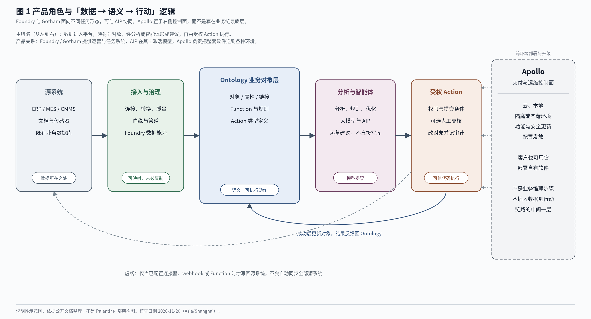
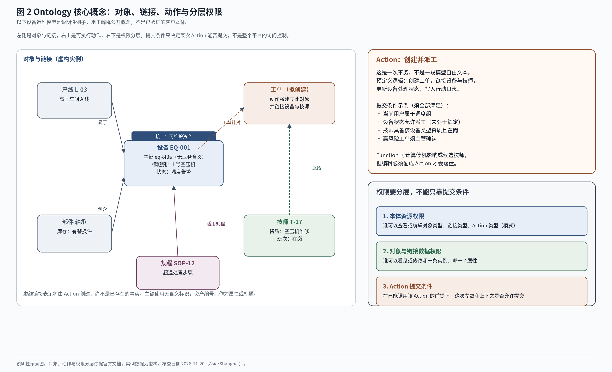
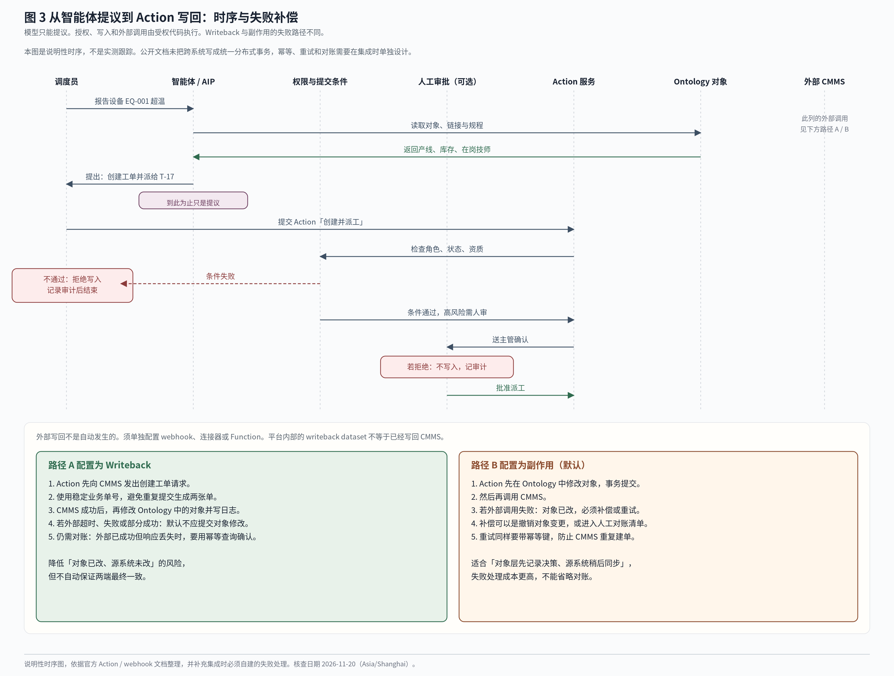

# 理解 Palantir：从 Ontology 到企业 Agent 的工程与商业闭环

作者：HansenUp
技术资料核查日期：2026-11-20，Asia/Shanghai

> Palantir 经常被说成大数据公司，或被当成又一家大模型公司。这两种说法都不准确。它卖的是一套把分散数据映射成业务对象，并在权限内执行业务动作的软件平台，再把大模型和智能体接到这套对象与动作上。本文依据官方文档和 2025 财年年报，说明它是什么公司，Gotham、Foundry、Apollo、AIP 各自解决什么、如何协作，Ontology 与普通知识图谱、RDF/OWL 图库有何不同，公开资料把存储实现说到哪一步，以及写回外部系统时事务边界在哪里。文中的设备运维流程是说明性例子，不是已部署或已实测的案例。客户效果若只出现在官方案例页，会标明为企业自述，未做独立复现。

阅读路线：

- [一、先把判断口径说清楚](#一先把判断口径说清楚)
- [二、结论](#二结论)
- [三、公司定位与简史](#三公司定位与简史)
- [四、Gotham、Foundry、Apollo、AIP 各自解决什么](#四gothamfoundryapolloaip-各自解决什么)
- [五、Ontology 里到底有哪些东西](#五ontology-里到底有哪些东西)
- [六、逻辑架构，以及公开资料说到哪一步](#六逻辑架构以及公开资料说到哪一步)
- [七、大模型、语义层和动作层各自做什么](#七大模型语义层和动作层各自做什么)
- [八、AIP：接入、评测、人审，以及自托管的限制](#八aip接入评测人审以及自托管的限制)
- [九、用一个虚构的设备运维例子把链路说完](#九用一个虚构的设备运维例子把链路说完)
- [十、写回时序、事务边界，以及失败后怎么办](#十写回时序事务边界以及失败后怎么办)
- [十一、商业模式、适用边界与争议](#十一商业模式适用边界与争议)
- [十二、若用开源与自建对照，不要一对一画等号](#十二若用开源与自建对照不要一对一画等号)
- [十三、对企业 Agent 建设的启示和风险](#十三对企业-agent-建设的启示和风险)
- [十四、主要来源](#十四主要来源)

## 一、先把判断口径说清楚

本文区分三类陈述。产品能力指官方文档或向监管机构提交的年报已经写明的功能。公司营销指官网宣传语，例如 AIP Bootcamp 页面上的「五天从零到用例」。作者判断是根据公开资料作出的工程或商业解释，不是 Palantir 的承诺，也不是实测结果。

本文没有使用 Palantir 产品，没有部署或压测其组件，也没有核实任何客户内部的投资回报。涉及客户效果时，只引用官方案例页并标明为企业自述。

## 二、结论

第一，Palantir 是一家面向政府和商业机构的软件平台公司。它要解决的问题是：数据散落在多个系统中，但决策和执行必须跨系统完成。它不是数据库厂商，也不是以训练基础大模型为主业的公司。

第二，四条主平台不是互斥产品，也不是严格的四层套娃。Foundry 和 Gotham 面向不同任务形态，都围绕数据、对象和行动。AIP 把模型和智能体接到这些平台上。Apollo 是跨环境的交付与运维控制面，不是业务推理中的一步。

第三，Palantir 所说的 Ontology，是把数据集和模型映射为业务对象，并在对象上定义计算、动作和安全规则的运营层。它与 RDF/OWL 标准本体、Neo4j 一类图数据库不在同一层级。公开文档描述了元数据服务、对象数据库、对象集服务和动作服务，但没有披露底层是不是关系库、搜索引擎或图数据库，也没有说必须使用 OWL、SPARQL 或 Neo4j。

第四，大模型在这套结构里负责理解、起草和建议。真正改对象、写回业务系统，要走预先定义的 Action，并经过权限、提交条件和必要时的人工复核。Action 改的是 Ontology 里的对象。把结果写到 ERP 或维修系统，需要另行配置连接器、webhook 或 Function。Ontology 内的一次 Action 是一个事务。跨系统没有被公开文档写成统一的分布式事务。

第五，商业上，壁垒来自已经建成的对象模型、动作、权限、应用，以及把工程师派到客户现场的交付方式。这也带来平台锁定和高实施成本。它更适合数据分散、错误代价高、需要跨系统执行和审计的组织。只做部门报表或文档问答，通常应先评估更轻的方案。公司在防务和执法领域的业务长期伴随隐私与监督争议。技术能否做到，与应不应该做，不是同一个问题。

## 三、公司定位与简史

Palantir Technologies 于 2003 年成立。2025 财年 Form 10-K（会计年度截止 2025-12-31，2026-02-17 提交）写明：公司起步是为美国情报界提供反恐调查与行动软件，后来把同类问题扩展到商业机构，也就是如何把分散数据变成可执行的决策。

2020 年直接上市相关文件把 Alexander Karp、Peter Thiel、Stephen Cohen 称为 Founders。更早的公开报道还把 Joe Lonsdale、Nathan Gettings 列为共同创始人。截至核查日，Karp 为首席执行官，Thiel 为董事长，Cohen 为总裁。公司名来源年报未解释。《纽约时报》2020 年报道称，名称取自 J. R. R. Tolkien《魔戒》中的真知晶石 palantíri。这是媒体转述，不是年报表述。

年报把客户分成政府与商业两段。2025 财年，公司收入 44.75 亿美元，其中政府约占 54%，商业约占 46%；美国约占 74%，海外约占 26%。截至 2025-12-31，客户 954 家。这些数字只描述 2025 财年，不是 2026 年最新季度结果。

官方 [About](https://www.palantir.com/about/) 页强调增强人的判断，而不是取代人，并称产品内建隐私保护能力。这是公司自我定位，需要与后文的监督报道一起看。

## 四、Gotham、Foundry、Apollo、AIP 各自解决什么

年报写明四条主要软件平台，并写 AIP「与 Foundry、Gotham、Apollo 无缝捆绑」。不要把它们画成「Apollo 在最底层、AIP 在最顶层、Gotham 只给政府、Foundry 只给企业」的固定分层。

| 平台 | 主要解决什么 | 依据 |
|---|---|---|
| [Foundry](https://www.palantir.com/platforms/foundry/) | 数据运营与 Ontology：管数据、写逻辑、建语义映射、做分析与工作流。年报称全部商业客户及许多政府客户在用。 | 2025 财年 10-K，Foundry 产品页 |
| [Gotham](https://www.palantir.com/platforms/gotham/) | 面向防务与情报等全球决策：近实时融合跨域和传感器数据，让分析员与一线操作员在同一图景上理解、计划并行动。与其他平台及防务产品集成。 | 2025 财年 10-K，Gotham 产品页 |
| [Apollo](https://www.palantir.com/platforms/apollo/) | 跨环境持续交付与运维：云、本地，乃至更苛刻或隔离的环境，用同一控制层发放功能、安全补丁和配置。客户也可用它部署自己的软件。 | 2025 财年 10-K，Apollo 产品页 |
| AIP | 2023 年开始部署：把第三方、开源或自托管模型接到组织的数据与行动上，提供智能体与自动化工具链、应用和评测治理。 | 2025 财年 10-K，[AIP 概览](https://www.palantir.com/docs/foundry/aip/overview/) |

更准确的说法是：Foundry 与 Gotham 是面向不同任务形态的操作系统，Ontology 是其中的语义与行动中枢。AIP 在这些平台上激活模型与智能体。Apollo 负责把软件送到云、本地甚至隔离环境，并持续发放功能和安全更新。官方文档里的 AIP Logic、AIP Chatbot Studio（文档注明其前身为 AIP Agent Studio）、AIP Evals 等，属于 AIP 的构建与治理工具，不是年报中的第五条主平台。

图 1 画的是这条逻辑关系，而不是产品目录。

## 五、Ontology 里到底有哪些东西

官方把 Ontology 定义为组织的运营层：它坐在已接入的数据集、虚拟表和模型之上，把这些数字资产连接到工厂、设备、订单等现实对应物。它包含语义部分（对象、属性、链接）和动能部分（Action、Function、动态安全）。

年报特意写了它与一般「本体」一词的差别：

> Ontology generally refers to the systematic mapping of data to meaningful context. The Palantir Ontology goes far beyond the traditional concept by integrating the elements of a decision—the data, logic, and actions—into a foundational representation of the organization...

可以译为：本体通常指把数据系统映射到有意义的上下文。Palantir 的 Ontology 走得更远，把决策的要素，也就是数据、逻辑和行动，集成为组织的基础表示。

这与知识工程里的 RDF/OWL 本体不是同一个对象。后者是形式化的概念、关系与公理体系，常用 SPARQL 查询，可用 SHACL 校验。Palantir 的 Ontology 是平台里的业务对象系统，查询走官方所说的对象集和 Ontology API，变更走 Action。两者都可以对「设备」「工单」建模，但约束方式、推理方式和工程接口不同。不能根据名字，把它理解成「必须用 OWL」，也不能理解成「内部一定是 Neo4j」。

核心概念可以对照如下。

| 概念 | 官方含义 | 设备运维中的例子 |
|---|---|---|
| 对象类型（object type） | 一类业务实体的定义 | 设备、工单、技师 |
| 对象（object） | 某一类型下的具体实例 | 编号为 EQ-001 的设备 |
| 属性（property） | 对象上的字段，带类型与显示元数据 | 运行状态、温度、所属工厂 |
| 主键与标题键 | 主键是实例的唯一标识，标题键是给人看的名称 | 主键 `eq-8f3a`，标题键「1 号空压机」 |
| 链接（link） | 对象之间的关系 | 工单针对设备，技师被派到工单 |
| 接口（interface） | 一组对象类型共同遵守的契约，用于多态 | 「可维护资产」要求提供状态、位置和责任人 |
| Function | 在隔离服务端运行的对象逻辑，可计算派生值或准备编辑 | 计算停机影响，筛选有资质且在班的技师 |
| Action | 一次事务，按预定义逻辑修改一个或多个对象，并可带副作用 | 「创建并派工」「关闭工单」 |
| 对象集（object set） | 保存下来供各应用复用的实体列表或过滤定义 | 「当前产线 L-03 上状态为告警的设备」 |

对象集需要单独说清楚。官方文档把它定义为保存下来、供各应用复用的实体列表，并按定义方式和保存状态分类。静态对象集保存主键列表，不随源数据自动改成员。动态对象集保存过滤条件，符合条件的新数据会进入该集合。临时对象集主要用于应用或服务之间传递，由创建者访问，文档举例称 24 小时内过期。永久对象集保存在对象后端，供后续引用。因此，对象集是可保存的查询定义或主键集合，不是普通数据库里一次查询结果的通用物化表。Object Set Service（OSS）负责向平台内其他服务提供搜索、过滤、聚合和加载。

安全要分层看，不能把 Action 的提交条件当成整个平台的访问控制。

第一层是本体资源权限，管对象类型、链接类型、Action 类型这些模式定义，谁可以查看或编辑类型本身。第二层是对象和链接这些数据的权限，管谁能看到或改哪一条实例、哪一个属性。官方文档把这两层分开描述，并提到 Object Storage v2 支持更细的属性级权限。第三层是某个 Action 的提交条件：在用户已经能够调用该 Action 的前提下，还要不要根据当前用户、参数和执行上下文决定这次能不能提交。官方文档明确，提交条件与「谁能编辑这个 Action 类型」是两套规则。一个对象类型上可以有多个 Action，每个 Action 有自己的提交条件。

提交条件可以检查当前用户的组、对象当前状态，也可以区分是否在 Ontology Scenario（情景推演）中执行。例如，正式派工只允许调度员，在情景中可以由规划人员试算。官方还提醒，不要对组、标记或组织成员关系滥用 NOT 条件，因为作用域更窄的令牌可能缺少被检查的属性，反而让条件误通过。

图 2 用一套虚构的设备运维对象，把这些概念放在同一张图里。

## 六、逻辑架构，以及公开资料说到哪一步

业务链可以概括为：源系统接入；清洗、转换、质量与血缘；把数据集或模型映射为 Ontology 中的对象、属性和链接；在对象上做分析、规则、优化，或由大模型和智能体起草建议；经权限、提交条件和必要时的人工复核后，由 Action 修改对象；若已配置连接器、webhook 或 Function，再把变更发到外部业务系统；执行结果作为新数据回到对象层。

Apollo 不插入这条业务链的中间某一步，它是把上述软件部署到不同环境并持续升级的控制面。官方产品页还提到 Native Federation：可以把外部数据平台中的数据集映射成对象，而不复制底层数据。这是产品能力描述，不等于跨系统写入已经自动打通。

后端方面，官方架构文档列出一组协同工作的服务，而不是一个被点名的开源图数据库：

- Ontology Metadata Service（OMS）：定义对象类型、链接类型、Action 类型等元数据。
- 对象数据库：保存经过索引的对象数据，支撑查询，并处理用户编辑的索引与编排。
- Object Set Service：对外提供对象读取。
- Actions 服务：把用户编辑应用到对象数据库，并可写行动日志。
- Object Data Funnel：在 Object Storage v2 中编排数据写入，从数据集、受限视图、流式数据源以及 Action 产生的编辑中读取数据，并保持索引更新。
- Functions on Objects：在隔离的服务端执行基于对象的逻辑。

关于存储世代，需要按文档的时间来写，避免把已过日期仍写成「即将」。2026-11-20 查阅的官方文档仍将 Object Storage v1（Phonograph）标为计划弃用，并写明 2026-06-30 之后将不可用，同时把 Object Storage v2 称为现行规范存储，要求将对象类型和链接类型迁移到 v2。本文无法确认每个租户是否已经完成迁移，只把 v2 当作文档中的现行架构来介绍。文档还列出了 v2 的一些能力上限，例如单一对象类型的索引吞吐量可达数百亿量级、单次 Action 默认可编辑最多 1 万个对象、单一对象类型最多 2000 个属性。这些是厂商文档中的规格，不是本文的实测结果。

公开文档没有说明对象数据库的底层引擎是关系库、搜索引擎、列存还是图数据库，也没有要求使用 OWL、RDF、SPARQL、Apache Jena Fuseki 或 Neo4j。把 Palantir Ontology 理解成「一种图数据库」，或理解成「必须用语义网技术栈实现」，都超出了公开资料。

还需要把「索引」和「语义」分开。OMS 里的类型、属性、链接和 Action 定义，是业务语义。对象数据库里的索引，是为了搜索、过滤和聚合。主键是实例的稳定标识，标题键是给人看的名称。大模型上下文里出现的对象，是经过映射和权限过滤后的业务数据，不是模型参数里记住的知识。

## 七、大模型、语义层和动作层各自做什么

如果把这套结构拆成三层责任，边界会清楚很多。

语义层回答：这是哪类对象，它和谁有关，当前状态是什么。动作层回答：允许哪些变更，谁在什么条件下可以执行，执行后如何记录。模型层回答：如何理解非结构化输入，如何起草方案，如何把自然语言变成一次拟议中的 Action。

分析、规则和优化不必都交给大模型。设备是否超温、技师是否具备资质，更适合规则或 Function。大模型更适合阅读故障描述、检索规程、起草派工说明。若让模型直接改库，权限、审计和回滚都会失去统一入口。官方对 Action 的定义是：一次事务，按用户定义的逻辑，修改一个或多个对象的属性或链接，并可附带副作用。

Function 用于在操作场景中快速执行逻辑。官方概述写明它在隔离的服务端运行，并支持读取对象属性、遍历链接，以及编写对象编辑逻辑。概述列出 TypeScript 和 Python 为支持的语言，并且分别提供 TypeScript v1、TypeScript v2 和 Python 的入门文档。不同语言、不同版本的能力并不自动等同，官方要求以语言特性支持说明为准。文档还写明：编辑对象的函数必须配置成 Function 支持的 Action，才能在操作中真正修改数据；在 Action 之外运行编辑函数，不会写入对象数据。

## 八、AIP：接入、评测、人审，以及自托管的限制

年报对 AIP 的表述是：统一接入开源、自托管和商用大模型，把结构化和非结构化数据变成模型可理解的对象，把组织的行动和流程变成人与智能体可调用的工具，并提供决策界面、反馈、人机交接，以及模型使用控制和流程中的人工复核点。AIP 于 2023 年开始部署。它不是 Palantir 自研并对外提供的基础大模型，也不保证模型输出永远正确。

[AIP Evals](https://www.palantir.com/docs/foundry/aip-evals/overview/) 是官方提供的评测环境，用于应对大模型输出的非确定性。文档说明，它可以对 AIP Logic、聊天机器人和代码编写的函数建立测试用例，定义评价指标，比较不同模型或版本，并观察多次运行的方差。评测能提高上线前的信心，不能消除模型出错。

权限方面，AIP 文档称沿用平台的访问控制、加密和审计，并对第三方托管模型另有安全说明。模型能否被谁使用，还要在 Control Panel 中启用。这些是平台提供的能力，仍需正确配置才有效。

关于自有模型和自托管，官方 [Bring your own model](https://www.palantir.com/docs/foundry/aip/bring-your-own-model/) 文档写明两种来源。一是通过 Data Connection 中的 REST API 接入外部模型服务。二是用 Compute Module 托管模型服务，文档写明可运行在自有硬件和 GPU、本地或隔离环境，或作为代理层。文档建议优先使用平台已提供的模型（举例包括 OpenAI、Azure OpenAI、AWS Bedrock、xAI、GCP Vertex）或 Palantir 提供的自托管开源模型（文档举例包括 Llama）。只有在法律与合规不允许使用平台提供的模型，或需要使用自有微调、特殊模型时，才建议注册自有模型。2026 年 3 月，文档介绍了新的注册模型实现，并建议用它替代旧的「用 function interface 注册 LLM」做法。

限制同样写在文档里。注册模型当前不支持 AIP Assist（包括代码仓库中的代码辅助），以及 Pipeline Builder 的 Generate 和 Explain。原因是这些原生功能依赖对平台提供模型的评测，官方不保证对客户自有模型有同样效果，并写明暂无支持计划。注册模型由 Enrollment 管理员登记，终端用户不必拥有底层数据源权限，而是由 Control Panel 中的模型启用规则控制。能否使用某个开源模型，以当期文档和支持列表为准，不能把「年报写了可接入开源与自托管模型」理解成任意模型、任意应用都已可用。

## 九、用一个虚构的设备运维例子把链路说完

下面的例子只用于说明对象、规则、模型和 Action 如何分工。它不是 Palantir 的客户案例，也未经部署或集成验证。

假设某装备企业要把「故障诊断与维修工单」接到现有维修管理系统（CMMS）上。对象可以包括：设备、故障现象、部件、维修规程、工单、技师、产线。链接例如：设备属于产线、设备包含部件、故障涉及部件、工单针对设备、工单引用规程、技师具备某类资质。接口可以定义为「可维护资产」，让不同设备类型都提供状态、位置和维保责任人等共同能力。

规则放在 Action 的提交条件或 Foundry Rules 中，而不是指望模型临时发明。例如：只有具备该设备类型资质的技师，才能被派到高风险工单；关闭工单前必须填写更换部件；设备处于停机锁定时，不允许再派第二张冲突工单。

当设备温度异常时，系统先通过对象和链接给出可核验的事实：这台设备在哪条产线、正在影响哪张订单、库存有没有替换件、哪些技师在班且有资质。规则或 Function 可以算出超温是否已达派工阈值。大模型可以阅读点检记录和规程，起草一份维修说明，并提出「创建工单并派给技师 T-17」。到这一步，模型只是提议。

真正生效要走「创建并派工」这个 Action。系统检查调用者是否有权派工、设备状态是否允许、技师资质是否满足、是否需要主管确认。任一条件不满足，就拒绝写入，并记录审计。通过后，Action 在 Ontology 中创建工单、建立与设备及技师的链接、更新状态，并写入行动日志。若要把工单写入原有 CMMS，必须另行配置 webhook、连接器或 Function。不能假定对象一改，所有源系统就会自动同步。

## 十、写回时序、事务边界，以及失败后怎么办

官方 Action 文档把一次 Action 定义成对一个或多个对象的单次事务，提交后会反映到各用户应用，并且对象类型可以有 writeback dataset，用来保存包含用户编辑的最新对象数据。这里的 writeback dataset 是平台内部的对象回写数据集，不等于已经写回 ERP 或 CMMS。

把变更发到外部系统，要单独配置。官方 webhook 文档写明两种时机：

- 默认是副作用（side effect）：先在 Foundry 中修改对象，再调用外部系统。
- 若选 Writeback：先向外部系统发请求，再修改 Foundry 中的对象。

这两种配置解决的失败模式不同。Writeback 降低「对象已改、源系统未改」的风险，但外部系统若超时、部分成功或稍后回滚，仍可能造成两端不一致。副作用则相反：对象已经改完，外部调用失败时，需要补偿、重试或对账。公开文档没有把跨系统写成一条统一的分布式事务，也没有把外部系统的幂等、重试和补偿写成开箱即用的保证。这些要在集成时单独设计。例如：为每次派工准备稳定的业务单号，使重复提交不会在 CMMS 里生成两张工单；为失败的外部调用建立可重试队列和人工对账清单；明确「以哪个系统为工单的系统源」。

图 3 按「模型提议，受权代码执行」画出这条时序，并标出外部失败时的两条不同路径。

## 十一、商业模式、适用边界与争议

交付方式是理解这家公司的关键。官方 About 页写明，公司会把工程师派到客户现场，用客户自己的数据和问题把产品用起来。Forward Deployed Engineer（前线部署工程师）是公司长期使用的正式职位名称。2025 年报用「直接嵌入客户」来描述这种做法，并把 AIP Bootcamp 写成一种获客与验证方式：「在数天内用客户真实数据交付真实工作流」。[Bootcamp 官网](https://www.palantir.com/platforms/aip/bootcamp/) 的标题是「五天从零到用例」。后一句是营销表述。它说明公司用短周期、真实数据来证明一个用例，不能理解成完整企业系统可以在五天内完成生产上线。

收入来自软件平台的使用和持续运营，而不是一次性把代码交给客户后离开。年报还提到 Developer Tier，向美国和部分国家的开发者提供有限的 Foundry 与 AIP 访问，降低前期试用成本。已经建成的对象模型、动作、权限规则、应用和现场交付方法，会提高转换成本。这是壁垒，也是锁定。平台许可、实施投入，以及对熟悉该平台人员的依赖，都要计入总成本。这些是作者根据公开商业模式作出的判断，不是对某份合同条款的转述。

它较适合数据分散在多个系统、决策错误代价高、需要跨系统执行并且要留下审计的组织。如果目标只是部门报表、文档问答，或没有意愿把业务动作和权限建模进系统，通常应先评估更轻的方案。

争议需要单独看待。公司起源于情报与反恐软件，至今仍有大量防务、情报和执法业务。官方 About 页强调隐私保护，并称帮助客户在利用数据的同时防止滥用。另一方面，公共部门、尤其是执法数据场景，长期受到公民权利组织和媒体的监督。2025 年 9 月 22 日，《卫报》根据通过信息公开获得的文件报道，美国移民海关执法局（ICE）长期使用 Palantir 工具辅助调查与现场执法；报道并转述，公司一贯自称「数据处理方」，不主导客户如何采集或使用数据。技术能力、合同范围与用途是否正当，是三个问题。本文不把平台能力先进与否，当成对具体用途的背书。

公开客户效果只引用一个官方案例，且标明为企业自述。Palantir 的 [Airbus 与 Skywise 案例页](https://www.palantir.com/impact/airbus/) 称，2015 年用 Foundry 整合 A350 生产中的计划、班次、零件、交付和缺陷，并称这使 A350 交付加快 33%。该数字来自官方案例页，未经本文独立复现。

## 十二、若用开源与自建对照，不要一对一画等号

下面的对照只说明能力切片，不是产品等价，也不是迁移指南。

| 能力切片 | Palantir 侧（平台能力） | 常见开源或自建对照（不等价） |
|---|---|---|
| 数据接入与转换 | Pipeline Builder、数据连接、血缘 | Java 或 Python 管道、Airflow 或 Spark，血缘自管 |
| 语义与对象层 | Ontology 对象、属性、链接、接口 | RDF/OWL 加 Fuseki 与 TDB2，或 Neo4j 加自建模式 |
| 约束与规则 | Action 提交条件、Foundry Rules | SHACL、规则引擎、状态机校验 |
| 查询 | 对象集、Ontology API | SPARQL 或 Cypher，权限要自己做 |
| 行动与写回 | Action、Function、webhook | 自建命令服务加出站 API，事务边界自管 |
| 智能体与模型 | AIP、权限、工具、Evals | vLLM 或 SGLang，再加编排框架和自建工具层 |
| 交付运维 | Apollo（多环境、隔离网） | Kubernetes 与 GitOps，隔离网要另做 |
| 治理审计 | 平台权限、行动日志、模型审计 | 自己拼身份、审计表和评测集 |

一条可验收的最小一期，不必先模仿整套平台。先选定一个窄场景，例如「高风险设备的工单创建与派工」。先定义对象、稳定主键、关键链接和少数 Action。存储可以用属性图（如 Neo4j）或 RDF 存储（如 Jena TDB2 加 Fuseki），取决于是否需要 OWL、SPARQL 或标准本体交换。再用规则或状态机约束派工条件，用服务端命令接口执行写入，带身份、权限、审计和幂等键。模型只负责起草和建议，不能直接写库。外部系统写回要单独做接口、失败重试和对账。最后用固定评测集回归「该不该派工、派给谁、何时必须拒绝」。这一期的目标是跑通一条受控链路，而不是先建一个声称覆盖全企业的图谱。

## 十三、对企业 Agent 建设的启示和风险

对正在做企业 Agent 的团队，Palantir 公开架构里最有参考价值的不是产品名词，而是责任划分。

先把业务对象、动作和权限说清楚，再决定模型出现在哪一步。模型可以提议，授权必须由可信代码执行，并留下审计。Action 要预先定义，而不是让模型临时发明写库工具。Ontology 内的事务与外部系统的成败是两条边界，写回必须显式配置。评测要覆盖「正确拒绝」，而不是只看生成文本是否流畅。平台能提供集成与治理能力，但不能免除配置错误、模型幻觉和外部系统失败。

主要风险同样具体。对象模型若与真实流程脱节，后面的应用和智能体都会在错误语义上运行。权限若只做在应用层，查询接口和应用入口可能不一致。若把提交条件当成全部访问控制，模式权限和行级、属性级权限仍可能漏配。若假设对象变更会自动写回所有源系统，生产里会出现两边账对不上。若把短周期示范当成生产就绪，会低估主数据质量、组织培训和长期运维。若在高风险领域使用类似能力，还要单独评估法律、隐私和监督要求，而不是只评估技术可行性。

这些判断针对的是公开资料所展示的工程结构，不是对某一个未公开实施项目的评价。

## 十四、主要来源

以下链接在 2026-11-20（Asia/Shanghai）查阅。产品能力以当期官方文档为准，功能可用性可能因客户环境而异。

1. [Palantir Technologies Inc. Form 10-K，财年截止 2025-12-31](https://investors.palantir.com/files/2025%20FY%20PLTR%2010-K.pdf)
2. [Palantir 平台总览](https://www.palantir.com/platforms/)
3. [Foundry Ontology 构建说明](https://www.palantir.com/docs/foundry/ontology/overview/)
4. [Ontology 后端与对象存储架构](https://www.palantir.com/docs/foundry/object-backend/overview/)
5. [Action 类型说明](https://www.palantir.com/docs/foundry/action-types/overview/)、[提交条件](https://www.palantir.com/docs/foundry/action-types/submission-criteria/) 与 [Webhook 写回配置](https://www.palantir.com/docs/foundry/action-types/set-up-webhook)
6. [Functions 概述](https://www.palantir.com/docs/foundry/functions/overview/) 与 [对象权限概述](https://www.palantir.com/docs/foundry/object-permissioning/overview/)
7. [AIP 概览](https://www.palantir.com/docs/foundry/aip/overview/)、[AIP Evals](https://www.palantir.com/docs/foundry/aip-evals/overview/) 与 [自有模型接入（含自托管）](https://www.palantir.com/docs/foundry/aip/bring-your-own-model/)
8. [Apollo 产品页](https://www.palantir.com/platforms/apollo/)、[AIP Bootcamp](https://www.palantir.com/platforms/aip/bootcamp/)、[About Palantir](https://www.palantir.com/about/)
9. [Airbus / Skywise 官方案例页](https://www.palantir.com/impact/airbus/)（其中 33% 等效果数据为企业自述，未经独立复现）
10. [《纽约时报》对 Palantir 名称来源的报道（2020-10-21）](https://www.nytimes.com/interactive/2020/10/21/magazine/palantir-alex-karp.html)
11. [《卫报》对 ICE 与 Palantir 相关文件的报道（2025-09-22）](https://www.theguardian.com/us-news/ng-interactive/2025/sep/22/ice-palantir-data)

> 说明：本文是个人学习分享，不代表任何组织的观点。文中对产品能力的转述仅基于检索日能找到的公开资料；若官方文档更新，请以原文为准。欢迎在 Issues 里指正。
